> 📚 **1º ASIR · Planificación y Administración de Redes** · Tema 5: Nivel de red · Curso 2025/2026

## NAT en Linux

### Preparación escenario

Primero voy a conectar las máquinas a un switch donde voy a conectar una nube NAT para tener salida a Internet y poder actualizar el sistema e instalar los paquetes que vamos a necesitar para el escenario. Este proceso lo voy a repetir con todas las máquinas que vamos a necesitar.

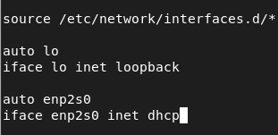

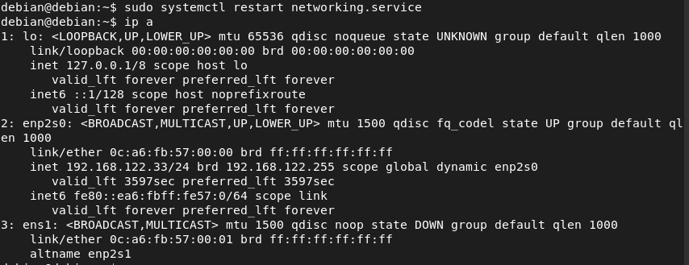

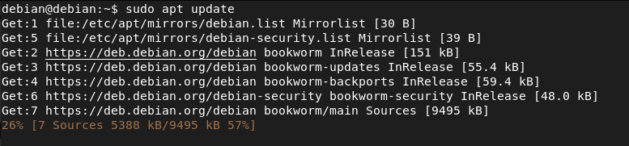

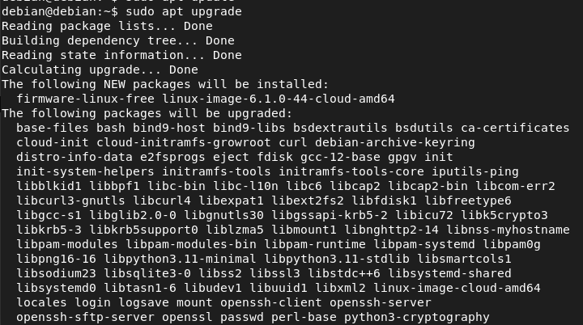

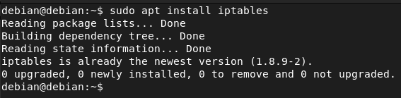

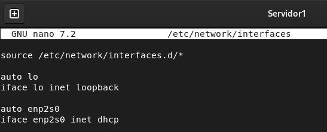

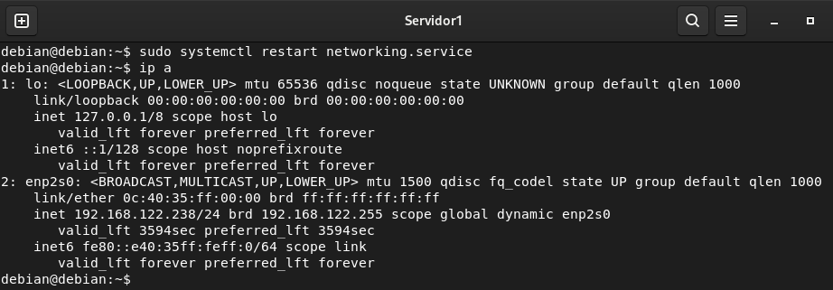

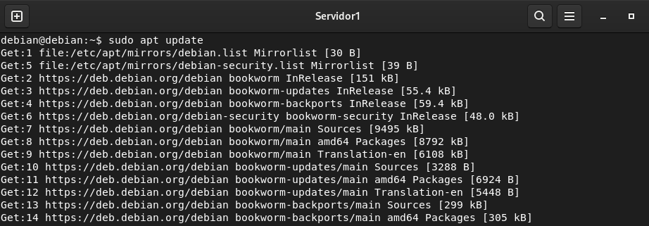

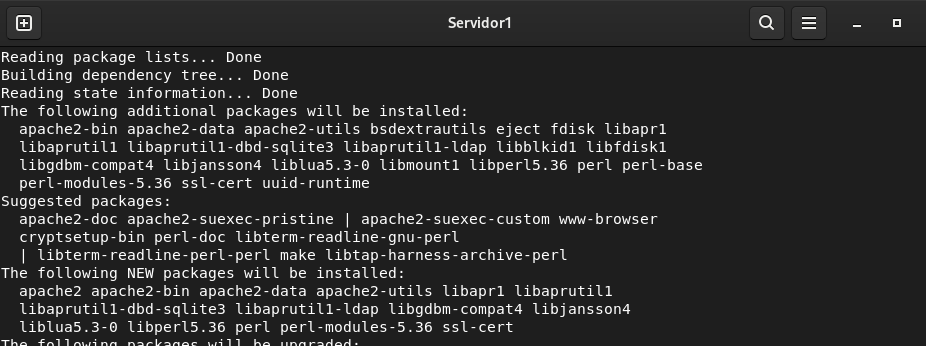

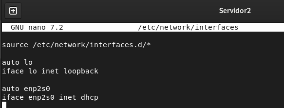

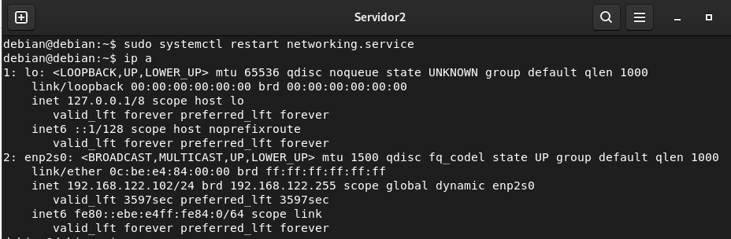

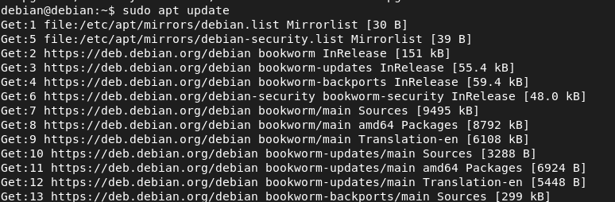

#### Servidor PostgreSQL

<debian@debian>:~\$ sudo apt install postgresql postgresql-contrib -y

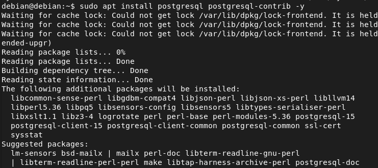

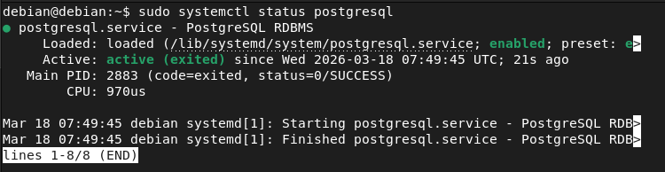

Una vez que lo hemos instalado voy a acceder como administrador y voy a crear un usuario y una base de datos con todos los privilegios.

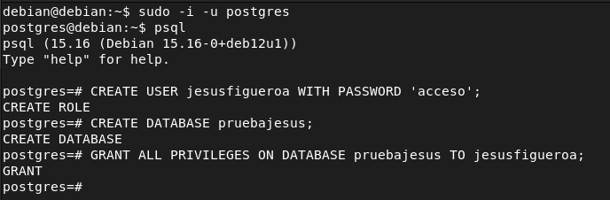

Voy a activar el servicio para que se arranque automáticamente al encender la máquina.

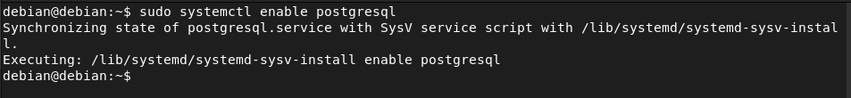

Y voy a cambiar la configuración del fichero para poder entrar a los usuarios sin contraseña (no recomendado en entornos de producción).

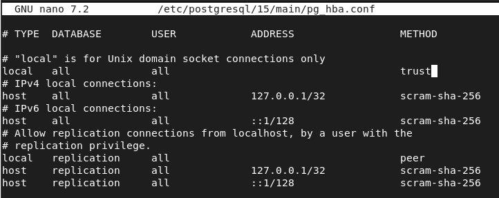

Una vez hechos los cambios vamos a reiniciar el servicio para que se apliquen los cambios.

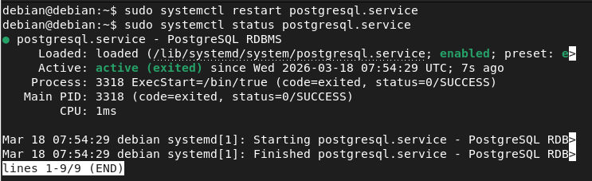

Accedemos con el usuario y vamos a crear un par de tablas en mi caso voy a usar el esquema SCOTT.

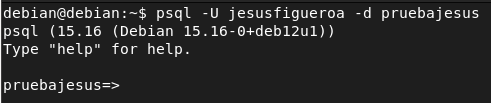

Al insertar los datos y las tablas me dió este fallo y al consultar el diccionario de datos me di cuenta que no tenía los permisos suficientes para crear tablas. f: false.

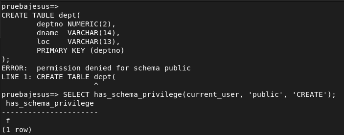

Entre como usuario administrador y le di los permisos para poder insertar los datos.

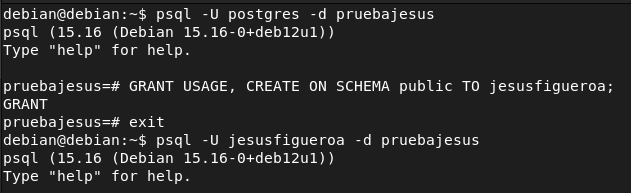

Y si volvemos a consultar el diccionario ya tenemos los permisos suficientes.

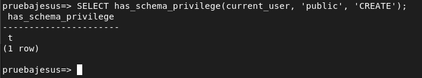

Aquí vemos las tablas ya creadas.

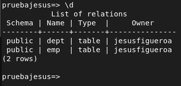

#### Servidor ssh

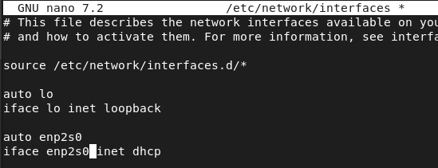

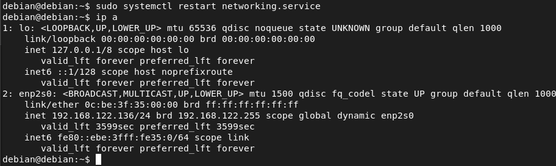

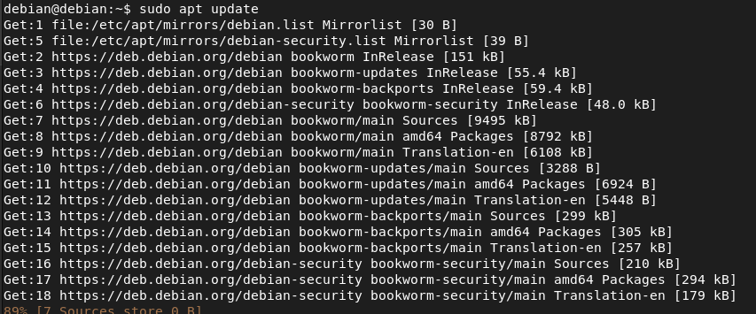

<debian@debian>:~\$ sudo apt install openssh-server -y

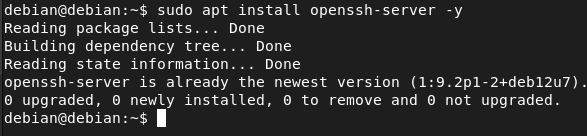

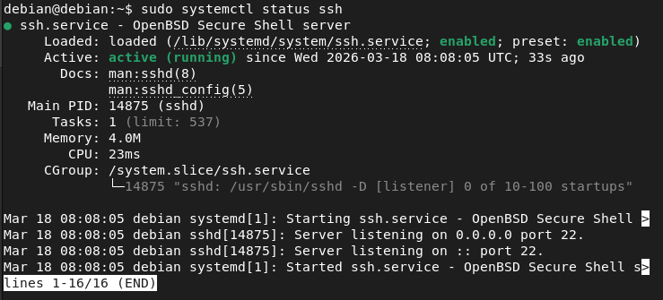

#### Servidor MariaDB

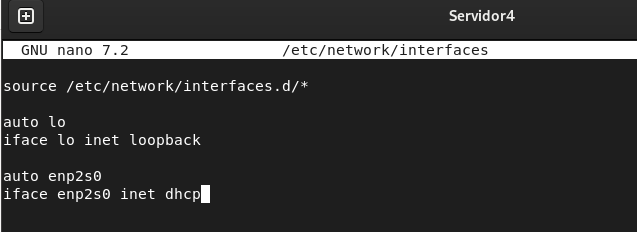

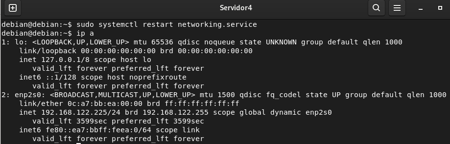

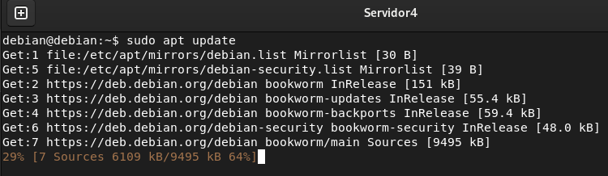

<debian@debian>:~\$ sudo apt install mariadb-server -y

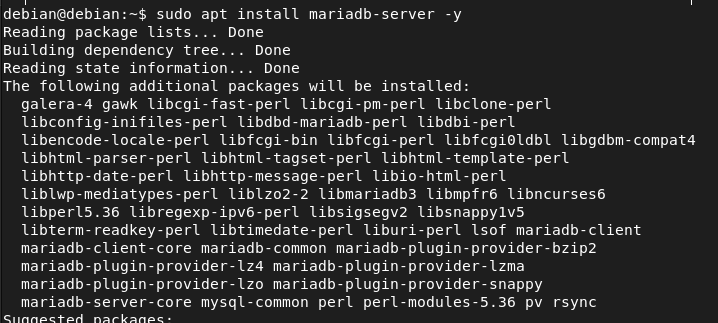

Una vez instalado iniciamos el servicio y lo hacemos persistente en el arranque.

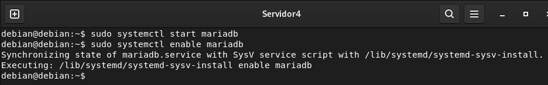

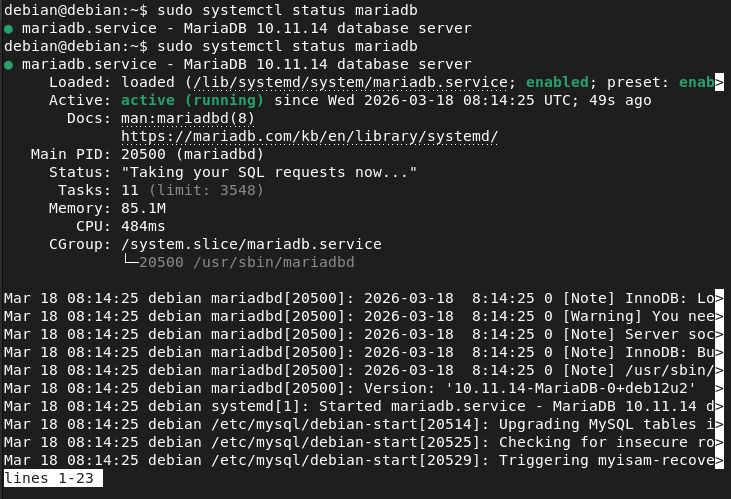

Ahora vamos a proceder con el script de configuración en el cuál vamos a poner una contraseña para root.

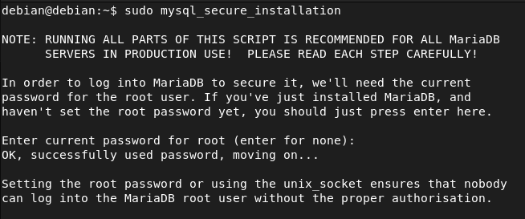

Y también vamos a poder borrar usuarios anónimos, eliminar la base de datos de prueba y deshabilitar el inicio de sesión remoto de root.

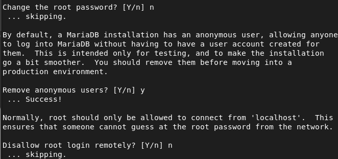

Tambiénm voy a borrar las bases de datos de test y después de esto voy a recargar los privilegios de las tablas.

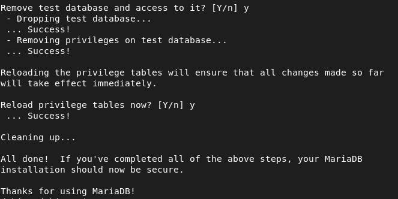

Una vez configurado todo voy a acceder comoo root y voy a crear un usuario y una base de datos para posteriormente hacer las pruebas del correcto funcionamiento de NAT.

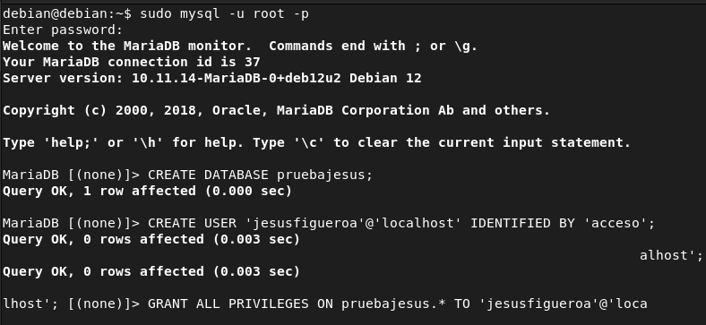

Una vez creado correctamente voy a probar que podemos acceder correctamente al usuario.

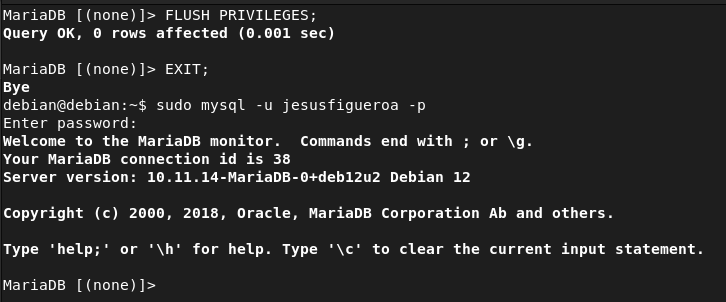

Aquí vemos como las tablas están creadas con contenido (esto es desde el servidor, más tarde al configurar NAT lo realizaremos desde el cliente).

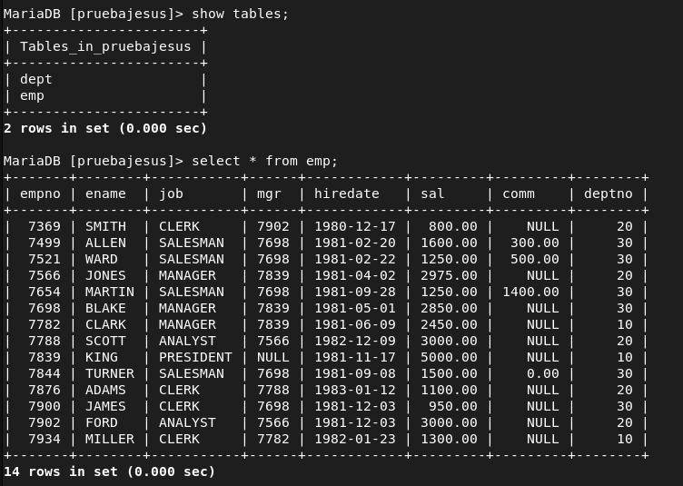

#### Acceso remoto PostgreSQL

Tendremos que editar un fichero de configuración, la ruta dependerá de la versión que tengamos instalada, en mi caso es la siguiente:

<debian@debian>:~\$ sudo nano /etc/postgresql/15/main/postgresql.conf

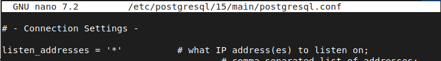

Y tendremos que editar la línea de listen address y yo en mi caso voy a poner un asterisco para permitir todas las direcciones IP. Luego de hacer los cambios en el fichero de configuración voy a reiniciar el servicio para que los cambios tengan efecto.

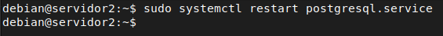

Una vez que hemos editado este fichero con las direcciones que va a escuchar el servidor tenemos que indicar en el siguente fichero a que usuario en concreto vamos a permitir el acceso remoto y lo podemos hacer indicando una IP en concreto o cualquier dirección IP (no recomendado en entornos de producción). Y voy a usar md5 para que el acceso sea por contraseña.

debian@servidor2:~\$ sudo nano /etc/postgresql/15/main/pg_hba.conf

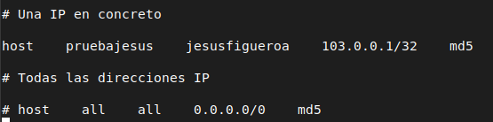

#### Acceso remoto MariaDB

<debian@debian>:~\$ sudo nano /etc/mysql/mariadb.conf.d/50-server.cnf

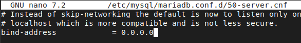

Para MariaDB editamos el siguiente fichero cambiando el bind address e indicando 0.0.0.0 para permitir cualquier IP. Y una vez hecho los cambios reiniciamos el servicio.

Tras el reinicio del servicio voy a acceder como administrador a la base de datos para crear un usuario para la dirección IP remota y darle permisos sobre la base de datos que tenemosl (En este caso yo he permitido solo la red 103.0.0.1 que es la red que sale de casa por lo tanto toda petición que el servidor le llegue con otra IP origen la va a denegar. Para que el servidor reciba toda las peticiones sin importar la IP habría que poner en le creación del usuario lo siguiente:)

MariaDB \[(none)\]\> CREATE USER ‘nombreusuario’@’%’ IDENTIFIED BY ‘password’

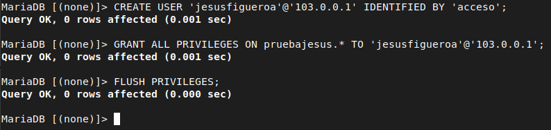

### Instalación clientes 

Para la configuración de los clientes simplemente voy a realizar lo mismo voy a conectarlos a un switch con una nube NAT y voy a actualizar el sistema e instalar los clientes necesarios (SSH, MariaDB, PostgreSQL y curl).

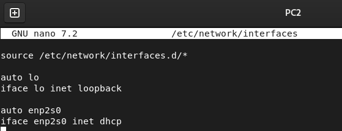

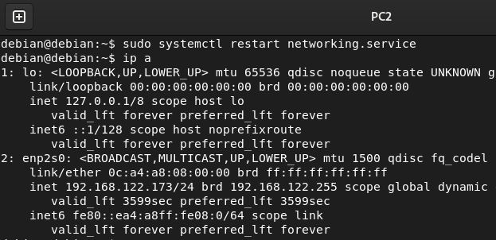

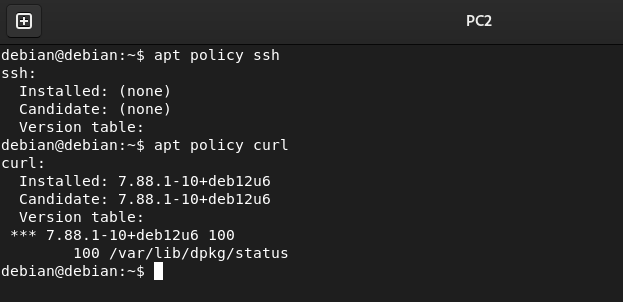

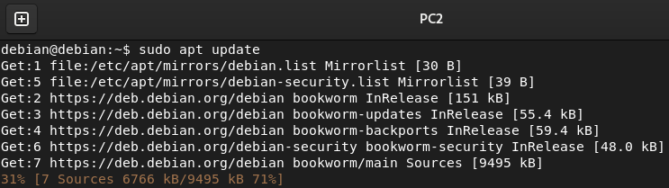

<debian@debian>:~\$ sudo apt install openssh-client

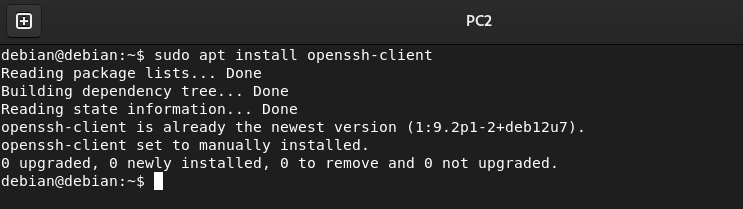

<debian@debian>:~\$ sudo apt install mariadb-client


Una vez instalado vamos a comprobar que se haya instalado correctamente.


<debian@debian>:~\$ sudo apt install postgresql-client


Y nuevamente una vez instalado comprobamos que se haya instalado correctamente.


### Servidor DHCP

<debian@debian>:~\$ sudo apt install isc-dhcp-server -y


Al acabar la instalación saltara un código de error, esto ocurre ya que no hay una configuración valida en el servicio.


### Direccionamiento

#### Router casa

Para las direcciones IP privadas voy a usar en todo momento la red 10.0.3.0/24 para comprobar que el NAT está haciendo su trabajo mientras que para las direcciones IP públicas voy a usar como base 100.0.0.0/16 en adelante.


#### Internet2


#### Internet 1


#### Empresa1


#### Empresa2


### Persistencia bit de forwarding

En Debian 12 para hacer persistente el bit de forwarding es decir que se comporte como un router hay que editar este fichero de configuración y ponerlo en 1. Una vez editado este fichero de configuración con el comando sysctl -p vamos a recargar la configuración del kernel de la red mediante este fichero de configuración. (Este proceso se va a repetir en todos los routers).


### Tablas de enrutamiento

#### Internet 1


#### Internet 2


#### Empresa1


#### Empresa3


#### Router casa


#### Persistencia tablas de enrutamiento mediante creación de un servicio (systemd)

Cuando hacemos un ip route add en el siguiente reinicio se nos borra las entradas que hayamos metido para ello voy a crear un servicio de systemd para cada router el cual va a ejecutar un script en el que va a estar en cada router las rutas necesarias para que el escenario sea funcional.


Una vez hecho el script lo voy a mover a los binarios del sistema y le voy a dar permisos de ejecución.


Ahora nos faltaría crear el servicio de systemd para ello creamos un fichero en la ruta:

/etc/systemd/system/nombre-servicio.service.

En mi caso le he dado el nombre de rutas-estaticas.service y tendría que quedar con las siguientes líneas:


Una vez realizado el servicio vamos a refrescar la lista de servicios y vamos a activarlo en el arranque e iniciar dicho servicio. Este proceso se va a repetir en todos los routers para que todas las rutas sean persistentes y no la perdamos en el siguiente reinicio.


Internet 2


Empresa 1


Empresa 3


Casa


### Configuración servidor DHCP

Para el servidor DHCP voy a configurar la subred 10.0.3.0/24 que como comente anteriormente es el rango que estoy usando en las redes privadas. Esta configuración IP va a tener gateway, máscara de red, dirección de broadcast y servidores DNS. El lease time por defecto (tiempo de concesión) será de 600 segundos.


También voy a reservar la 10.0.3.1 que es la interfaz del router para que no asigne esta IP.


Y en el siguiente fichero tendremos que indicar la interfaz para que asigne IPS ya que sino el servicio no funcionará. (En mi caso enp2s1).


Una vez hecho todos estos cambios reiniciaremos el servicio para que se lleven a cabo los cambios.


Si ahora en la red de casa pedimos IP por DHCP en los 2 clientes que tenemos vemos como nos da IP en el rango del servidor DHCP.


Para comprobar que realmente es el servidor DHCP el que está dando las direcciones IP tenemos un fichero en la siguiente ruta donde podemos ver más detalladamente todo sobre las concesiones del servidor DHCP incluyendo dirección MAC.

debian@Casa:~\$ cat /var/lib/dhcp/dhcpd.leases


### SNAT y DNAT

Para hacer SNAT simplemente añadimos la red de origen (-s), la tarjeta de salida (-o) y hacia que dirección IP va a ir “hacia fuera” (en caso de que fuesen IPS dinámicas se usaría MASQUERADE).


Si ponemos las reglas iptable en la línea de comandos con el siguiente reinicio se perderán, por ello para hacerlas persistentes tendremos que poner en la interfaz las reglas iptables con up y down (down para cuando caiga la interfaz y borre la regla).


Aquí vemos la regla se ha aplicado correctamente.


Voy a realizar una prueba para ver que el SNAT en el router de casa ya es funcional para ello voy a iniciar una captura justo en este punto para ver que al hacer un ping desde casa cambia la IP origen por la pública.


Y aquí vemos como la IP origen ha cambiado por la pública.


Empresa1

En este router tenemos servidores por lo que hay que hacer SNAT y DNAT (para que los servidores sean accesibles desde fuera). Primero voy a realizar el DNAT del servidor web y luego de PostgreSQL, para ello indicamos el puerto, la interfaz de entrada y la dirección destino a la que redirige la petición. Se usa PREROUTING ya que no nos interese que mira la tabla de enrutamiento (es decir queremos que antes que la mira el paquete haga DNAT).


Aquí vemos que al hacer una petición desde un cliente de la red de casa a la última IP pública antes de llegar a la red privada del servidor web nos contesta.


Vamos a verificar que tengamos configurado correctamente el acceso remoto.


DNAT postgresql

Y vamos a proceder con el DNAT de PostgreSQL para ello simplemente tenemos que cambiar el puerto por el 5432 y la IP de destino ya que son servidores diferentes es decir son dos máquinas, no está todo en una máquina.


Tras hacer la regla de DNAT si pobramos a acceder al servidor desde uno de los clientes con el parámetro -h (host) indicando la IP podremos acceder sin problemas y veremos que están los datos con sus respectivas tablas.


SNAT Empresa2


Tras aplicar la regla correspondiente de SNAT voy a realizar una captura entre empresa3 e internet1 para ver como cambia la IP origen.


Tras hacer el ping vemos como la IP de origen ha cambiado por la de empresa2.


DNAT empresa2


Tras hacer las reglas correspondientes DNAT si desde un cliente accedemos a la base de datos remota con el parámetro -h (host) podemos acceder y tenemos las tablas disponibles con los datos.


## NAT en Cisco

### Escenario inicial

Vamos a sustituir únicamente los routers Linux por routers Cisco. Para el direccionamiento voy a usar las mismas redes.


### Asignación interfaces

Router Casa


Internet 2


Internet 1


Empresa 1


R3


### Tablas de enrutamiento


### Prueba conectividad

Hacemos ping a las diferentes redes de internet y como vemos llegan. Si pobrasemos a hacer un ping a una red privada que no sea la de casa desde este router no vamos a llegar nunca porque los routers de internet no enrutan IPS privadas.


### Servidor DHCP

Para crear el servidor DHCP crearemos un pool, y vamos a excluir la IP 10.0.3.1 que es la interfaz del router y sobre este pool vamos a definir la subred con le gateway.


Una vez configurado el servidor DHCP hay que iniciarlo para que empiece a conceder direcciones.


Una vez que tenemos todo configurado vamos a irnos hacia los clientes y vamos a pedir IP por DHCP para ver que el servidor esté funcionando correctamente.


<debian@debian>:~\$ sudo systemctl restart networking.service

Tras reiniciar el servicio veremos como hemos recibido una IP dentro de la subred del DHCP.


Para comprobar que verdaremente nos ha concedido la IP vamos a ver las estadísticas del servidor y como vemos tenemos la IP con la hora de concesión y más parámetros relevantes.


Aquí vemos las peticiones que le han llegado al servidor y como vemos tenemos 1 Offer, y 1 de ACK es decir que el servidor ha dado 1 configuración IP y el cliente la ha recibido.


Repetimos el mismo proceso para el otro cliente.


Y aquí veremos que tanto los OFFER como los ACK han incrementado en 1 ya que ha dado una configuración IP a otro cliente.


### SNAT

Casa

Para hacer SNAT en Cisco hay que crear una ACL básica indicando la red que va a hacer SNAT y la vamos a asignar a la interfaz de dentro es decir la de la red privada.


Sobre esto tendremos que crear un pool de direcciones públicas e indicar que interfaz es la de dentro es decir la red privada y la interfaz de fuera es decir a la interfaz que va a salir.

Casa(config)#ip nat pool dir_publica 103.0.0.1 103.0.0.1 netmask 255.255.0.0


Una vez configurado el SNAT voy a iniciar un captura de Wireshark en este punto para ver como cambia la IP de origen y destino tras realizar un ping.


Aquí vemos como tras lanzar un ping desde un cliente como la IP que se está “usando” es la IP pública es decir la f0/0.


Para ver que realmente nuestras reglas NAT están funcionando tendremos que mirar el parámetro hits con la salida del comando que tenemos. Si en este parámetro no tenemos valor es decir 0 nuestra NAT no está funcionando.


Empresa 1

Vamos a repetir el proceso para el router empresa1.


Tras configurar NAT nuevamente vamos a verificar nuevamente el proceso para ello inicio una captura lanzo un ping y veremos como cambia la IP origen.


Tras hacer el proceso vemos como la IP cambia.


Y nuevamente vemos los hits para comprobar que las reglas están funcionando.


Empresa 2

Repetimos el proceso en el router de la empresa2. No voy a explicar el proceso para no ser repetitivo ya que lo he explicado anteriormente.


Vemos como ha cambiado la IP tras hacer NAT.


Problema DHCP

Cuando añadimos la ACL para hacer NAT todo lo que añadamos a la ACL va a hacer NAT por lo que voy a borrar la ACL básica en la que voy a denegar los paquetes DHCP para que dichos paquetes no hagan NAT. Bootps (Servidor DHCP – Puerto 67), Bootpc (Cliente DHCP – Puerto 68). Con esta ACL conseguimos que las peticiones DHCP no hagan NAT ya que esta ACL se está usando para hacer NAT. Ahora las peticiones DHCP llegan y no salen hacia el exterior por lo que los clientes reciben IP.


Cambiamos la ACL del NAT.


### DNAT

Para hacer DNAT la sintaxis es la siguiente:

ip nat inside source static \[protocolo\] \[IP_privada\] \[puerto\] \[IP_pública\] \[puerto\]


Tras hacer DNAT si enviamos una petición al servidor web vemos como nos responde.


Ahora vamos a realizar el DNAT para el servidor PostgreSQL que usa el puerto 5432.


Tras realizar la regla DNAT vamos a comprobar desde el cliente que tenemos conectividad con el servidor para ello vamos a usar el parámetro -h para indicar la IP del servidor y los parámetros para el usuario y la base de datos. Tras conectarnos vemos como tenemos las tablas disponibles que creamos en el servidor. Vemos que al ser una conexión remota usa conexión con certificado SSL.


Ahora vamos a pasar al DNAT de la empresa 2 para ello vamos a empezar con el servidor SSH para ello usamos la misma sintaxis y ponemos la IP del servidor.


Tras hacer el DNAT vemos como podemos conectarnos al servidor.


Por último vamos a realizar la regla DNAT para el servidor MariaDB para ello seguimos usando la misma sintaxis y el puerto 3306 (MariaDB).


Tras hacer la regla DNAT vemos como nos podemos conectar con el parámetro -h al servidor remoto y tenemos las tablas disponibles que introducimos en el servidor.


Si hacemos una consulta sencilla para ver que datos hay en la tabla vemos que tenemos los datos totalmente disponibles.


Comprobación servidor web

Aunque ya haya hecho las comprobaciones y todo funcione voy a realizar una captura con Wireshark para ver los paquetes.


Aquí vemos como he iniciado la captura dentro en la red privada la IP destino ha cambiado por la privada mediante el DNAT.


También lo podemos comprobar mediante un firefox y vemos como tenemos la página por defecto de apache.


Si preguntamos por las IPS privadas no nos va contestar en la vida ya que son routers de internet y en el mundo hay millones de IPS privadas y dichos routers no enrutan redes privadas.


### Depuración NAT final


Para ver los paquetes en tiempo real con el siguiente comando lo podemos ver:

Casa#debug ip nat


### Bibliografía

<https://www.cisco.com/c/en/us/support/docs/ip/network-address-translation-nat/13778-9.html>

<https://netfilter.org/documentation/HOWTO/es/NAT-HOWTO-7.html>

<https://blog.junglacode.org/software/software-libre/configurar-acceso-remoto-en-mariadb/>

<https://help.clouding.io/hc/es/articles/4403784968594-Acceso-remoto-a-PostgreSQL>

## 📎 Ficheros de la práctica

<details>
<summary><code>Enrutamiento.txt</code></summary>

```bash
Internet 1

ip route default via 102.0.0.1 dev enp2s2
 
Internet 2

ip route add default via 102.0.0.2 dev enp2s0
 
Casa

ip route add default via 103.0.0.2 dev enp2s0

Empresa 1

ip route add default via 100.0.0.1 dev enp2s1

Empresa 2

ip route add default via 101.0.0.2 dev enp2s0

-- Cisco

Empresa 1

ip route 0.0.0.0 0.0.0.0 100.0.0.1 

Internet 1

ip route 0.0.0.0 0.0.0.0 102.0.0.1 

R3

ip route 0.0.0.0 0.0.0.0 101.0.0.1

Internet 2

ip route 0.0.0.0 0.0.0.0 102.0.0.2 
 
Casa

ip route 0.0.0.0 0.0.0.0 103.0.0.2
```

</details>

