> 📚 **1º ASIR · Planificación y Administración de Redes** · Tema 5: Nivel de red · Curso 2025/2026

## Escenario Linux

b\) Usando Zebra, Quagga o FRR como herramienta y OSPFv2 o BGP como protocolo, monta enrutamiento dinámico sobre los routers Linux del escenario de la práctica 14: The Hunger Games: Sinsajo con los costes asignados en el apartado anterior.

Debes explicar las rutas elegidas por el algoritmo en cada uno de los casos, para ilustrar esta explicación recuerda que puedes usar traceroute o mostrar las tablas de enrutamiento directamente.

Comprueba también que pasa cuando cambias el coste de una ruta o cuando apagas el Router 5.

### Preparación escenario

Lo primero que voy a realizar es poner la política ACCEPT pero solo para instalar la herramienta FRR, ya que al ser un entorno virtualizado para acceder a Internet GNS3 tiene un elemento llamado NAT que hace de “puente” entre la red privada y el exterior, en la realidad se implementarían las reglas necesarias para poder instalar paquetes. Una vez que instale esta herramienta vuelvo a ejecutar el script con todas las reglas iptables. Configuro una tarjeta de red por DHCP del NAT y a partir de ahí instalo el paquete. Este proceso se repite en todos los routers.

R1

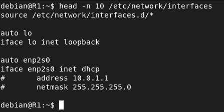

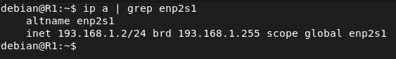

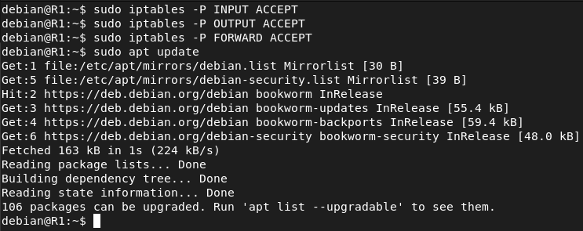

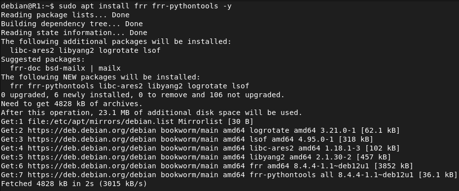

R2

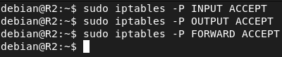

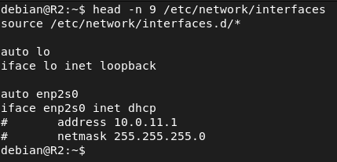

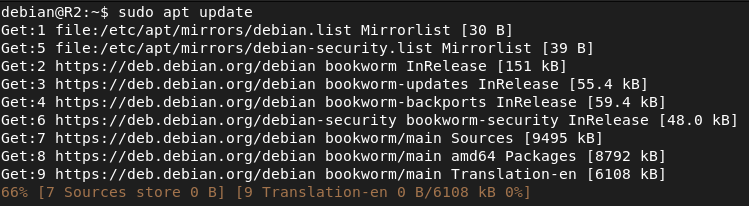

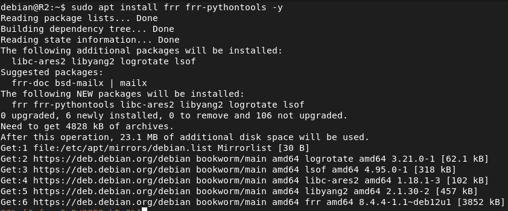

R3

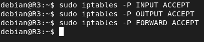

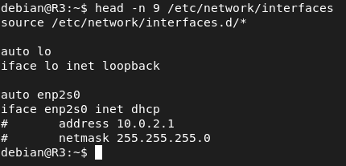

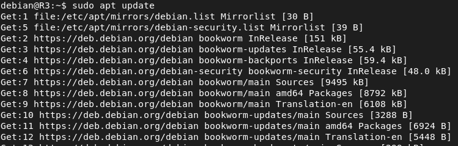

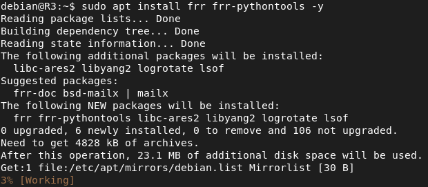

R4

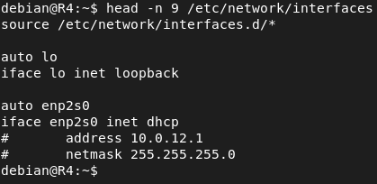

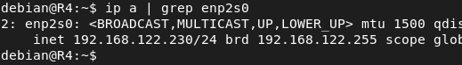

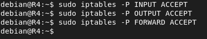

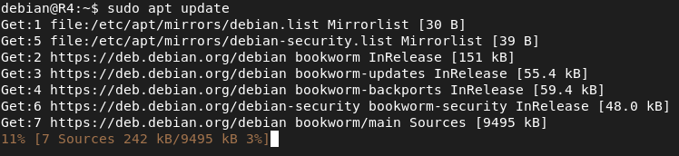

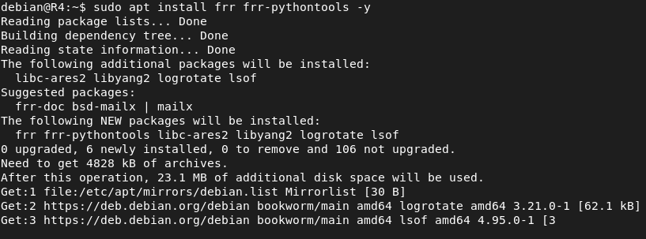

R5

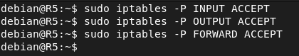

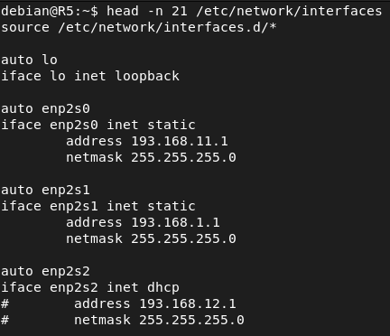

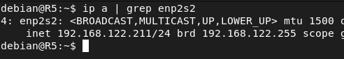

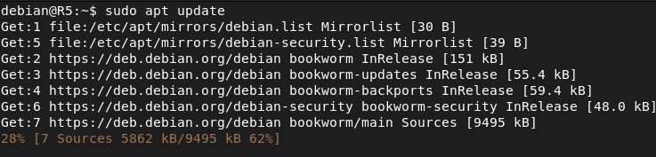

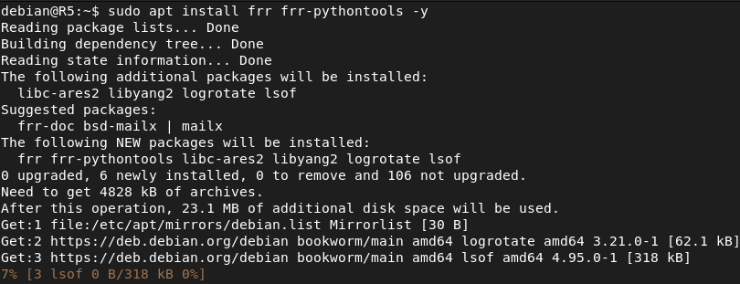

### Permitir tráfico OSPF entre routers

Una vez que he instalado la herramienta de enrutamiento dinámico Frr al tener una política DROP por defecto en iptables hay que permitir el tráfico OSPF entre los routers del escenario. Para ello he implementado dos reglas (“petición” y “respuesta”) y el 89 no es el número de puerto sino el protocolo 89 que es el número asignado oficialmente a OSPF. Este proceso se va a repetir en todos los routers.

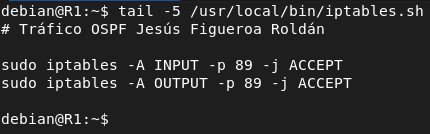

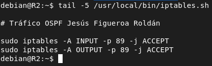

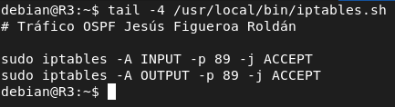

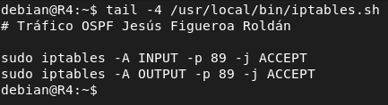

### Configuración protocolos de enrutamiento

Para configurar los protocolos de enrutamiento he borrado el scripts con las tablas de enrutamiento a las diferentes redes y el servicio de systemd el cuál hacia persistente dichas rutas. Y a partir de esto voy a configurar OSPF como protocolo de enrutamiento. Como vemos tenemos más protocolos de enrutamiento don esta herramienta.

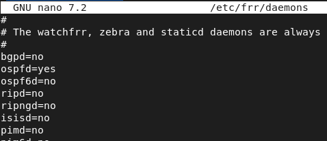

R1

Tras hacer los cambios vamos a reiniciar el servicio y vamos a acceder a la consola de esta herramienta.

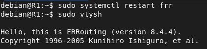

Una vez en la consola vamos a definir un router id para ospf y las redes que tiene conectadas. En este caso vamos a trabajar en el area 0. (Este proceso se va a repetir en todos los routers pero cambiando la definición de las redes).

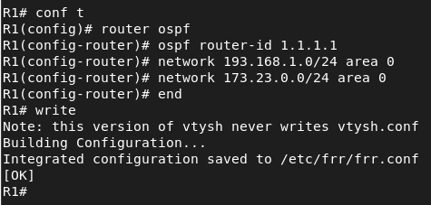

R2

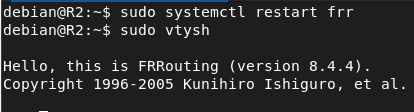

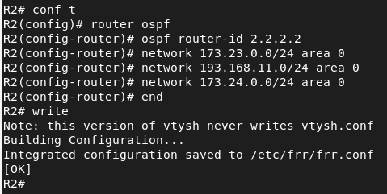

R3

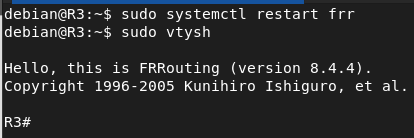

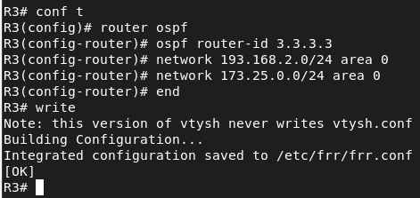

R4

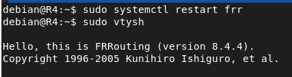

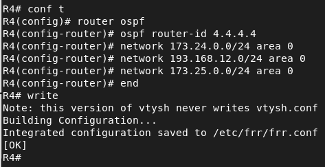

R5

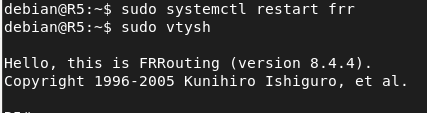

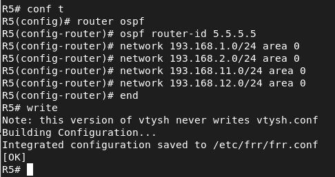

### Rutas generadas

Tras definir las redes y esperar unos 40 segundos a que el protocolo mande los hello packets para que sepan que están usando dicho protocolo tendremos generadas las tablas de enrutamiento. Las rutas generadas sin asignar costes es el camino con el costo total más bajo, en este caso al no configurar costes el router mira la velocidad de los enlaces y asigna un número. Si para llegar a una red hay 2 caminos posibles y los 2 tienen el mismo coste OSPF añade los 2 caminos y a la hora de enrutar los paquetes hace un balanceo de carga en función del tráfico que haya.

R1

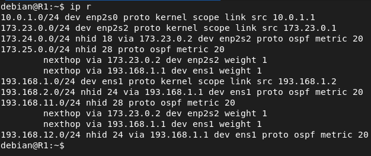

R2

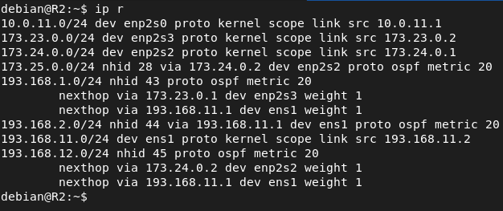

R3

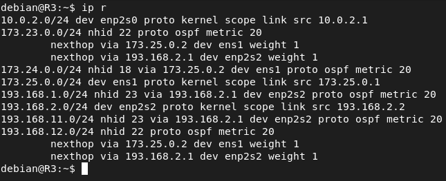

R4

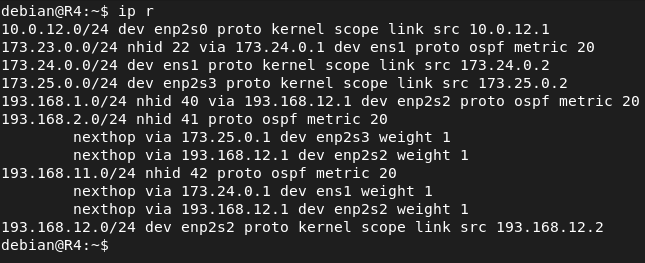

R5

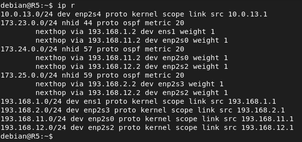

#### Con R5 apagado

Una vez que apagamos R5 y los routers vean que contesta a los hello packets recalcularán las rutas.

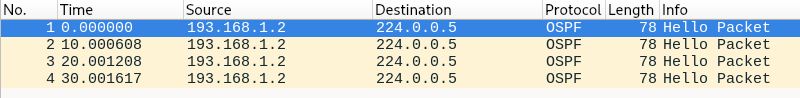

Aquí podremos ver el contenido de un paquete hello de OSPF.

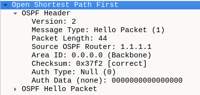

### Nuevas rutas sin R5

Tras apagar R5 se han generado nuevas rutas.

R1

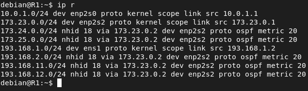

R2

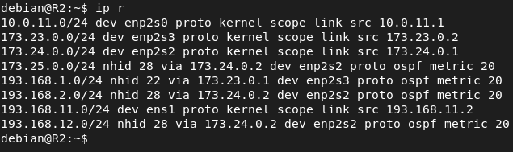

R3

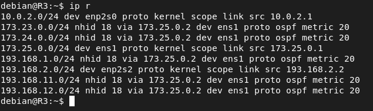

R4

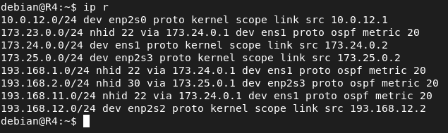

### Asignación de costes

Ahora vamos a proceder a asignar costes, lo voy a realizar de tal manera que los costes más caros sean tirando hacia R5 y los más baratos por los extremos.

R1

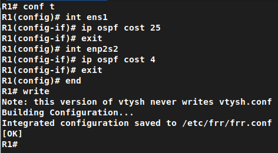

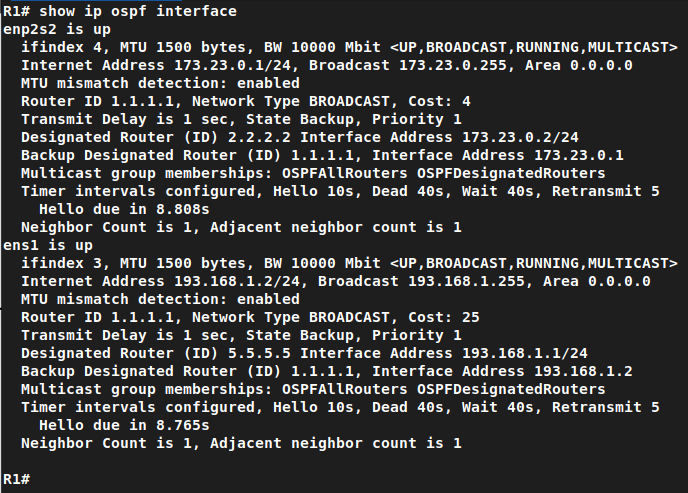

R2

R3

R4

R5

### Rutas generadas con costes

El númro que vemos entre corchetes es el coste total de todos los enlaces para llegar a esa subred. En este caso si vemos las tablas de enrutamientos los caminos no suelen ir por R5 ya que he asignado costes más grandes que en los otros enlaces aunque se puede dar el caso.

R1

R2

R3

R4

R5

### Prueba conectividad

Para poder comprobar que hay conectividad entre todas las redes tengo que añadir las reglas para permitir el tráfico ICMP. Este proceso se repite en todos los routers.

### Prueba conectividad

### Traceroute

## Escenario Cisco

a\) Usando OSPFv2, monta enrutamiento dinámico sobre los routers CISCO del escenario de la práctica 12: The Hunger Games. Posteriormente, realiza el mismo ejercicio asignando costes a cada uno de los enlaces.

Debes explicar las rutas elegidas por el algoritmo en cada uno de los casos, para ilustrar esta explicación recuerda que puedes usar traceroute o mostrar las tablas de enrutamiento directamente.

Comprueba también que pasa cuando cambias el coste de una ruta o cuando apagas el Router 5.

### Configuración OSPF

Ahora vamos a realizar los mismos pasos y es definir las redes que tienen los routers conectadas a él para que el protocolo calcule las rutas. En este escenario no voy a tener problema con las ACLS ya que en la práctica 12 puse un permit ip any any para que funcione todo lo demás por lo que paras las ACLS no voy a necesitar configuracioón adicional.También es importante destacar que al configurar el enrutamiento dinámico en Cisco en lugar de usar la másca de red de la subred tendremos que usar la máscara de Wildcard (lo mismo que en ACL).

### Rutas generadas

Tras definir todas las redes el protocolo OSPF ha generado una ruta en función al algoritmo que usa. Las rutas con un 0 a la izquierda significa que son routers generadas por OSPF.

### Prueba conectividad

### Rutas con R5 apagado

Una vez apagado R5 el protocolo mandará los hello packets y al no recibir respuesta tras un tiempo procederá a cambiar las rutas a las diferentes redes.

#### Prueba conectividad

#### Traceroute

### Asignación de costes

Para la asignación de costes voy a seguir el mismo criterio que en el escenario de Linux es decir que las rutas más caras en cuanto a coste sean por R5.

### Rutas generadas

En las rutas tenemos entre corchetes dos valores importantes, el primero que es la fiabilidad de la ruta que OSPF por defecto tiene 110 y el 2 valor que es el coste total para llegar a la red destino.

#### Traceroute

### Bibliografía

<https://www.ticarte.com/contenido/quagga-enrutamiento-ospf>

<https://frrouting.org/doc/>

<https://docs.oracle.com/cd/E63244_01/html/E63245/z40025071872988.html>
