> 📚 **1º ASIR · Planificación y Administración de Redes** · Tema 5: Nivel de red · Curso 2025/2026

## ¿Qué es?

Kathará es un sistema ligero de emulación de redes basado en contenedores Docker, diseñado para educación, investigación y pruebas de protocolos. Permite crear topologías complejas interconectando contenedores con redes LAN virtuales de Capa 2, siendo sucesor de Netkit.

## Instalación Kathara

Para instalar Kathara lo podemos hacer mediante varios procedimiento, con entorno virtual de python(pip), con pipx o de la manera tradicional con apt añadiendo la clase GPG ya que no está firmado. Para ello vamos a añadir la clave al fihcero de repositorios de kathara y con trusted vamos a decirle que confiamos aunque no tenga firma, sin esto nos va a da error al instalarlo ya que en Debian 13 tiene que estar firmado la clave GPG.

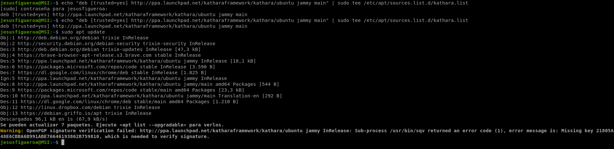

Una vez que tenemos los repositorios vamos a instalar kathara y xterm que es la consola que van a usar los contenedores aunque nosotros nos conectaremos por la terminal tradicional.

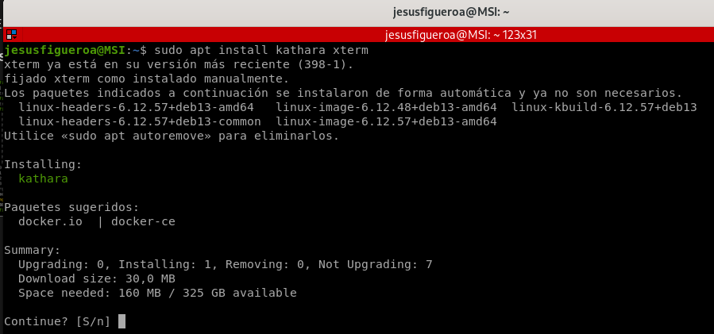

Para que Kathara funcione correctamente también tendremos que instalar Docker o Kubernetes para poder trabajar con contenedores, en mi caso Docker ya lo tenía instalado pero de igual modo aquí dejo documentación a seguir para instalar Docker en Debian 13.

<https://docs.docker.com/engine/install/debian/>

<https://voidnull.es/instalacion-de-docker-en-debian-13/>

## Instalación Kubernetes

Para trabajar con Kathara podemos usar Docker y Kubernetes o ambas, como en mi caso ya tenía instalado Docker voy a instalar Kubernetes para ello vamos a actualizar la lista de repositorios de nuestro sistema.

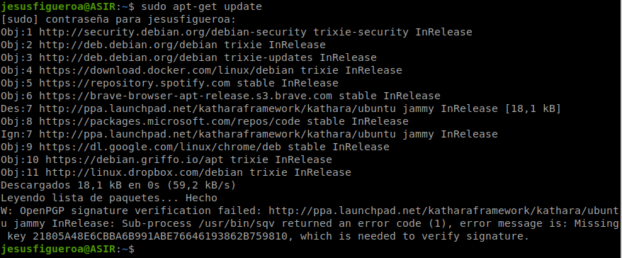

Vamos a instalar los paquetes que vamos a necesitar para trabajar con Kubernetes.

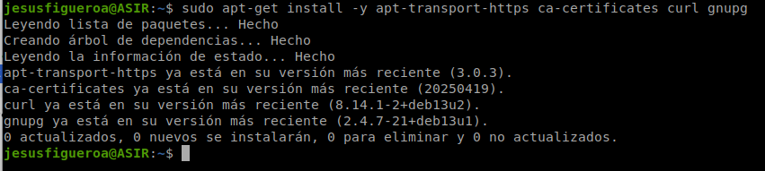

Nos vamos a descargar la firma GPG de kubernetes mediante curl y vamos a meter los repositorios para poder instalar kubectl.

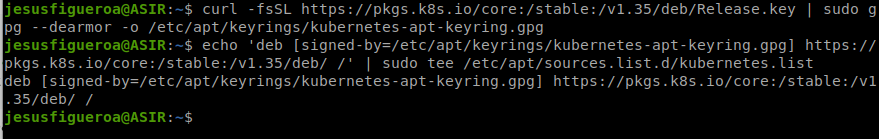

Una vez que hemos añadido la lista de repositorios de kubernetes vamos a actualizar la lista de repositorios de nuestra máquina.

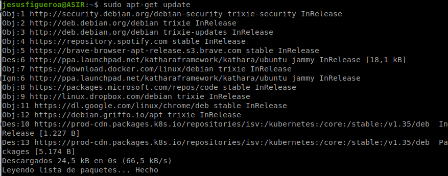

Y vamos a instalar kubectl con una instalación desatendida.

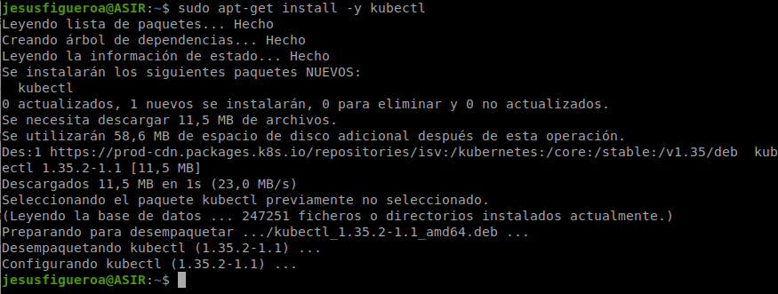

Para poder ver los nodos que tenemos tenemos que iniciar el cluster.

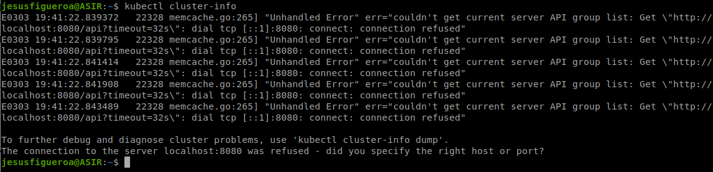

Para ello vamos a hacer un curl a esta URL y vamos a instalar minikube.

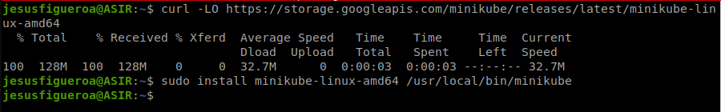

Y una vez que tenemos minikube instalado iniciamos con el driver de docker, automáticamente esto lo que va a realizar es descargar una imagen docker y va a desplegar un contenedor.

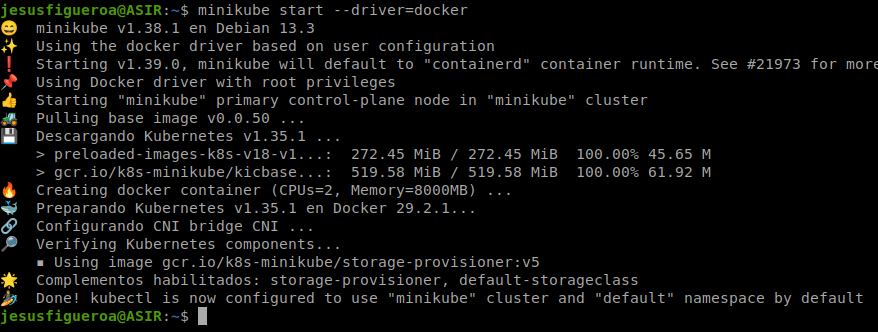

Y ya podremos obtener los nodos de kubernetes que actualmente tenemos el contenedor de minikube.

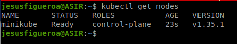

Aquí vemos las imágenes de minikube que he comentado anteriormente.

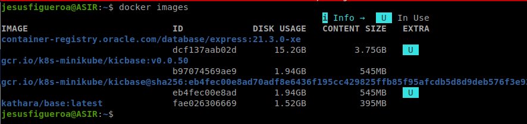

## Despliegue escenario kathara

<https://github.com/KatharaFramework/Kathara-Labs> (Diversidad de escenarios)

Para el despliegue del escenario voy a usar uno que tiene 3 PCS y 4 routers, 3 router de red interna y una que hace SNAT que conecta la red interna con el exterior mediante una regla iptable.

Para iniciar el escenario entramos en el directorio y ponemos kathara lstart. Una vez ejecutado el comando empezará a desplegar tantos contenedores como ficheros .startup tengamos.

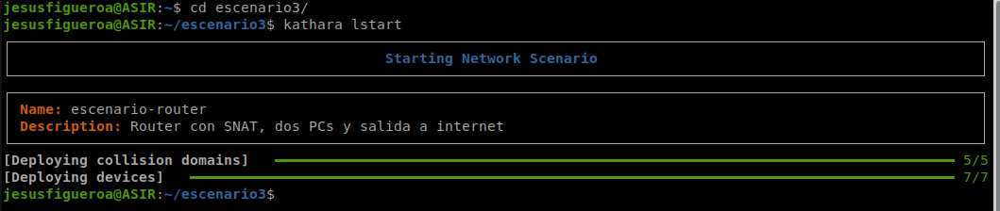

Aquí vemos los contenedores que están corriendo al haber desplegado el escenario.

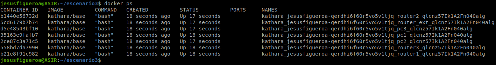

Al instalar Kathara se descarga una imagen Docker que contiene un Debian 12.

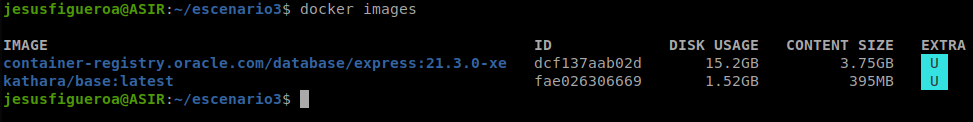

Aquí vemos la estructura del escenario, en fichero con extensión .conf es donde se va a definir las conexiones de los cables y también vamos a definir las máquinas Linux como router Debian activando el bit de forwarding. Y para los PCS en los ficheros startup vamos a indicar los comandos Linux para asignar direcciones IP y las rutas.

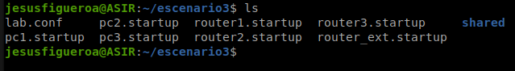

## Ficheros de configuración escenario

Como he comentado anteriormente aquí he definido las conexiones entre los diferentes dispositivos y activamos el bit de forwarding para que actúen como router.

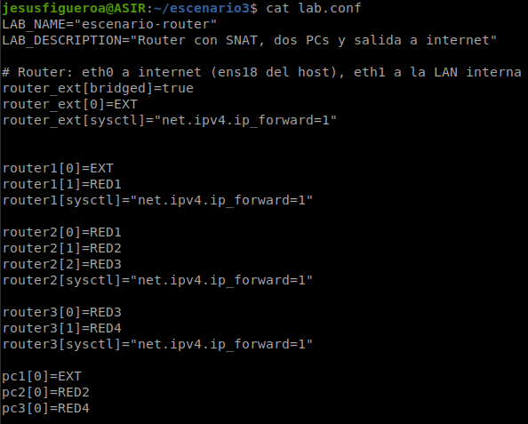

Aquí vemos el ejemplo de un PC que tiene las instrucciones Linux para tener dirección IP y las rutas para llegar a las diferentes redes y el DNS para tener salida a Internet gracias al router que conecta nuestra red interna con el exterior.

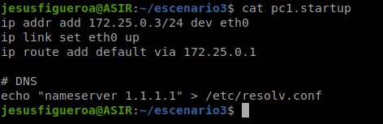

Aquí vemos el fichero de configuración de los routers con las instrucciones Linux para que reciban dirección IP.

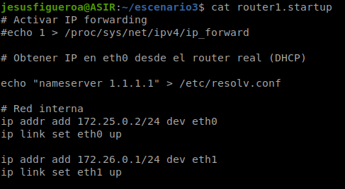

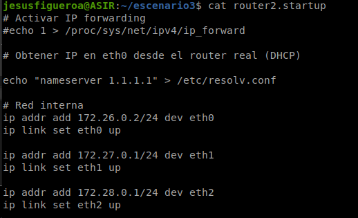

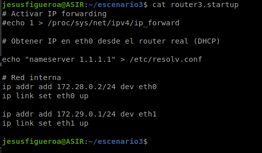

Aquí vemos el router que conecta nuestra red interna con el exterior mediante una regla iptable la cual hace SNAT.

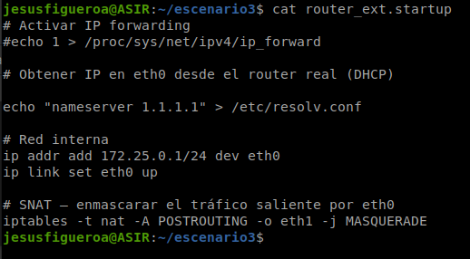

## Esquema gráfico topología

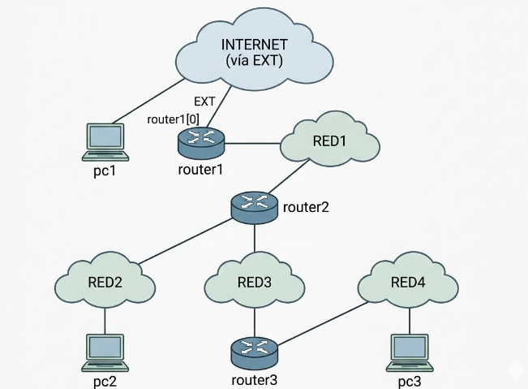

## Bibliografía

[https://kubernetes.io/es/docs/tasks/tools/install-kubectl-linux/#instalaci%C3%B3n-mediante-el-administrador-de-paquetes-nativo](https://kubernetes.io/es/docs/tasks/tools/install-kubectl-linux/#instalación-mediante-el-administrador-de-paquetes-nativo)

<https://minikube.sigs.k8s.io/docs/start/?arch=%2Flinux%2Fx86-64%2Fstable%2Fbinary+download>

<https://docs.docker.com/engine/install/debian/>

<https://voidnull.es/instalacion-de-docker-en-debian-13/>

## 📎 Ficheros de la práctica

<details>
<summary><code>Despliegue escenarios.txt</code></summary>

```bash
En los startups de los PCS ponemos las IPS estáticas con comandos linux, y para el escenario lab.conf

kathara lstart para iniciar el escenario

hathara linfo

kathara connect pc1

kathara lclean

para conectar con internet router[bridged]=true, para activar el bit de forwarding va en el lab.conf con router[sysctl]=net.ipv4.ip_forward=1
```

</details>

<details>
<summary><code>Instalación Kathara.txt</code></summary>

```bash
echo "deb [trusted=yes] http://ppa.launchpad.net/katharaframework/kathara/ubuntu jammy main" | sudo tee /etc/apt/sources.list.d/kathara.list
sudo apt update
sudo apt install kathara xterm
```

</details>

<details>
<summary><code>escenarios/escenario1/lab.conf</code></summary>

```ini
# Descripción del laboratorio
LAB_NAME="escenario-basico"
LAB_DESCRIPTION="Dos PCs conectados en la misma red"

# pc1 conectado a la red "A" por su interfaz eth0
pc1[0]=A

# pc2 conectado a la misma red "A" por su interfaz eth0
pc2[0]=A
```

</details>

<details>
<summary><code>escenarios/escenario1/pc1.startup</code></summary>

```bash
ip addr add 192.168.1.1/24 dev eth0
ip link set eth0 up
```

</details>

<details>
<summary><code>escenarios/escenario1/pc2.startup</code></summary>

```bash
ip addr add 192.168.1.2/24 dev eth0
ip link set eth0 up
```

</details>

<details>
<summary><code>escenarios/escenario2/lab.conf</code></summary>

```ini
LAB_NAME="escenario-router"
LAB_DESCRIPTION="Router con SNAT, dos PCs y salida a internet"

# Router: eth0 a internet (ens18 del host), eth1 a la LAN interna
router[bridged]=true
router[0]=LAN

# Los dos PCs en la LAN interna
pc1[0]=LAN
pc2[0]=LAN

# Permisos para el Forwarding
router[sysctl]="net.ipv4.ip_forward=1"
```

</details>

<details>
<summary><code>escenarios/escenario2/pc1.startup</code></summary>

```bash
ip addr add 10.0.0.2/24 dev eth0
ip link set eth0 up
ip route add default via 10.0.0.1

# DNS
echo "nameserver 1.1.1.1" > /etc/resolv.conf
```

</details>

<details>
<summary><code>escenarios/escenario2/pc2.startup</code></summary>

```bash
ip addr add 10.0.0.3/24 dev eth0
ip link set eth0 up
ip route add default via 10.0.0.1

echo "nameserver 1.1.1.1" > /etc/resolv.conf
```

</details>

<details>
<summary><code>escenarios/escenario2/router.startup</code></summary>

```bash
# Activar IP forwarding
#echo 1 > /proc/sys/net/ipv4/ip_forward

# Obtener IP en eth0 desde el router real (DHCP)

echo "nameserver 1.1.1.1" > /etc/resolv.conf

# Red interna
ip addr add 10.0.0.1/24 dev eth0
ip link set eth0 up

# SNAT — enmascarar el tráfico saliente por eth0
iptables -t nat -A POSTROUTING -o eth1 -j MASQUERADE
```

</details>

<details>
<summary><code>escenarios/escenario3/lab.conf</code></summary>

```ini
LAB_NAME="escenario-router"
LAB_DESCRIPTION="Router con SNAT, dos PCs y salida a internet"

# Router: eth0 a internet (ens18 del host), eth1 a la LAN interna
router_ext[bridged]=true
router_ext[0]=EXT
router_ext[sysctl]="net.ipv4.ip_forward=1"


router1[0]=EXT
router1[1]=RED1
router1[sysctl]="net.ipv4.ip_forward=1"

router2[0]=RED1
router2[1]=RED2
router2[2]=RED3
router2[sysctl]="net.ipv4.ip_forward=1"

router3[0]=RED3
router3[1]=RED4
router3[sysctl]="net.ipv4.ip_forward=1"

pc1[0]=EXT
pc2[0]=RED2
pc3[0]=RED4
```

</details>

<details>
<summary><code>escenarios/escenario3/pc1.startup</code></summary>

```bash
ip addr add 172.25.0.3/24 dev eth0
ip link set eth0 up
ip route add default via 172.25.0.1

# DNS
echo "nameserver 1.1.1.1" > /etc/resolv.conf
```

</details>

<details>
<summary><code>escenarios/escenario3/pc2.startup</code></summary>

```bash
ip addr add 172.27.0.2/24 dev eth0
ip link set eth0 up
ip route add default via 172.27.0.1

# DNS
echo "nameserver 1.1.1.1" > /etc/resolv.conf
```

</details>

<details>
<summary><code>escenarios/escenario3/pc3.startup</code></summary>

```bash
ip addr add 172.29.0.2/24 dev eth0
ip link set eth0 up
ip route add default via 172.29.0.1

# DNS
echo "nameserver 1.1.1.1" > /etc/resolv.conf
```

</details>

<details>
<summary><code>escenarios/escenario3/router1.startup</code></summary>

```bash
# Activar IP forwarding
#echo 1 > /proc/sys/net/ipv4/ip_forward

# Obtener IP en eth0 desde el router real (DHCP)

echo "nameserver 1.1.1.1" > /etc/resolv.conf

# Red interna
ip addr add 172.25.0.2/24 dev eth0
ip link set eth0 up

ip addr add 172.26.0.1/24 dev eth1
ip link set eth1 up
```

</details>

<details>
<summary><code>escenarios/escenario3/router2.startup</code></summary>

```bash
# Activar IP forwarding
#echo 1 > /proc/sys/net/ipv4/ip_forward

# Obtener IP en eth0 desde el router real (DHCP)

echo "nameserver 1.1.1.1" > /etc/resolv.conf

# Red interna
ip addr add 172.26.0.2/24 dev eth0
ip link set eth0 up

ip addr add 172.27.0.1/24 dev eth1
ip link set eth1 up

ip addr add 172.28.0.1/24 dev eth2
ip link set eth2 up
```

</details>

<details>
<summary><code>escenarios/escenario3/router3.startup</code></summary>

```bash
# Activar IP forwarding
#echo 1 > /proc/sys/net/ipv4/ip_forward

# Obtener IP en eth0 desde el router real (DHCP)

echo "nameserver 1.1.1.1" > /etc/resolv.conf

# Red interna
ip addr add 172.28.0.2/24 dev eth0
ip link set eth0 up

ip addr add 172.29.0.1/24 dev eth1
ip link set eth1 up
```

</details>

<details>
<summary><code>escenarios/escenario3/router_ext.startup</code></summary>

```bash
# Activar IP forwarding
#echo 1 > /proc/sys/net/ipv4/ip_forward

# Obtener IP en eth0 desde el router real (DHCP)

echo "nameserver 1.1.1.1" > /etc/resolv.conf

# Red interna
ip addr add 172.25.0.1/24 dev eth0
ip link set eth0 up

# SNAT — enmascarar el tráfico saliente por eth0
iptables -t nat -A POSTROUTING -o eth1 -j MASQUERADE
```

</details>

