> 📚 **1º ASIR · Planificación y Administración de Redes** · Tema 5: Nivel de red · Curso 2025/2026

## Acceso por contraseña máquina

Primero vamos a editar el tiempo del GRUB ya que por defecto en OpenStack viene a 0 y no vemos el grub, para ello entramos en este fichero y cambiamos el valor por uno superior (en segundos).

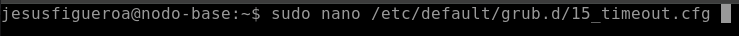

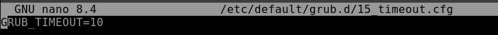
Una vez cambiado esto vamos a actualizar el grub para que se apliquen los cambios.

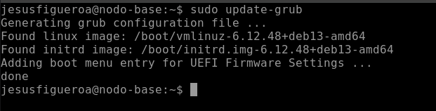
Ahora vamos a cambiar la configuración del servicio ssh para podernos conectar a la máquina mediante contraseña.

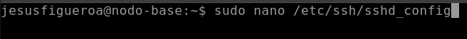
Para ello nos vamos a esta línea y lo ponemos en yes, por defecto en OpenStack está en no ya que el acceso es por clave pública / privada.

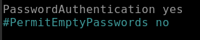
Una vez que hemos realizado los cambios en el fichero de configuración reiniciamos el servicio para que los cambios se lleven a cabo.

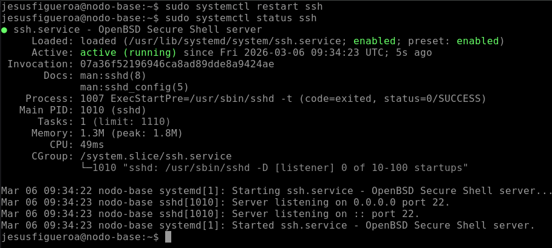

Y una vez que hemos hecho todos estos cambios vamos a proceder a darle contraseña al usuario de la máquina.

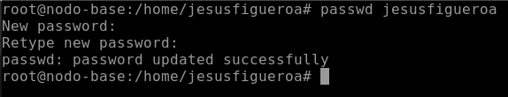

## Creación de imagen

Una vez que ya tenemos la imagen de la cual vamos a partir con las configuraciones hechas para poder acceder por contraseña lo primero que vamos a hacer es crear una instantánea de la instancia que previamente hemos configurado en mi caso tiene un Debian 13.

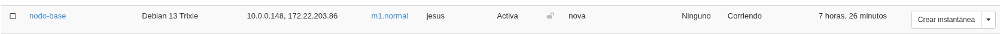

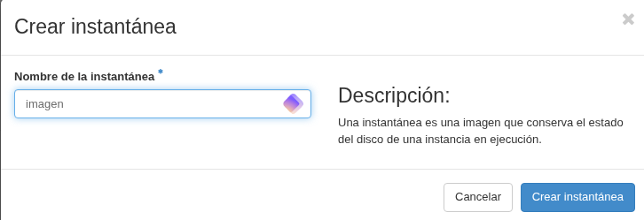

Para desplegar el escenario vamos a copiarnos el ID de la imagen que hemos creado de nuestra instancia.

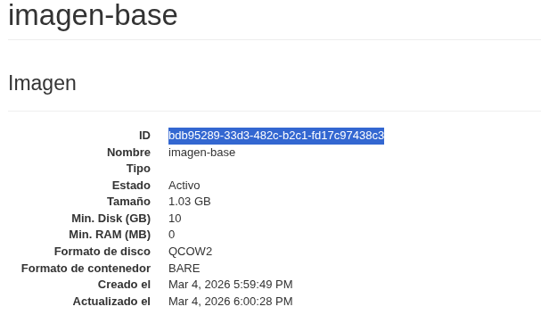

Y ponemos esa ID en el .yaml junto con el sabor en mi caso he elegido m1.normal.

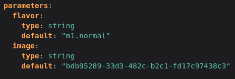

Una vez que hemos creado la imagen vamos a proceder al despliegue del escenario para ello nos vamos a orquestación y en pilas o stack.

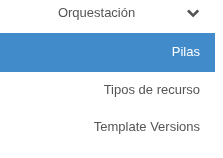

Vamos a lanzar una nueva pila.

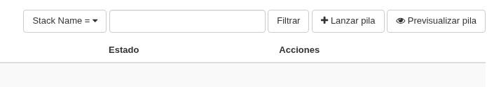

Y vamos a elegir archivo ya que es un fichero .yaml, lo seleccionamos y continuamos.

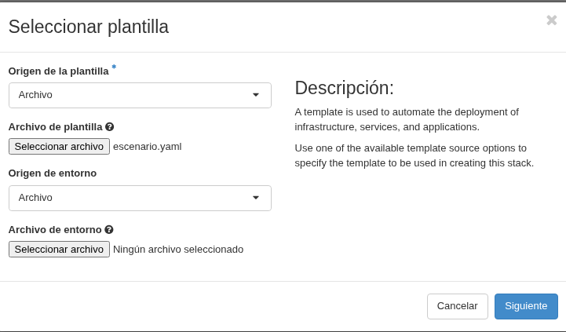

Le ponemos un nombre identificativo a la pila y ponemos la contraseña de nuestro usuario de acceso a OpenStack. Como vemos aquí ya no está identificando la imagen que le hemos indicado en el .yaml y el sabor.

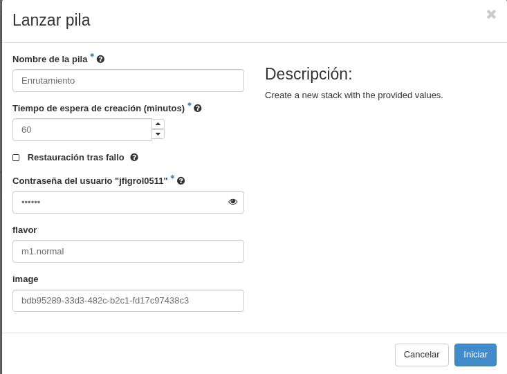

Al desplegar el escenario con el fichero .yaml de la práctica esta recibiendo un fallo porque las IPS estaban interfiriendo, entonces lo que hice fue desactivar el DHCP y asignar IPS estáticas a todo aunque en OpenStack en la interfaz al desplegar el escenario nos encontramos con las IPS para asignar.

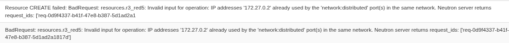

## Esquema gráfico de la configuración

Una vez corregido el fichero volvemos a desplegar y ya lo tenemos correcto, aquí vemos el escenario ya desplegado.

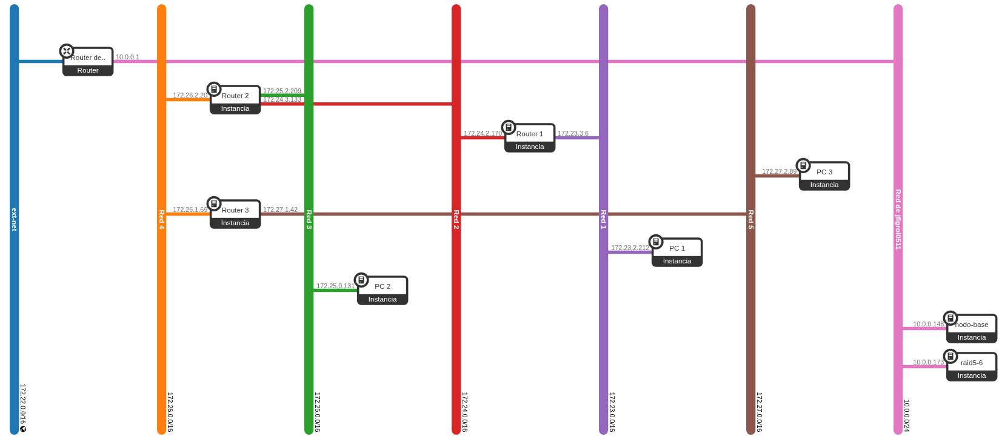

Aquí vemos las instancias ya creadas con las redes pero las direcciones IP hay que asignarlas manualmente porque como he comentado anteriormente desactivé el DCHP.

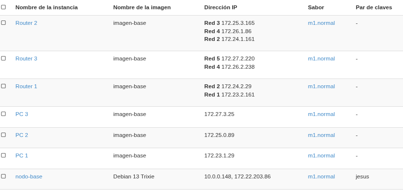

Para tener un poco más claro el escenario, he replicado el escenario en GNS3 y esto sería un esquema del escenario con las redes.

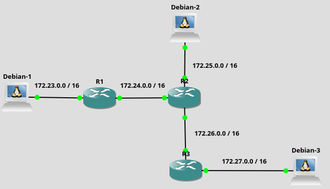

## Direcciones IP

|          |              |
|----------|--------------|
| R1 – PC1 | 172.23.2.161 |
| PC1      | 172.23.1.29  |
| R1 – R2  | 172.24.2.29  |
| R2 – R1  | 172.24.1.161 |
| PC2      | 172.25.0.89  |
| R2 – PC2 | 172.25.3.165 |
| R2 – R3  | 172.26.1.86  |
| R3 – R2  | 172.26.2.238 |
| R3 – PC3 | 172.27.2.220 |
| PC3      | 172.27.3.25  |

## Tablas de enrutamiento

He puesto las tablas de enrutamiento sin simplificar pero al meterlas en el escenario las simplifico añadiendo ruta por defecto.

R1

|                  |             |                 |
|------------------|-------------|-----------------|
| Dirección de red | Máscara     | Siguiente salto |
| 172.23.0.0       | 0.0.0.0     | 0.0.0.0         |
| 172.24.0.0       | 0.0.0.0     | 0.0.0.0         |
| 172.25.0.0       | 255.255.0.0 | 172.24.1.161    |
| 172.26.0.0       | 255.255.0.0 | 172.24.1.161    |
| 172.27.0.0       | 255.255.0.0 | 172.24.1.161    |

R2

|                  |             |                 |
|------------------|-------------|-----------------|
| Dirección de red | Máscara     | Siguiente salto |
| 172.23.0.0       | 255.255.0.0 | 172.24.2.29     |
| 172.24.0.0       | 0.0.0.0     | 0.0.0.0         |
| 172.25.0.0       | 0.0.0.0     | 0.0.0.0         |
| 172.26.0.0       | 0.0.0.0     | 0.0.0.0         |
| 172.27.0.0       | 255.255.0.0 | 172.26.2.238    |

R3

|                  |             |                 |
|------------------|-------------|-----------------|
| Dirección de red | Máscara     | Siguiente salto |
| 172.23.0.0       | 255.255.0.0 | 172.26.1.86     |
| 172.24.0.0       | 255.255.0.0 | 172.26.1.86     |
| 172.25.0.0       | 255.255.0.0 | 172.26.1.86     |
| 172.26.0.0       | 0.0.0.0     | 0.0.0.0         |
| 172.27.0.0       | 0.0.0.0     | 0.0.0.0         |

## Router 1

Al ser una máquina Debian hay que activar el bit de forwarding para que cuando envíe un mensaje no lo deseche como un PC, para ello ponemos lo siguiente:

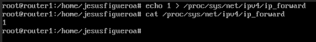

Como he comentado anteriormente el DCHP de neutron estaba dando fallo por lo que puse las IPS estáticas para ello hay que añadir en cada router.

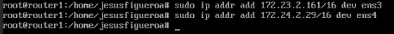

Y añadimos las rutas.

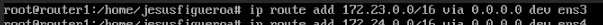

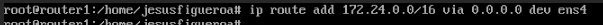


## Router 2

Al ser una máquina Debian hay que activar el bit de forwarding para que cuando envíe un mensaje no lo deseche como un PC, para ello ponemos lo siguiente:

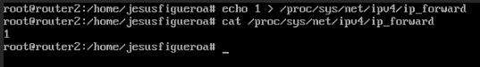

Asignamos las direcciones IP a las interfaces.

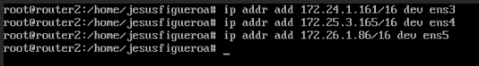

Y añadimos las rutas estáticas. Onlink es para forzar al kernel a aceptar la ruta aunque el gateway no esté en la misma subred.

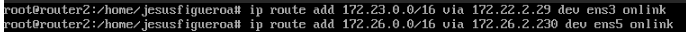

## Router 3

Al ser una máquina Debian hay que activar el bit de forwarding para que cuando envíe un mensaje no lo deseche como un PC, para ello ponemos lo siguiente:

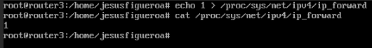

Asignamos direcciones IP con sus correspondientes subredes a las interfaces.

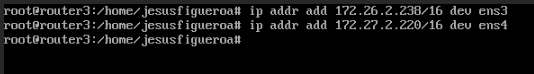

Y añadimos la ruta por defecto para simplificar la tabla de enrutamiento.

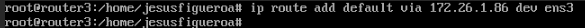

## Persistencia bit de forwarding

El proceso que hemos hecho de añadir el bit de forwarding solo es válido hasta que reiniciemos la máquina, una vez que la reiniciemos se perderá para ello vamos a crear el siguiente fichero (nuevo en Debian 13) y vamos a poner la siguiente línea:

Anterior a Debian 13 el fichero es: /etc/sysctl.conf

Este proceso lo vamos a realizar en todos los routers.

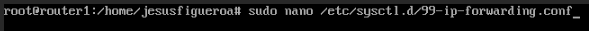

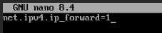

Si queremos guardar las tablas de enrutamiento o restaurarlas ip route nos da la posibilidad.

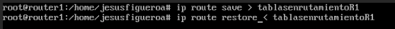

Añadimos una ruta por defecto para simplificar la tabla de enrutamiento.

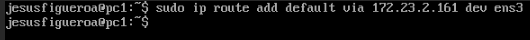

## Verificación de conectividad (ping) entre nodos

PC1

PC1 - PC2

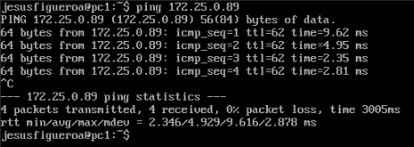

PC1 - PC3


PC2

PC2 – PC1


PC2 – PC3

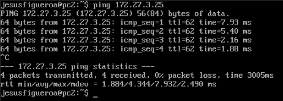

PC3

PC3 – PC1

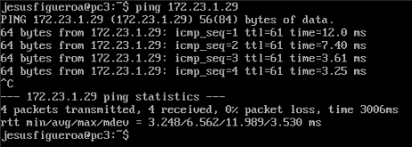

PC3 – PC2

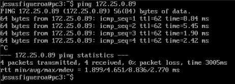

## Tablas de enrutamiento finales

Aquí vemos la ruta por defecto ya que no se puede editar la configuración de las interfaces de red por lo que hay que añadir una ruta por defecto. Esto hay que hacerlo para todos los PCS.

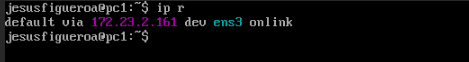

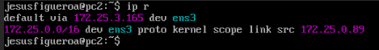

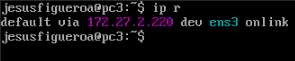

R1

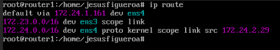

R2

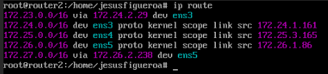

R3

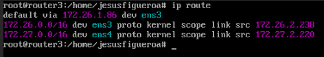

## Captura de tráfico en el router R3 mostrando tráfico entre h1 y h3

Con tcpdump podemos capturar el tráfico y guardarlo en un archivo o capturar y que lo vaya mostrando automáticamente entre otras maneras. Para guardar un archivo de captura es con el parámetro w.

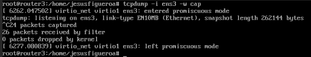

Para capturar tráfico con tcpdump vamos a usar el parámetro -n. En esta captura vemos como llegan los ICMP request de PC3 a PC1 y los ICMP reply de PC1 a PC3

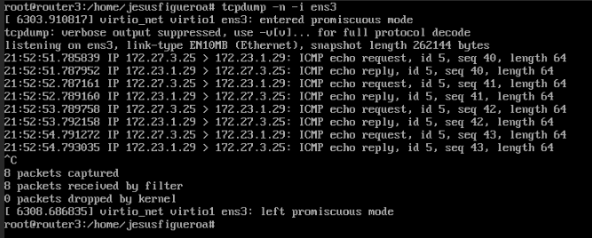

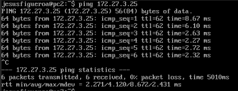

En esta captura también podemos ver a parte de los ping request y reply una petición APR con su correspondiend respuesta. La pregunta ARP es en el camino entre routers.

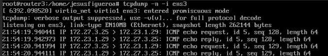

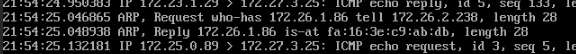

## Configuración funcional

Para que el escenario funcione correctamente tendremos que poner en las máquinas que actúan como router el bit de forwarding y crear las tablas de enrutamiento para cada uno.

Y para las máquinas clientes (PCS) añadir una ruta por defecto ya que no se puede editar la configuración de las tarjetas de red y tampoco se puede modificar el gateway.

## Conclusión

En conclusión esta práctica me ha gustado bastante ya que introduce conceptos sobre la orquestación, un tema bastante interesante. En general me ha resultado muy útil para ir mezclando conceptos no solo hacer enrutamiento en GNS3 de manera “superficial”.

## Bibliografía

<https://docs.oracle.com/cd/E56339_01/html/E56870/gptjs.html>

<https://formacion.intef.es/tutorizados_2013_2019/pluginfile.php/37414/mod_imscp/content/1/enrutamiento_en_linux.html>

## 📎 Ficheros de la práctica

<details>
<summary><code>Permitir acceso por contraseña.txt</code></summary>

```bash
sudo nano /etc/default/grub.d/15_timeout.cfg
GRUB_TIMEOUT=10
update-grub


sudo nano /etc/ssh/sshd_config
PasswordAuthentication yes
sudo systemctl restart ssh
```

</details>

<details>
<summary><code>escenario.yaml</code></summary>

```yaml
heat_template_version: newton

description: 5 redes, 3 routers y 3 pcs

parameters:
  flavor:
    type: string
    default: "m1.normal"
  image:
    type: string
    default: "bdb95289-33d3-482c-b2c1-fd17c97438c3"

resources:

  red1:
    type: OS::Neutron::Net
    properties:
      name: "Red 1"
  red2:
    type: OS::Neutron::Net
    properties:
      name: "Red 2"
  red3:
    type: OS::Neutron::Net
    properties:
      name: "Red 3"
  red4:
    type: OS::Neutron::Net
    properties:
      name: "Red 4"
  red5:
    type: OS::Neutron::Net
    properties:
      name: "Red 5"

  subnet1:
    type: OS::Neutron::Subnet
    properties:
      network: { get_resource: red1 }
      cidr: 172.23.0.0/16
      enable_dhcp: false

  subnet2:
    type: OS::Neutron::Subnet
    properties:
      network: { get_resource: red2 }
      cidr: 172.24.0.0/16
      enable_dhcp: false

  subnet3:
    type: OS::Neutron::Subnet
    properties:
      network: { get_resource: red3 }
      cidr: 172.25.0.0/16
      enable_dhcp: false

  subnet4:
    type: OS::Neutron::Subnet
    properties:
      network: { get_resource: red4 }
      cidr: 172.26.0.0/16
      enable_dhcp: false

  subnet5:
    type: OS::Neutron::Subnet
    properties:
      network: { get_resource: red5 }
      cidr: 172.27.0.0/16
      enable_dhcp: false

  pc1_red1:
    type: OS::Neutron::Port
    depends_on: subnet1
    properties:
      network: { get_resource: red1 }

  r1_red1:
    type: OS::Neutron::Port
    depends_on: subnet1
    properties:
      network: { get_resource: red1 }
      allowed_address_pairs:
        - ip_address: 0.0.0.0/0

  r1_red2:
    type: OS::Neutron::Port
    depends_on: subnet2
    properties:
      network: { get_resource: red2 }
      allowed_address_pairs:
        - ip_address: 0.0.0.0/0

  r2_red2:
    type: OS::Neutron::Port
    depends_on: subnet2
    properties:
      network: { get_resource: red2 }
      allowed_address_pairs:
        - ip_address: 0.0.0.0/0

  r2_red3:
    type: OS::Neutron::Port
    depends_on: subnet3
    properties:
      network: { get_resource: red3 }
      allowed_address_pairs:
        - ip_address: 0.0.0.0/0

  r2_red4:
    type: OS::Neutron::Port
    depends_on: subnet4
    properties:
      network: { get_resource: red4 }
      allowed_address_pairs:
        - ip_address: 0.0.0.0/0

  r3_red4:
    type: OS::Neutron::Port
    depends_on: r2_red4
    properties:
      network: { get_resource: red4 }
      allowed_address_pairs:
        - ip_address: 0.0.0.0/0

  r3_red5:
    type: OS::Neutron::Port
    depends_on: subnet5
    properties:
      network: { get_resource: red5 }
      allowed_address_pairs:
        - ip_address: 0.0.0.0/0

  pc2_red3:
    type: OS::Neutron::Port
    depends_on: subnet3
    properties:
      network: { get_resource: red3 }

  pc3_red5:
    type: OS::Neutron::Port
    depends_on: subnet5
    properties:
      network: { get_resource: red5 }

  pc1:
    type: OS::Nova::Server
    properties:
      name: "PC 1"
      flavor: { get_param: flavor }
      image: { get_param: image }
      networks:
        - { port: { get_resource: pc1_red1 } }

  r1:
    type: OS::Nova::Server
    properties:
      name: "Router 1"
      flavor: { get_param: flavor }
      image: { get_param: image }
      networks:
        - { port: { get_resource: r1_red1 } }
        - { port: { get_resource: r1_red2 } }

  r2:
    type: OS::Nova::Server
    properties:
      name: "Router 2"
      flavor: { get_param: flavor }
      image: { get_param: image }
      networks:
        - { port: { get_resource: r2_red2 } }
        - { port: { get_resource: r2_red3 } }
        - { port: { get_resource: r2_red4 } }

  r3:
    type: OS::Nova::Server
    properties:
      name: "Router 3"
      flavor: { get_param: flavor }
      image: { get_param: image }
      networks:
        - { port: { get_resource: r3_red4 } }
        - { port: { get_resource: r3_red5 } }

  pc2:
    type: OS::Nova::Server
    properties:
      name: "PC 2"
      flavor: { get_param: flavor }
      image: { get_param: image }
      networks:
        - { port: { get_resource: pc2_red3 } }

  pc3:
    type: OS::Nova::Server
    properties:
      name: "PC 3"
      flavor: { get_param: flavor }
      image: { get_param: image }
      networks:
        - { port: { get_resource: pc3_red5 } }

outputs:
  mac_r1_red1:
    description: "Router 1 - Red 1"
    value: { get_attr: [r1_red1, mac_address] }
  mac_r1_red2:
    description: "Router 1 - Red 2"
    value: { get_attr: [r1_red2, mac_address] }
  mac_r2_red2:
    description: "Router 2 - Red 2"
    value: { get_attr: [r2_red2, mac_address] }
  mac_r2_red3:
    description: "Router 2 - Red 3"
    value: { get_attr: [r2_red3, mac_address] }
  mac_r2_red4:
    description: "Router 2 - Red 4"
    value: { get_attr: [r2_red4, mac_address] }
  mac_r3_red4:
    description: "Router 3 - Red 4"
    value: { get_attr: [r3_red4, mac_address] }
  mac_r3_red5:
    description: "Router 3 - Red 5"
    value: { get_attr: [r3_red5, mac_address] }
```

</details>

