> 📚 **1º ASIR · Planificación y Administración de Redes** · Tema 5: Nivel de red · Curso 2025/2026

## Importación appliance

Para poder importar el appliance en GNS3 tenemos que tener anteriormente descargado el fichero con extensión out.kvm.zip para ello tenemos dos opciones para descargarnos dicho fichero:

IMPORTANTE: para poder descargar la imagen de Fortigate tendremos que tener una cuenta registrada en Fortigate.

<https://support.fortinet.com/Download/VMImages.aspx>

<https://support.fortinet.com/support/#/downloads/vm>

Al descargarnos el fichero nos tenemos que asegurar que empiece por algo similar a esto FGT_VM64_KVM ya que sino podríamos tener problemas en un futuro. Dicho fichero contiene el disco virtual del firewall fortigate. Tras descargarnos este comprimido vamos a proceder a importarlo en GNS3 para ello nos iremos a la pestaña de security devices y le daremos a la opción de new template.

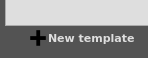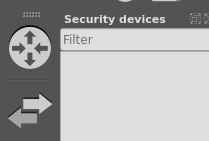

Una vez aquí yo voy a usar appliance que incluye lo que sería el fichero con extensión gns3a, pero si tenemos el fichero gns3a usaríamos la segunda opción en mi caso voy a usar la primera.

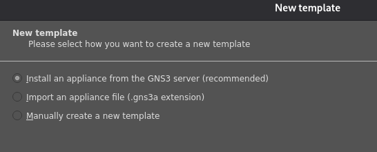

Una vez aquí vamos a buscar fortigate y como vemos tenemos varias opciones, en mi caso voy a elegir el FortiWeb, todo esto serían los templates o gns3a.

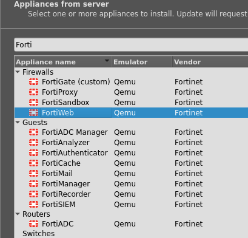

Una vez que hemos seleccionado el correcto vamos a proceder a instalarlo en el servidor de GNS3.

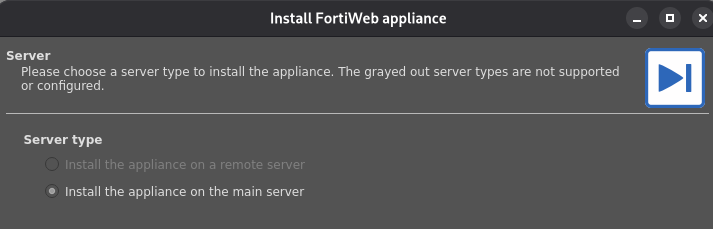

Una vez aquí tendremos que importar el fichero que nos hemos descargado al inicio del documento para ello previamente tendremos que permitir la opción de ficheros personalizados es decir vamos a permitir ficheros con un hash (MD5) diferente al que espera el programa.

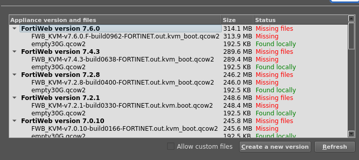

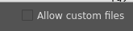

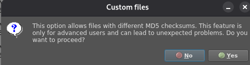

Tras activar esta opción vamos a pinchar en cualquier versión y vamos a importar el fichero que nos hemos descargado.

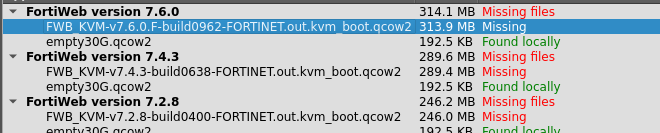

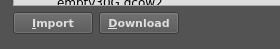

Elegiremos el fichero que nos hemos descargado pero descomprimido y dentro del directorio tendremos el fichero.

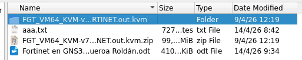

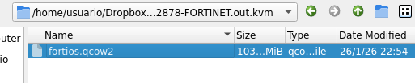

Y aceptamos a instalar. Como vemos aquí tenemos el MD5 del fichero y el que esperaba el programa.

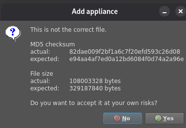

Una vez que hemos hecho esto deberíamos de tenerlo listo para instalar por lo que vamos a proceder a instalarlo.

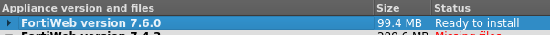

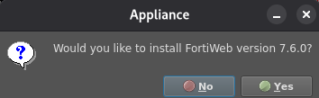

Daremos siguiente y aquí nos da información sobre las credenciales del firewall en mi caso la versión que yo he usado tiene admin como usuario y contraseña en blanco.

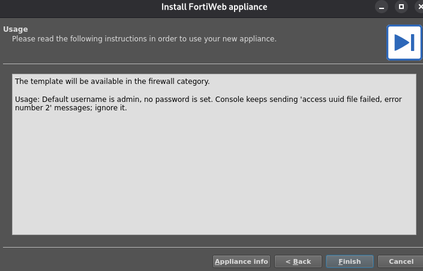

Y ya lo tendríamos instalando.

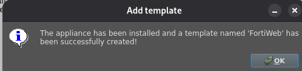

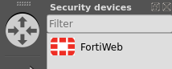

## Configuración previa

Tras instalarlo vamos a proceder a arrastrarlo y lo conectaremos a un switch el cual va a tener conectado un NAT. Esto lo que va a hacer es que nos va a dar IP por DHCP y vamos a poder salir a Internet con este elemento de GNS3. Más adelante veremos que tendremos que salir a Internet para ejecutar la licencia en el firewall.

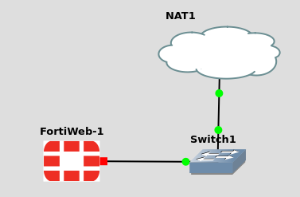

Antes de arrancar el firewall voy a cambiar la consola ya que por defecto este template usa VNC como consola, yo voy a usar telnet.

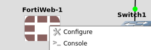

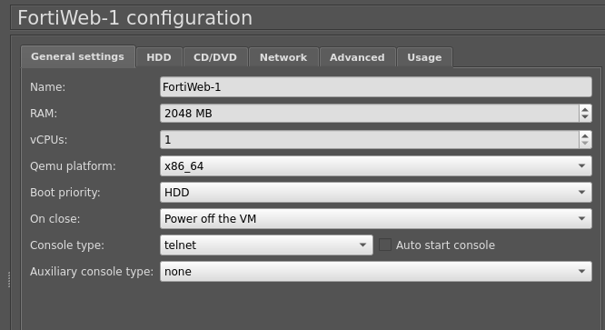

Tras arrancarla tendremos que esperar ya que el primer arranque del firewall suele tardar entre 3 a 5 minutos.

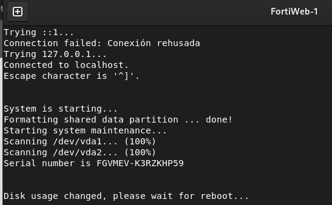

Tras pasar el tiempo de espera iniciaremos como admin y contraseña vacía y en el momento que iniciemos nos pedirá que creemos una contraseña por motivos de seguridad.

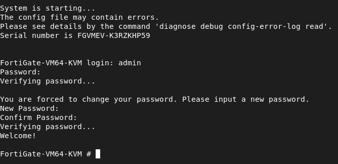

## Administración mediante interfaz web

Una vez que tenemos todas estas configuraciones previas realizadas vamos a ver la IP del firewall para acceder a la web de configuración. También se podría realizar por CLI.

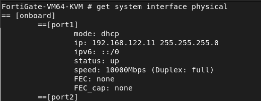

Tras ver la IP la pondremos en nuestro navegador y veremos una pantalla de login similar a este y nos pedirá las credenciales para acceder. Estas credenciales son las mismas que las del firewall en mi caso admin admin.

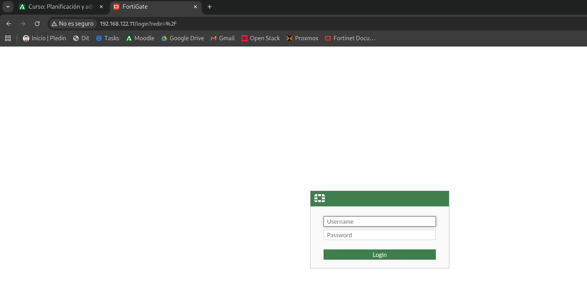

## Gestión de licencias

Tras el login nos toparemos con esta pantalla ya que el firewall no tiene una licencia registrada. Para tener una licencia he encontrado dos maneras para conseguir la licencia de evalución. Dicha licencia es ilimitada pero solo se puede usar en entornos de laboratorio. También otra de las limitantes que he encontrado es que solo se puede usar 1 licencia por cuenta, en caso de que tengamos una licencia en una cuenta no podremos usar más esa cuenta. Por aquí dejo otras limitantes encontradas:

CPU: Máximo 1 vCPU.

RAM: Máximo 2 GB.

Interfaces: Máximo 3 interfaces de red.

Políticas: Máximo 3 políticas de firewall y 3 rutas estáticas.

Cifrado (Low Encryption): Solo admite cifrado débil/bajo para el tráfico, excepto para el acceso a la interfaz de administración (GUI) y la comunicación con FortiManager. Esto significa que no es apta para túneles VPN productivos.

Servicios FortiGuard: No incluye actualizaciones de firmas (Antivirus, IPS, Web Filter, etc.). Las bases de datos se quedan con lo que traiga la imagen por defecto.

Para más información:

<https://docs.fortinet.com/document/fortigate/7.6.6/administration-guide/441460>

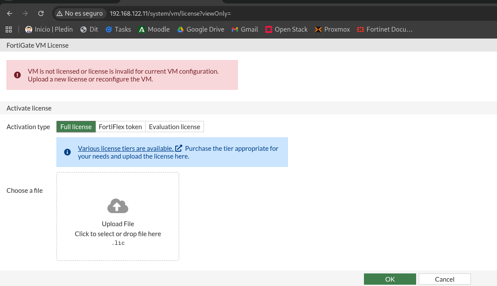

### Método 1

Una manera de conseguir la licencia de evaluación es desde la interfaz web en esta pantalla, tendremos que indicar el login de nuestra cuenta de Fortinet registrada previamente.

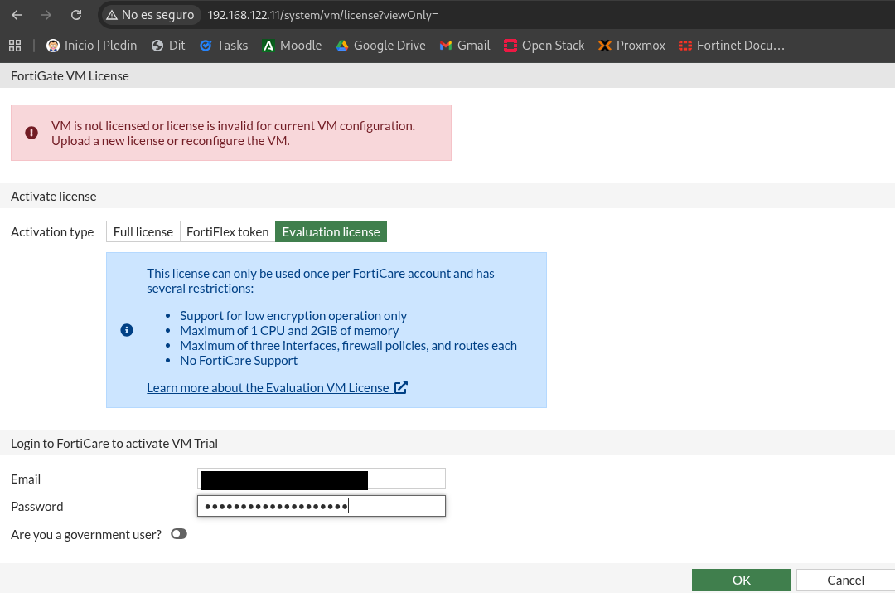

Tras indicar el lodin nos pedira que reiniciemos el firewall y ya tendremos lista la licencia,

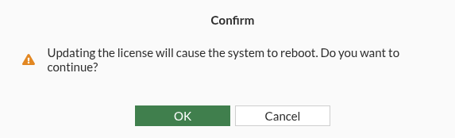

### Método 2

Para pedir la licencia por CLI tendremos que indicar nuestro correo y contraseña de Fortinet y tras indicar las credenciales ejecutaremos execute vm-license para que se nos aplique. Al ejecutar la licencia nos pedirá que reiniciemos el firewall y lo haremos.

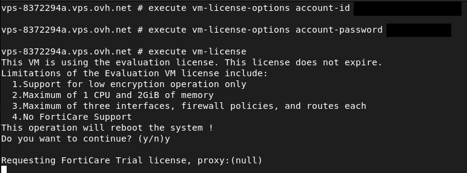

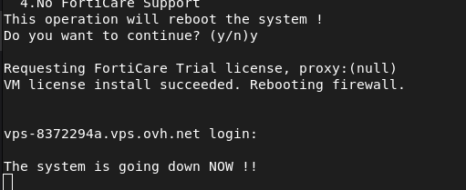

Tras el reinicio miraremos la nueva IP ya que está conectado al NAT y este dispositivo da direcciones por DHCP.

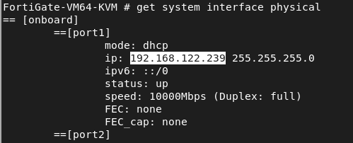

Tras hacer todo este proceso nos iremos a la interfaz web mediante la IP y nos sadrá una pantalla con el setup.

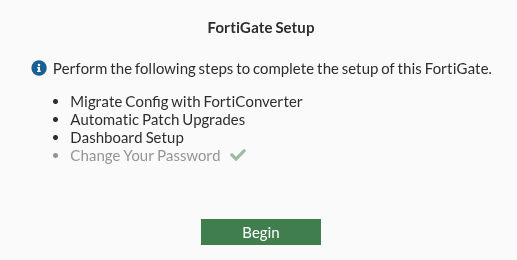

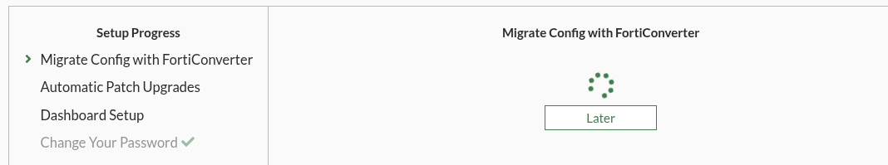

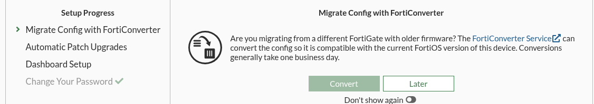

Esta configuración es para actualizar nuevos parches de seguridad yo lo he puesto por defecto que son 3 días.

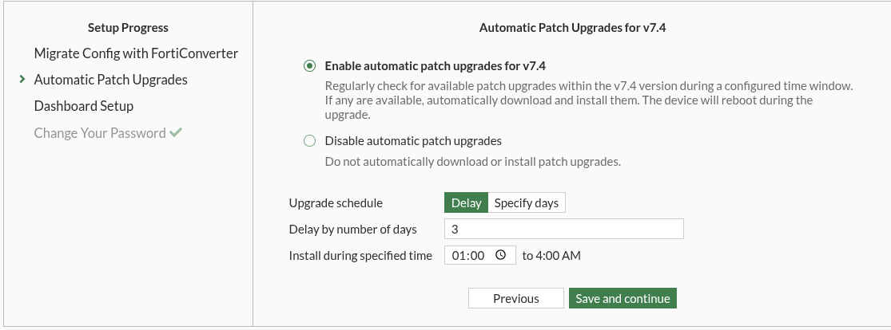

Le diremos que sí para los parches de seguridad.

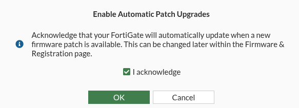

Y para la interfaz podemos elegir 2 opciones, la optimal que contiene todas las funcionalidades y la comprensiva que trae menos parámetros y es para los usuarios que están empezando con el sistema operativo de Fortinet.

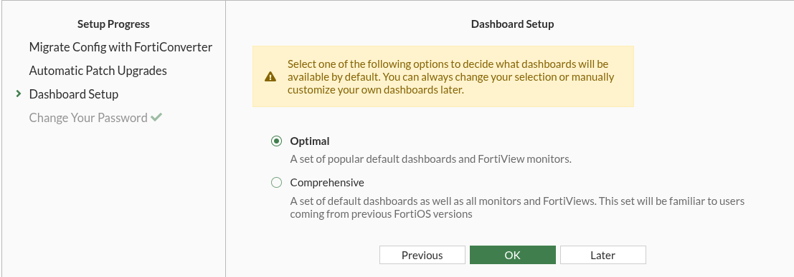

Una vez finalizada la configuración nos saldrá un vídeo de instroducción y lo saltamos.

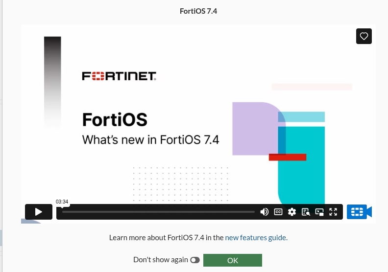

Y ya tendríamos el Fortigate correctamente desplegado para usarlo.

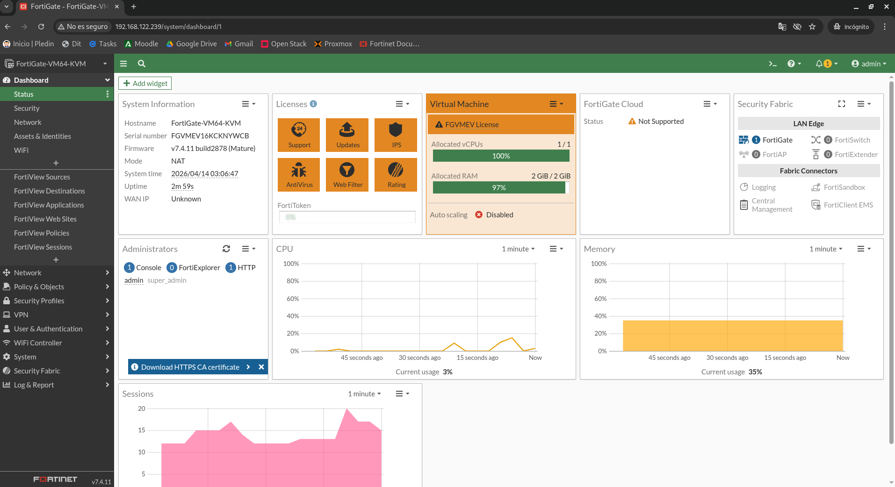

## Bibliografía

<https://docs.fortinet.com/document/fortigate/7.6.6/administration-guide/416169>

<https://docs.fortinet.com/document/fortigate/7.6.6/administration-guide/441460>

<https://espaciotecnologico.co/simular-un-firewall-fortigate-en-linux/>

<https://support.fortinet.com/Download/VMImages.aspx>

## 📎 Ficheros de la práctica

<details>
<summary><code>Comandos.txt</code></summary>

```bash
https://support.fortinet.com/Download/VMImages.aspx
https://espaciotecnologico.co/simular-un-firewall-fortigate-en-linux/#google_vignette
https://pressbooks.bccampus.ca/fortigatefirewall/back-matter/appendix/

-machine pc-i440fx-2.8
https://docs.fortinet.com/document/fortigate/latest/administration-guide/441460?
get system interface physical

execute vm-license-options account-id <tu-email>
execute vm-license-options account-password <tu-contraseña>
execute vm-license

get system dns

config system dns
set primary 8.8.8.8
set secondary 1.1.1.1
end


diagnose debug enable
diagnose debug application dnsproxy -1

config system interface
edit port1
set mode dhcp
next
end
get system interface physical

https://gns3.com/fortigate-evaluation-license-byp

execute vm-license-options account-id <tu-email>
execute vm-license-options account-password <tu-contraseña>
execute vm-license
```

</details>

