> 📚 **1º ASIR · Planificación y Administración de Redes** · Tema 5: Nivel de red · Curso 2025/2026

## Bit de forwarding

Antes de realizar ninguna configuración voy a activar el bit de forwarding para que la máquina reenvíe tráfico y se comporte como un router para ello en Debian 12 es el siguiente fichero de configuración y una vez que lo tengamos activado vamos a recargar la configuración con sudo sysctl -p. (Esta máquina es una plantilla que he realizado y a partir de esta las voy a ir duplicando)

<debian@debian>:~\$ sudo nano /etc/sysctl.conf

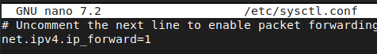

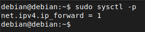

## Preparación escenario

Para preparar los servicios necesarios para el escenario voy a conectar a un switch una máquina que va a ser el nodo base a partir del cuál voy a ir duplicando máquinas y a dicho switch también hay un NAT conectado para tener salida a Internet y poder instalar paquetes.

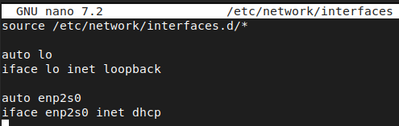

Tras poner una configuración por DHCP voy a reiniciar el servicio para recibir IP por DHCP.

debian@debian:~\$ sudo systemctl restart networking.service

Voy a realizar una actualización de los repositorios.

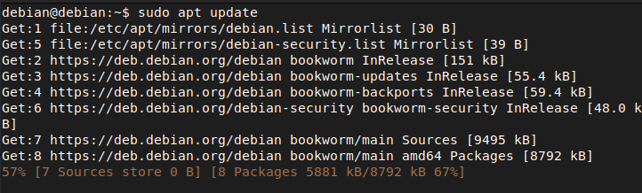

Y voy a instalar todos los servicios necesarios para este escenario. (Plantilla masculina).

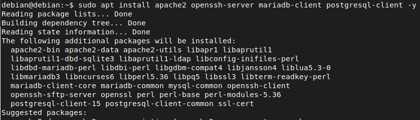

Para la plantilla femenina va a ser algo similar primeramente vamos a conectarlo a dicho switch para poder salir a Internet. (No lo voy a explicar el proceso ya que es lo mismo nuevamente).

debian@debian:~\$ sudo nano /etc/network/interfaces

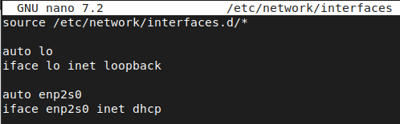

debian@debian:~\$ sudo systemctl restart networking.service

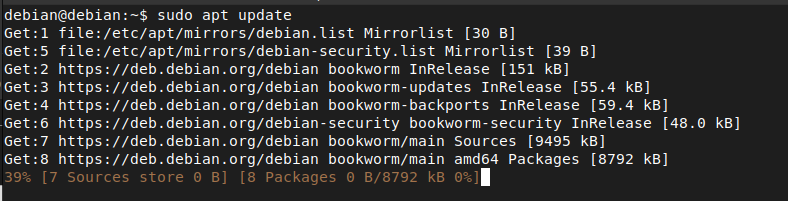

La instalación de MariaDB tiene dos pasos uno que es instalar este paquete y luego tiene un script de instalación para desplegar la base de datos.

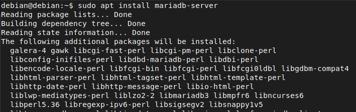

Ejecutamos el script de instalación de MariaDB.

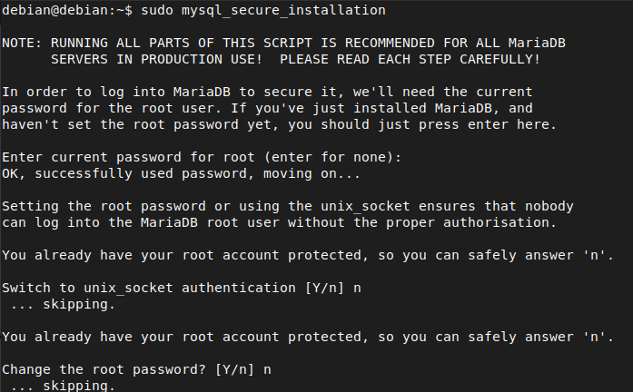

El acceso remoto de root lo voy a tener desactivado por motivos de seguridad.

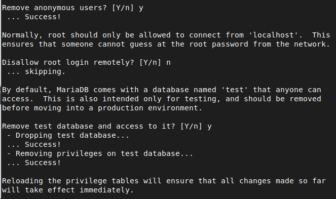

Y tras hacer esto recargamos los permisos delas tablas.

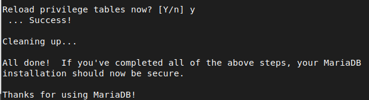

### Acceso remoto MariaDB

Para permitir el acceso remoto en MariaDB lo vamos a realizar mediante el siguiente fichero de configuración y en el bind address con la IP que tenemos vamos a permitir la conexión desde cualquier host.

debian@debian:~\$ sudo nano /etc/mysql/mariadb.conf.d/50-server.cnf

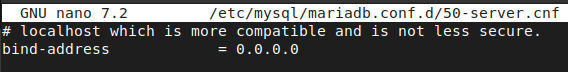

Y tras hacer este cambio vamos a reiniciar el servicio para que los cambios tengan efecto.

debian@debian:~\$ sudo systemctl restart mariadb.service

Una vez instalado voy a acceder a la base de datos como root.

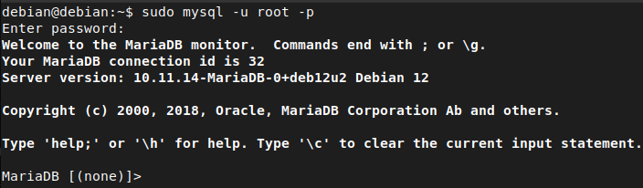

Una vez dentro voy a crear una base de datos de prueba para el escenario, y voy a crear un usuario poniendo % que esto indica que vamos a permitir la conexión con este usuario desde cualquier host y en mi caso le voy a dar todos los privilegios que esto no se recomienda en entornos de producción.

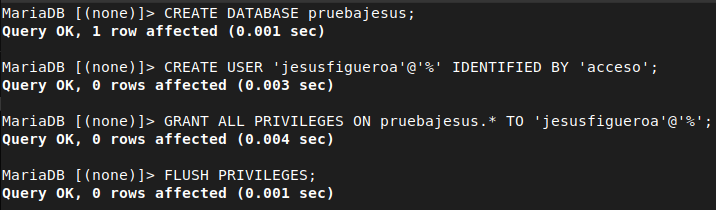

Una vez creado el usuario voy a acceder para meter tablas.

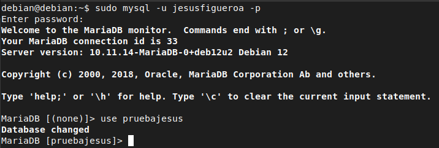

En mi caso he usado el script Scott.

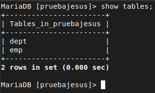

Para el distrito 13 voy a instalar el servidor PostgreSQL ya que ssh y apache ya están instalados porque es la plantilla femenina. (Más adelante le cambio el nombre a la máquina).

<debian@Thresh>:~\$ sudo apt install postgresql postgresql-contrib

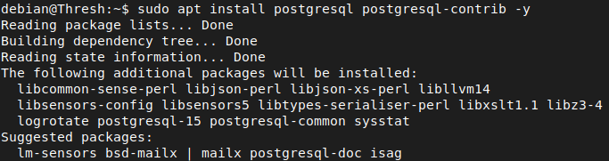

Cuando accedemos al usuario administrador de postgresql con la configuración por defecto que trae el paquete nos sale este error.

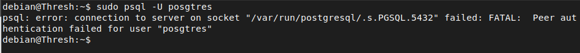

Para ello hay que editar el siguiente fichero de configuración y en el usuario postgres y en los demás podemos poner trust (no recomendado en entornos de producción ya que no pide contraseña) o también tenemos la opción de md5 que nos pide contraseña para el login.

debian@Thresh:~\$ sudo nano /etc/postgresql/15/main/pg_hba.conf

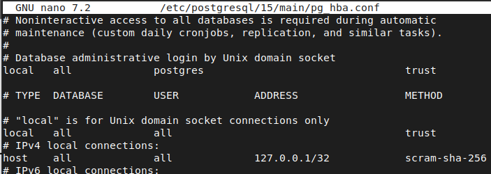

Tras hacer este cambio en el fichero y reiniciar el servicio ya podremos acceder con el usuario administrador de postgreSQL.

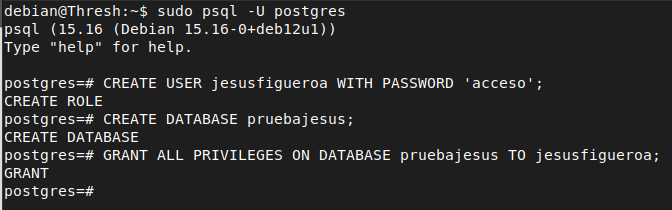

### Acceso remoto PostgreSQL

Para configurar el acceso remoto en PostgreSQL es mediante el siguiente fichero de configuración y las direcciones de escucha ponemos el asterisco para permitir conexiones desde cualquier host.

debian@Thresh:~\$ sudo nano /etc/postgresql/15/main/postgresql.conf

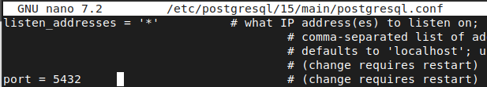

Y tras realizar este cambio reiniciamos el servicio para que los cambios tengan efecto.

debian@Thresh:~\$ sudo systemctl restart postgresql.service

Una vez que tenemos configurado el acceso remoto vamos a configurar el usuario remoto para ello mediante el siguiente fichero de configuración y voy a permitir conexiones desde cualquier host pero con acceso por contraseña. Esta métrica es la de método (md5).

debian@Thresh:~\$ sudo nano /etc/postgresql/15/main/pg_hba.conf

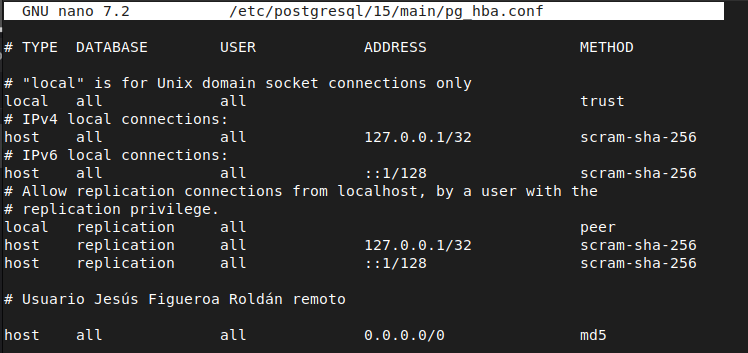

Una vez configurado el acceso remoto voy a introducir nuevamente el esquema scott pero por defecto en Debian 12 al introducir datos nos da este error. Básicamente es por tema de administración de permisos.

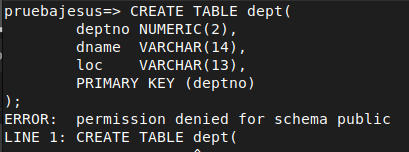

Para ello nos metemos en la base de datos que hemos creado pero con el usuario administrador y le vamos a dar permisos para que pueda insertar datos.

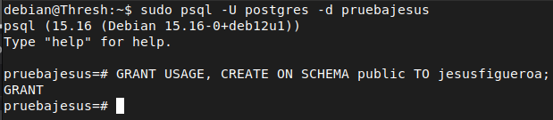

Tras realizar esto listamos las tablas y ya tenemos el esquema introducido.

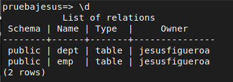

## Direccionamiento

Para configurar las interfaces simplemente es configurar cada IP con su máquina correspondiente y tras configurar el fichero de configuración reiniciar el servicio de red. (No voy a explicar este paso por cada máquina ya que siempre es el mismo proceso).

debian@Marvel:~\$ sudo nano /etc/network/interfaces

debian@Marvel:~\$ sudo systemctl restart networking.service

Marvel

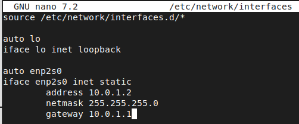

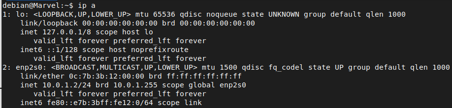

Glimmer

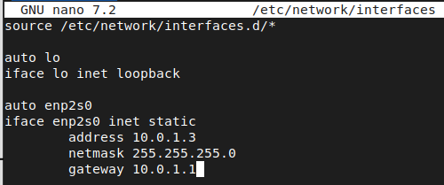

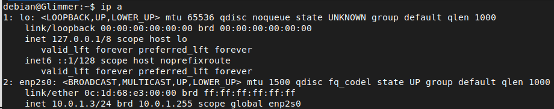

Thresh

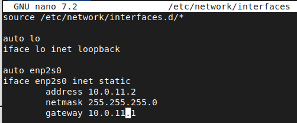

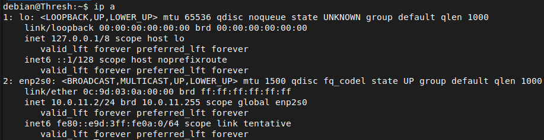

Rue

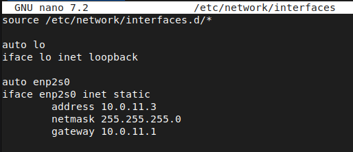

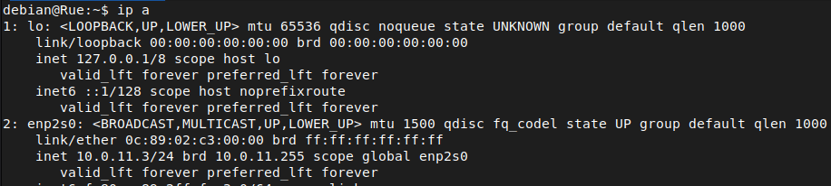

Cato

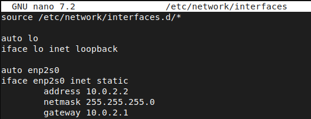

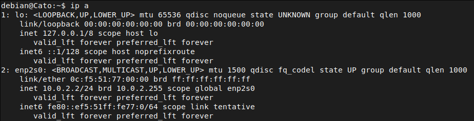

Clove

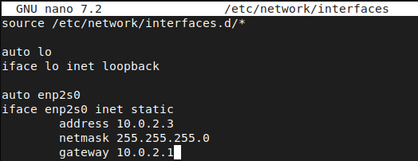

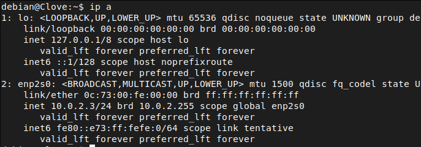

Peeta

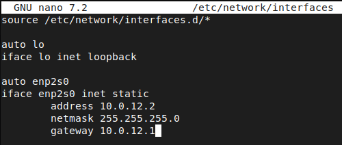

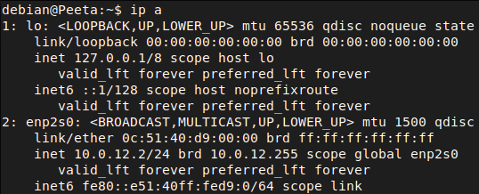

Katniss

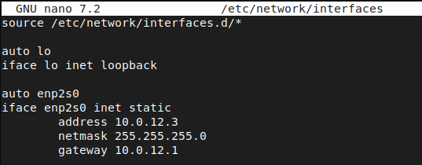

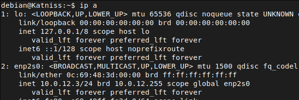

## Direccionamiento routers

R1

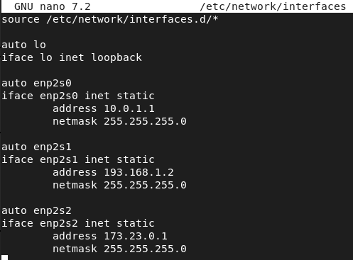

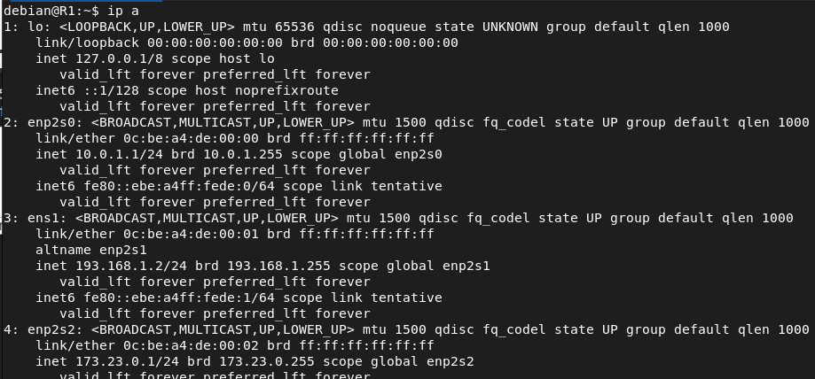

R2

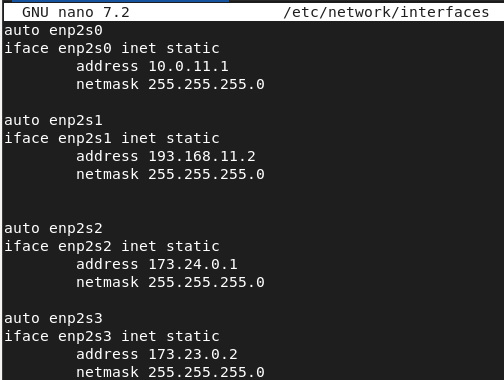

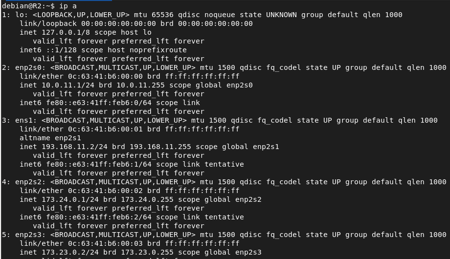

R3

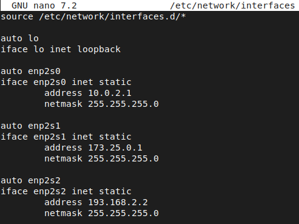

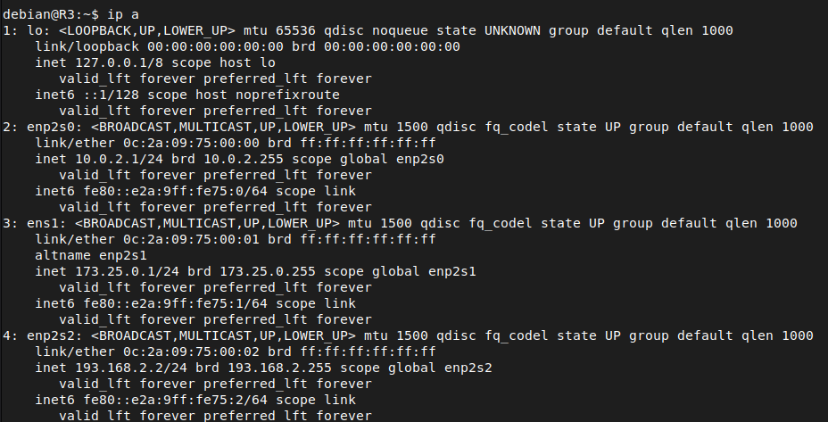

R4

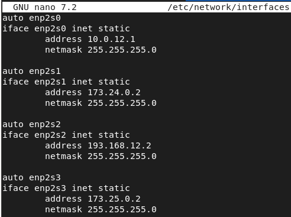

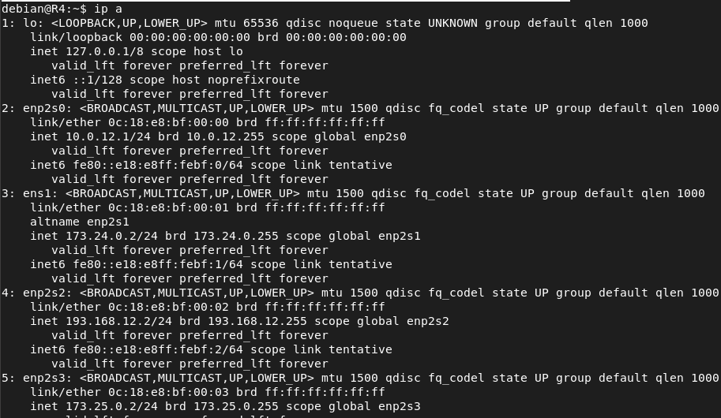

R5

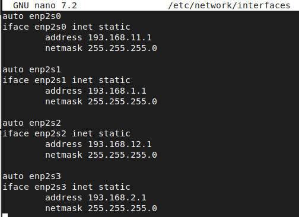


## Tablas de enrutamiento

R1


R2


R3


R4


R5


## Prueba conectividad

Para probar la efectividad de las tablas de enrutamiento simplemente desde R3 voy a realizar ping a las IPS públicas ya que son routers de Internet y no enrutan IPS privadas y además no está configurado el NAT.


## Persistencia tablas de enrutamiento (systemd)

Para hacer las tablas de enrutamiento persistentes voy a crear un servicio de systemd el cual va a ejecutar un script con todos las tablas de enrutamiento.

R1


R2


R3


R4


R5


## Reglas SNAT y DNAT persistentes

Para hacer las reglas iptables persistentes voy a crear un script con todas las reglas, las primeras líneas de este script va a borrar las reglas anteriores y reinicia los contadores de las matches. Una vez que tenga el script con todas las reglas creo un servicio de systemd para que el script se ejecute automáticamente. (Este proceso se va a repetir en todos los routers).

Para hacer SNAT simplemente añadimos la red de origen (-s) hacia que dirección IP va a ir “hacia fuera” (en caso de que fuesen IPS dinámicas se usaría MASQUERADE).

Para el caso de DNAT usaremos el destino y el puerto y en prerouting ya que si no al ver el router que tiene como IP destino su IP se queda con el paquete y no lo redirecciona al servidor.

R1

SNAT y DNAT


Servicio de systemd


R2


R3


R4


R5


## Comprobación NAT


DNAT

Etag Servidores Web

Para cuando hagamos un curl y sepamos que máquina me está respondiendo he configurado una métrica de apache para saber en todo momento que máquina me responde. Para ello hay que activar el etag y una vez activado voy a exportar una variable la cuál va a leer el hostname del sistema. Esta variable la voy a asignar a un fichero para que cuando hagamos un curl nos devuelva el nombre. (Este proceso lo voy a realizar en todos los servidores web).

Marvel


Una vez que reiniciemos el servicio si comprobamos hacer curl vemos como en el parámetro etag nos responde con el nombre de la máquina.


Thresh


Cato


Peeta


Servidor Web secreto (Distrito 13)


DNAT comprobación

En este punto voy a comprobar todos los servidores de todas las redes (OpenSSH Server, MariaDB, PostgreSQL y Apache2).

R1

SSH


ServidorWEB


MariaDB


R2


R3


R4


R5


## Política por defecto

Instalar iptables en cada uno de los routers Linux, estableciendo una política DROP por defecto para todas las cadenas. Toma las medidas necesarias para conservar el acceso a los routers por ssh y para que la configuración de iptables sea persistente. Demuestra que los cortafuegos han interrumpido todas las comunicaciones.

Voy a establecer en mi script de reglas la política por defecto para cortar todas las comunicaciones.

R1


R2


R3


R4


R5


## Permitir acceso por SSH

R1


R2


R3


R4


R5


Comprobación de como los cortafuegos han interrumpido todas las comunicaciones.


## Reglas de Firewall

### Regla a

a\) Los indigentes pueden acceder al servidor de bases de datos de los ricos.

Para que esto ocurra he contemplado dos posibles caminos uno que sería con R5 encendido y otro con R5 apagado. He usado el módulo state para asegurarme que no se inician conexiones nuevas al servidor solo las que ya han entablado una conexión previa.

#### Reglas


#### Funcionamiento

Para realizar la prueba de estas reglas he usado la dirección IP remota 193.168.1.2 porque es hacia la cuál mi enrutamiento sabe llegar según mis tablas de enrutamiento. Para comprobar el otro camino posible habría apagr R5 y cambiar las tablas de enrutamiento.


#### Matches

Tras realizar esta conexión al servidor vemos como los matches han subido con la regla que hemos implementado. En R2 los matches no han incrementado porque no hemos usado esa ruta.


### Regla b

b\) Los indigentes y los superpijos pueden acceder al servidor ssh existente en el distrito 13

En este regla solo hay un camino posible ya que si R5 se apaga, la LAN que tiene conectada a el donde están los diferentes servidores ya no estaría.

#### Reglas


#### Funcionamiento

Una vez implementada las reglas voy a realizar la conexión desde los indigentes y los superpijos para comprobar que ambas cosas funcionan.

Indigentes

Como vemos tras realizar SSH accedemos al servidor de la red interna de R5 que es el servidor secreto.


Superpijos


#### Matches

Tras conectarnos vemos como los matches asociado a esas reglas han incrementado.


### Regla c

c\) Los pobres pueden acceder al servidor web de Thresh, pero solo de 08 a 15 horas.

Para esta regla hay que implementar un cortafuegos de nodo ya que cuando los pobres intenten acceder al servidor web de Thresh ese mensaje pasa por el switch pero no llega al router porque ya están en la red interna. Por lo tanto hay que implementar un cortafuegos de nodo en Thresh.

#### Reglas

Para ello las primeras líneas del script es establecer una política DROP por defecto, la cadena de FORWARD no la he establecido por defecto ya que no tiene sentido porque está máquina no tiene el bit de forwarding es decir no reenvía paquetes si el destinatario no es él. Para controlar las horas voy a usar el módulo time indicando fecha de inicio y fin.


Tras crear el script con las reglas necesarias voy a seguir el mismo procedimiento que anteriormente. Damos permisos de ejecución a dicho script.


Y voy a crear un servicio de systemd para que el script de las reglas se ejecute automáticamente y además sea persistente (tanbién se puede con iptables-persistant).


Tras crear el servicio voy a recargar la lista de servicios disponibles y lo voy a hacer persistente en el arranque del sistema y también lo voy a iniciar.


#### Funcionamiento

Tras implementar estas reglas si desde una máquina de los pobres hacemos un curl fuera del rango horario que hemos definido en las reglas no vamos a poder acceder.


#### Matches

Vemos como no está haciendo match con ninguna regla por lo que la política por defecto drop tira el paquete.


Si probamos a realizar un curl dentro del rango horario vamos a poder realizarlo.


Aquí vemos como si ha hecho match con la regla que hemos implementado.


### Regla d

d\) Clover puede acceder a los servidores de los superpijos, excepto al ssh.

Para esta regla nuevamente he contemplado con R4 apagado y con R5 encendido. Pero como he comentado anteriormente siguiendo mis tablas de enrutamiento el camino más corto es por R5 por lo que para comprobar dichas reglas con R5 apagado habría que cambiar las tablas de enrutamiento. Hay que permitir el servidor web y el servidor de base de datos (MariaDB).

#### Reglas


#### Funcionamiento

Tras implementar las reglas voy a realizar la comprobación que puedo acceder a los diferentes servicios desde Clove.


#### Matches

Una vez comprobada la efectividad de las reglas vemos como los matches han incrementado (R2 y R4 no tienen matches ya que mi enrutamiento coge el camino más corto por R5).


### Regla e

e\) Marvel decide que Peeta pueda entrar en su servidor web, que recibe peticiones por el puerto 8080 en lugar de por el 80 para mayor seguridad.

Para ello lo que primero vamos a realizar es configurar el servidor web para que escuche en el puerto 8080 para ello editamos el siguiente fichero de configuración:

debian@Marvel:~\$ sudo nano /etc/apache2/ports.conf


También habrá que editar el siguiente fichero de configuración e indicarle el puerto 8080 ya que si lo dejamos este fichero con el puerto 80 el servidor no va a saber que página html servirle al cliente. Gracias a este fichero de configuración podemos tener varios sitios web mediante los virtual hosts.

debian@Marvel:~\$ sudo nano /etc/apache2/sites-available/000-default.conf


Una vez hecho los cambios voy a reiniciar el servicio para que tengan efecto en el servicio.


#### Reglas


Al cambiar el puerto de escucha del servidor web también hay que cambiar la regla de DNAT ya que ahora mismo esta en el puerto 80 y habría que cambiarla por el puerto 8080 para que el router redireccione la petición mediante ese puerto. También habría que cambiar el puerto en las reglas que permiten el tráfico hacia este servidor, en todos los routers que tengan reglas hacia este servidor y simplemente cambiamos el puerto 80 por el 8080.


#### Funcionamiento

Como el servidor está escuchando en el puerto 8080 al hacer la petición hay que indicarle ese puerto ya que no es el puerto por defecto.


#### Matches


### Regla f

f\) Se ha producido una fuga de información militar de la base de datos del distrito 13. Los pijos han conseguido acceder al servidor Postgres y realizar una consulta a la tabla Misiles. Añade las reglas necesarias para realizar dicho acceso y muestra el momento de la consulta de la información.

Para realizar esta consulta de carácter militar he añadido una tabla en la base de datos del distrito 13. Cabe destacar que en este punto podemos añadir reglas para que se pueda acceder desde las 4 interfaces posibles de R5 pero yo bajo mi punto de visto no lo veo seguro ya que el punto de ataque es más grande por lo que yo he añadido las reglas necesarias para que los pijos puedan acceder a la base de datos del distrito 13 desde la IP más cercana. También si añadimos las reglas que he comentado anteriormente no sería lo más efectivo ya que tal y como está el escenario montado los pijos está pegado a R5 por lo que no tiene sentido dar la vuelva a todo el escenario cuando ya el router está al lado.


#### Reglas


#### Funcionamiento

Aquí vemos el momento de la consulta (fuga militar).


#### Matches


### Regla g

g\) Katniss ha conseguido incorporar reglas que le permiten (solo a ella) acceder a todos los servidores ssh de todos los distritos. Una vez dentro de ellos puede acceder a los servidores de bases de datos, al haber conseguido infiltrarse en esas redes. Demuestra que puede hacerlo.

Primero voy a añadir las reglas que permiten el acceso a SSH desde Katniss a todas las redes y después comprobaremos como nos conectamos por SSH y estando en la red interna nos conectamos al servidor de base de datos. Para esto solo hace falta añadir las reglas de SSH ya que una vez que estamos en la red interna para acceder a la base de datos, ese mensaje no llega al router, simplemente llega al switch y el switch lo envía al servidor por lo que podríamos de alguna manera aprovechar esta regla como posibles ataques.

R4 a R2


R4 a R3


R4 a R5


#### Reglas


#### Matches


#### Funcionamiento

Una vez implementada las reglas voy a probar a conectarme a cada servidor ssh de cada red para posteriormente conectarme a la base de datos de la red interna.


Ya que en Thresh anteriormente configuramos un cortafuegos de nodo y tiene una política DROP por defecto hay que configurar esta máquina para que reciba las peticiones y mande respuesta el servidor de base de datos el cuál tiene un cortafuegos de nodo, para ello usamos input ya que es un mensaje que le llega a él (petición) y output el mensaje que manda al aceptar la conexión (respuesta).


Una vez implementado ya podremos conectarnos al servidor de base de datos.


### Regla h

h\) Los superpijos han planeado un ataque de denegación de servicios saturando de peticiones el servidor Postgres del distrito 13, configura el cortafuegos del R5 para rechazar el ataque, demostrando la eficacia de dicha defensa.

Actualmente con las reglas que tenemos los superpijos no pueden acceder al servidor de base de datos del distrito 13 por lo que primero voy a añadir las reglas para que esto sea posible.


Matches


Una vez que tenemos configurado el acceso normal vamos a proceder a evitar un ataque de denegación de servicios.

R5

Primero estas reglas las vamos a borrar porque vamos a sustituir añadiendo un módulo de iptables para limitar las conexiones.


Añadimos un módulo en el cual solo vamos a permitir una conexión simultánea y uso reject porque he estado realizando pruebas y corta más rápido el tráfico que DROP. Estas reglas las tenemos que añadir al principio ya que si llega a la regla con la que hace la conexión no va a seguir leyendo las reglas por lo que primero tienen que estar dichas reglas para que no haga la conexión con la regla sin el módulo de connlimit.


Una vez tenemos configuradas las reglas voy a proceder con el ataque de denegación de servicios para ello antes de nada para no tener que indicar cada conexión la contraseña he creado un fichero que tiene que tener el siguiente formato:  
IP:puerto:basededatos:usuario:contraseña

<debian@debian>:~\$ echo "193.168.1.1:5432:pruebajesus:jesusfigueroa:acceso" \> ~/.pgpass

Tendrá que tener permisos de lectura y escritura solo para el usuario.


Y una vez que tenemos la contraseña en un fichero podemos proceder al ataque. Este comando genera 10000 iteracciones, ejecutando hasta 50 procesos en paralelo.

seq 10000 \| xargs -P 50 -I{} psql -h 193.168.1.1 -U jesusfigueroa -d distrito13 -c "SELECT 1;"

Una vez ejecutado el ataque voy a ir monitorizando cada segundo los matches de las reglas que he añadido para prevenir este ataque.

watch -n1 sudo iptables -L FORWARD -n -v --line-numbers

Como vemos ahí tenemos los matches que están bloqueando el ataque.


Y simultáneamente si probamos a acceder podemos acceder sin problema.


## Servidor DHCP

5\. Configurar el servicio DHCP que tenían los superpijos en las mismas condiciones que tenían cuando se usaban routers CISCO. Comprueba que siguen funcionando las reglas d), e), g) y h)

He configurado el servidor DHCP de R1 en las mismas condiciones que los routers Cisco.


Para que cuando implemente el servidor DHCP y esté funcionando y no haya problemas con las direcciones IP de los servidores voy a reservar la IP del gateway de la red interna, y además la dirección IP de ambos servidores de la red. Ya que si no reservamos la IP va a estar constantemente cambiado y además habría que ir cambiado las reglas de DNAT por lo que es mucho más cómodo reservar IPS para los servidores de nuestra red.


Una vez que tenemos la configuración vamos a definir la interfaz hacia “fuera” que va a dar direcciones IPS el servidor DHCP.


Tras realizar todos estos cambios voy a reiniciar el servicio y lo voy a hacer persistente en el arranque.


Para que el tráfico DHCP llegue al router hay que añadir estas dos reglas.


Una vez implementado el servidor DHCP voy a configurar Marvel y Glimmer para que reciban IP por DHCP.


Comprobación reglas

Tras implementar el servidor DHCP en R1 no vamos a tener ningun problema con las reglas ya que he realizado la reserva de la IP de los servidores que hay en dicha red.

d\)


Matches


e\)


Matches


g\)


Matches


h\)


Matches


## Bibliografía

<https://docs.redhat.com/es/documentation/red_hat_enterprise_linux/6/html/security_guide/sect-security_guide-firewalls-using_iptables>

<https://plataforma.josedomingo.org/pledin/cursos/mv2006/files/IPtables_pello.pdf>

<https://sysadblog.onrender.com/posts/ejercicio1_cortafuegos_personal_iptables/>

<https://www.ibm.com/docs/es/qsip/7.5.0?topic=tasks-advanced-iptables-rules-examples>

<https://rincondelsistema.home.blog/2021/02/26/configuracion-iptables/>

## 📎 Ficheros de la práctica

<details>
<summary><code>Enrutamiento/Enrutamiento.txt</code></summary>

```bash
172.23.0.0 
172.24.0.0
172.25.0.0
193.168.1.0
193.168.2.0
193.168.11.0
193.168.12.0

R1

sudo ip route add 172.24.0.0/24 via 173.23.0.2 dev enp2s2
sudo ip route add 172.25.0.0/24 via 173.23.0.2 dev enp2s2
sudo ip route add default via 193.168.1.1

R2

sudo ip route add 193.168.1.0/24 via 173.23.0.1
sudo ip route add default via 173.24.0.2

R3
 
sudo ip route add 172.24.0.0/24 via 173.25.0.2 dev enp2s1
sudo ip route add default via 193.168.2.1

R4

sudo ip route add 172.23.0.0/24 via 173.24.0.1 dev enp2s1 
sudo ip route add 193.168.11.0/24 via 173.24.0.1 dev enp2s1
sudo ip route add default via 193.168.12.1

R5

sudo ip route add 173.23.0.0/24 via 193.168.1.2 dev enp2s1
sudo ip route add 173.24.0.0/24 via 193.168.11.2 dev enp2s0
sudo ip route add 173.25.0.0/24 via 193.168.2.2 dev enp2s3


Persistencia

sudo nano /etc/systemd/system/rutas-estaticas.service

[Unit]
Description=rutas estáticas Jesús Figueroa Roldán
After=network.target

[Service]
Type=oneshot
ExecStart=/usr/local/bin/rutas.sh
RemainAfterExit=yes
TimeoutStartSec=15

[Install]
WantedBy=multi-user.target

sudo nano /usr/local/bin/rutas.sh

#!/usr/bin/env bash

# Rutas estáticas Jesús Figueroa Roldán

sleep 5

sudo chmod +x /usr/local/bin/rutas.sh

sudo systemctl daemon-reload
sudo systemctl enable rutas-estaticas.service
sudo systemctl start rutas-estaticas.service
```

</details>

<details>
<summary><code>Enrutamiento/Servicio systemd.txt</code></summary>

```bash
sudo nano /usr/local/bin/iptables.sh

sudo chmod +x /usr/local/bin/iptables.sh

sudo nano /etc/systemd/system/iptables-persis.service


[Unit]
Description=iptables persistente Jesús Figueroa Roldán
After=network-pre.target
Before=network.target
Wants=network-pre.target

[Service]
Type=oneshot
ExecStart=/usr/local/bin/iptables.sh
RemainAfterExit=yes

[Install]
WantedBy=multi-user.target


sudo systemctl daemon-reload
sudo systemctl enable iptables-persis.service
sudo systemctl start iptables-persis.service
```

</details>

<details>
<summary><code>NAT/DNAT.txt</code></summary>

```bash
R1

DNAT

# Servidor web

sudo iptables -t nat -A PREROUTING -p tcp --dport 80 -d 173.23.0.1 -j DNAT --to 10.0.1.2
sudo iptables -t nat -A PREROUTING -p tcp --dport 80 -d 193.168.1.2 -j DNAT --to 10.0.1.2

# Servidor SSH

sudo iptables -t nat -A PREROUTING -p tcp --dport 22 -d 173.23.0.1 -j DNAT --to 10.0.1.2
sudo iptables -t nat -A PREROUTING -p tcp --dport 22 -d 193.168.1.2 -j DNAT --to 10.0.1.2

# Servidor MariaDB

sudo iptables -t nat -A PREROUTING -p tcp --dport 3306 -d 173.23.0.1 -j DNAT --to 10.0.1.3
sudo iptables -t nat -A PREROUTING -p tcp --dport 3306 -d 193.168.1.2 -j DNAT --to 10.0.1.3

R2

DNAT

# Servidor web

sudo iptables -t nat -A PREROUTING -p tcp --dport 80 -d 173.23.0.2 -j DNAT --to 10.0.11.2
sudo iptables -t nat -A PREROUTING -p tcp --dport 80 -d 193.168.11.2 -j DNAT --to 10.0.11.2
sudo iptables -t nat -A PREROUTING -p tcp --dport 80 -d 173.24.0.1 -j DNAT --to 10.0.11.2

# Servidor SSH

sudo iptables -t nat -A PREROUTING -p tcp --dport 22 -d 173.23.0.2 -j DNAT --to 10.0.11.2
sudo iptables -t nat -A PREROUTING -p tcp --dport 22 -d 193.168.11.2 -j DNAT --to 10.0.11.2
sudo iptables -t nat -A PREROUTING -p tcp --dport 22 -d 173.24.0.1 -j DNAT --to 10.0.11.2

# Servidor MariaDB

sudo iptables -t nat -A PREROUTING -p tcp --dport 3306 -d 173.23.0.2 -j DNAT --to 10.0.11.3
sudo iptables -t nat -A PREROUTING -p tcp --dport 3306 -d 193.168.11.2 -j DNAT --to 10.0.11.3
sudo iptables -t nat -A PREROUTING -p tcp --dport 3306 -d 173.24.0.1 -j DNAT --to 10.0.11.3

R3

DNAT

# Servidor web

sudo iptables -t nat -A PREROUTING -p tcp --dport 80 -d 173.25.0.1 -j DNAT --to 10.0.2.2
sudo iptables -t nat -A PREROUTING -p tcp --dport 80 -d 193.168.2.2 -j DNAT --to 10.0.2.2

# Servidor SSH

sudo iptables -t nat -A PREROUTING -p tcp --dport 22 -d 173.25.0.1 -j DNAT --to 10.0.2.2
sudo iptables -t nat -A PREROUTING -p tcp --dport 22 -d 193.168.2.2 -j DNAT --to 10.0.2.2

# Servidor MariaDB

sudo iptables -t nat -A PREROUTING -p tcp --dport 3306 -d 173.25.0.1 -j DNAT --to 10.0.2.3
sudo iptables -t nat -A PREROUTING -p tcp --dport 3306 -d 193.168.2.2 -j DNAT --to 10.0.2.3

R4

DNAT

# Servidor web

sudo iptables -t nat -A PREROUTING -p tcp --dport 80 -d 173.24.0.2 -j DNAT --to 10.0.12.2
sudo iptables -t nat -A PREROUTING -p tcp --dport 80 -d 193.168.12.2 -j DNAT --to 10.0.12.2
sudo iptables -t nat -A PREROUTING -p tcp --dport 80 -d 173.25.0.2 -j DNAT --to 10.0.12.2

# Servidor SSH

sudo iptables -t nat -A PREROUTING -p tcp --dport 22 -d 173.24.0.2 -j DNAT --to 10.0.12.2
sudo iptables -t nat -A PREROUTING -p tcp --dport 22 -d 193.168.12.2 -j DNAT --to 10.0.12.2
sudo iptables -t nat -A PREROUTING -p tcp --dport 22 -d 173.25.0.2 -j DNAT --to 10.0.12.2

# Servidor MariaDB

sudo iptables -t nat -A PREROUTING -p tcp --dport 3306 -d 173.24.0.2 -j DNAT --to 10.0.12.3
sudo iptables -t nat -A PREROUTING -p tcp --dport 3306 -d 193.168.12.2 -j DNAT --to 10.0.12.3
sudo iptables -t nat -A PREROUTING -p tcp --dport 3306 -d 173.25.0.2 -j DNAT --to 10.0.12.3

R5

DNAT

# Servidor SSH

sudo iptables -t nat -A PREROUTING -p tcp --dport 22 -d 193.168.1.1 -j DNAT --to 10.0.13.2
sudo iptables -t nat -A PREROUTING -p tcp --dport 22 -d 193.168.11.1 -j DNAT --to 10.0.13.2
sudo iptables -t nat -A PREROUTING -p tcp --dport 22 -d 193.168.12.1 -j DNAT --to 10.0.13.2
sudo iptables -t nat -A PREROUTING -p tcp --dport 22 -d 193.168.12.1 -j DNAT --to 10.0.13.2

# Servidor PostgreSQL

sudo iptables -t nat -A PREROUTING -p tcp --dport 5432 -d 193.168.1.1 -j DNAT --to 10.0.13.2
sudo iptables -t nat -A PREROUTING -p tcp --dport 5432 -d 193.168.11.1 -j DNAT --to 10.0.13.2
sudo iptables -t nat -A PREROUTING -p tcp --dport 5432 -d 193.168.12.1 -j DNAT --to 10.0.13.2
sudo iptables -t nat -A PREROUTING -p tcp --dport 5432 -d 193.168.12.1 -j DNAT --to 10.0.13.2

# Servidor web

sudo iptables -t nat -A PREROUTING -p tcp --dport 80 -d 193.168.1.1 -j DNAT --to 10.0.13.2
sudo iptables -t nat -A PREROUTING -p tcp --dport 80 -d 193.168.11.1 -j DNAT --to 10.0.13.2
sudo iptables -t nat -A PREROUTING -p tcp --dport 80 -d 193.168.12.1 -j DNAT --to 10.0.13.2
sudo iptables -t nat -A PREROUTING -p tcp --dport 80 -d 193.168.2.1 -j DNAT --to 10.0.13.2
```

</details>

<details>
<summary><code>NAT/SNAT.txt</code></summary>

```bash
R1

SNAT

sudo iptables -t nat -A POSTROUTING -s 10.0.1.0/24 -o ens1 -j SNAT --to 193.168.1.2
sudo iptables -t nat -A POSTROUTING -s 10.0.1.0/24 -o enp2s2 -j SNAT --to 173.23.0.1

R2

SNAT

sudo iptables -t nat -A POSTROUTING -s 10.0.11.0/24 -o ens1 -j SNAT --to 193.168.11.2
sudo iptables -t nat -A POSTROUTING -s 10.0.11.0/24 -o enp2s3 -j SNAT --to 173.23.0.2
sudo iptables -t nat -A POSTROUTING -s 10.0.11.0/24 -o enp2s2 -j SNAT --to 173.24.0.1

R3

SNAT

sudo iptables -t nat -A POSTROUTING -s 10.0.2.0/24 -o ens1 -j SNAT --to-source 173.25.0.1
sudo iptables -t nat -A POSTROUTING -s 10.0.2.0/24 -o enp2s2 -j SNAT --to-source 193.168.2.2

R4

SNAT

sudo iptables -t nat -A POSTROUTING -s 10.0.12.0/24 -o ens1 -j SNAT --to-source 173.24.0.2
sudo iptables -t nat -A POSTROUTING -s 10.0.12.0/24 -o enp2s2 -j SNAT --to-source 193.168.12.2
sudo iptables -t nat -A POSTROUTING -s 10.0.12.0/24 -o enp2s3 -j SNAT --to-source 173.25.0.2

R5

SNAT

sudo iptables -t nat -A POSTROUTING -s 10.0.13.0/24 -o enp2s0 -j SNAT --to-source 193.168.11.1
sudo iptables -t nat -A POSTROUTING -s 10.0.13.0/24 -o ens1 -j SNAT --to-source 193.168.1.1
sudo iptables -t nat -A POSTROUTING -s 10.0.13.0/24 -o enp2s2 -j SNAT --to-source 193.168.12.1
sudo iptables -t nat -A POSTROUTING -s 10.0.13.0/24 -o enp2s3 -j SNAT --to-source 193.168.2.1
```

</details>

<details>
<summary><code>Reglas iptables finales/Cortafuegos.txt</code></summary>

```bash
a)

R4

# Petición

sudo iptables -A FORWARD -s 10.0.12.0/24 -d 193.168.1.2 -p tcp --dport 3306 -m state --state NEW,ESTABLISHED -j ACCEPT
sudo iptables -A FORWARD -s 10.0.12.0/24 -d 173.23.0.1 -p tcp --dport 3306 -m state --state NEW,ESTABLISHED -j ACCEPT

# Respuesta

sudo iptables -A FORWARD -s 193.168.1.2 -d 10.0.12.0/24 -p tcp --sport 3306 -m state --state ESTABLISHED -j ACCEPT
sudo iptables -A FORWARD -s 173.23.0.1 -d 10.0.12.0/24 -p tcp --sport 3306 -m state --state ESTABLISHED -j ACCEPT 

R5

# Petición

sudo iptables -A FORWARD -s 193.168.12.2 -d 193.168.1.2 -p tcp --dport 3306 -m state --state NEW,ESTABLISHED -j ACCEPT

# Respuesta

sudo iptables -A FORWARD -s 193.168.1.2 -d 193.168.12.2 -p tcp --sport 3306 -m state --state ESTABLISHED -j ACCEPT 

R1

# Petición

sudo iptables -A FORWARD -s 173.24.0.2 -d 10.0.1.3 -p tcp --dport 3306 -m state --state NEW,ESTABLISHED -j ACCEPT
sudo iptables -A FORWARD -s 193.168.12.2 -d 10.0.1.3 -p tcp --dport 3306 -m state --state NEW,ESTABLISHED -j ACCEPT

# Respuesta 

sudo iptables -A FORWARD -s 10.0.1.3 -d 173.24.0.2 -p tcp --sport 3306 -m state --state ESTABLISHED -j ACCEPT
sudo iptables -A FORWARD -s 10.0.1.3 -d 193.168.12.2 -p tcp --sport 3306 -m state --state ESTABLISHED -j ACCEPT 

R2

# Petición

sudo iptables -A FORWARD -s 173.24.0.2 -d 173.23.0.1 -p tcp --dport 3306 -m state --state NEW,ESTABLISHED -j ACCEPT

# Respuesta

sudo iptables -A FORWARD -s 173.23.0.1 -d 173.24.0.2 -p tcp --sport 3306 -m state --state ESTABLISHED -j ACCEPT

b) Los indigentes y los superpijos pueden acceder al servidor ssh existente en el distrito 13

R4

# Petición

sudo iptables -A FORWARD -s 10.0.12.0/24 -d 193.168.12.1 -p tcp --dport 22 -m state --state NEW,ESTABLISHED -j ACCEPT

# Respuesta 

sudo iptables -A FORWARD -s 193.168.12.1 -d 10.0.12.0/24 -p tcp --sport 22 -m state --state ESTABLISHED -j ACCEPT

R5

# Petición indigentes

sudo iptables -A FORWARD -s 193.168.12.1 -d 10.0.13.2 -p tcp --dport 22 -m state --state NEW,ESTABLISHED -j ACCEPT

# Respuesta indigentes

sudo iptables -A FORWARD -d 10.0.13.2 -d 193.168.12.2 -p tcp --sport 22 -m state --state ESTABLISHED -j ACCEPT

# Petición superpijos

sudo iptables -A FORWARD -s 193.168.1.1 -d 10.0.13.2 -p tcp --dport 22 -m state --state NEW,ESTABLISHED -j ACCEPT

# Respuesta superpijos

sudo iptables -A FORWARD -s 10.0.13.2 -d 193.168.1.2 -p tcp --sport 22 -m state --state ESTABLISHED -j ACCEPT

R1

# Petición

sudo iptables -A FORWARD -s 10.0.1.0/24 -d 193.168.1.1 -p tcp --dport 22 -m state --state NEW,ESTABLISHED -j ACCEPT

# Respuesta

sudo iptables -A FORWARD -s 193.168.1.1 -d 10.0.1.0/24 -p tcp --sport 22 -m state --state ESTABLISHED -j ACCEPT

d) Clover puede acceder a los servidores de los superpijos, excepto al ssh.

R3

# Petición (por R5)

sudo iptables -A FORWARD -s 10.0.2.3 -d 193.168.1.2 -p tcp --dport 3306 -m state --state NEW,ESTABLISHED -j ACCEPT
sudo iptables -A FORWARD -s 10.0.2.3 -d 193.168.1.2 -p tcp --dport 80 -m state --state NEW,ESTABLISHED -j ACCEPT

# Respuesta (por R5)

sudo iptables -A FORWARD -s 193.168.1.2 -d 10.0.2.3 -p tcp --sport 3306 -m state --state ESTABLISHED -j ACCEPT
sudo iptables -A FORWARD -s 193.168.1.2 -d 10.0.2.3 -p tcp --sport 80 -m state --state ESTABLISHED -j ACCEPT

# Petición (sin R5)

sudo iptables -A FORWARD -s 10.0.2.3 -d 173.23.0.1 -p tcp --dport 3306 -m state --state NEW,ESTABLISHED -j ACCEPT
sudo iptables -A FORWARD -s 10.0.2.3 -d 173.23.0.1 -p tcp --dport 80 -m state --state NEW,ESTABLISHED -j ACCEPT

# Respuesta (sin R5)

sudo iptables -A FORWARD -s 173.23.0.1 -d 10.0.2.3 -p tcp --sport 3306 -m state --state ESTABLISHED -j ACCEPT
sudo iptables -A FORWARD -s 173.23.0.1 -d 10.0.2.3 -p tcp --sport 80 -m state --state ESTABLISHED -j ACCEPT

R5

# Petición

sudo iptables -A FORWARD -s 193.168.2.2 -d 193.168.1.2 -p tcp --dport 3306 -m state --state NEW,ESTABLISHED -j ACCEPT
sudo iptables -A FORWARD -s 193.168.2.2 -d 193.168.1.2 -p tcp --dport 80 -m state --state NEW,ESTABLISHED -j ACCEPT

# Respuesta

sudo iptables -A FORWARD -s 193.168.1.2 -d 193.168.2.2 -p tcp --sport 3306 -m state --state NEW,ESTABLISHED -j ACCEPT
sudo iptables -A FORWARD -s 193.168.1.2 -d 193.168.2.2 -p tcp --sport 80 -m state --state NEW,ESTABLISHED -j ACCEPT

R1

# Petición

sudo iptables -A FORWARD -s 193.168.2.2 -p tcp --dport 3306 -m state --state NEW,ESTABLISHED -j ACCEPT
sudo iptables -A FORWARD -s 193.168.2.2 -p tcp --dport 80 -m state --state NEW,ESTABLISHED -j ACCEPT
sudo iptables -A FORWARD -s 173.25.0.1 -p tcp --dport 3306 -m state --state NEW,ESTABLISHED -j ACCEPT
sudo iptables -A FORWARD -s 173.25.0.1 -p tcp --dport 80 -m state --state NEW,ESTABLISHED -j ACCEPT

# Respuesta

sudo iptables -A FORWARD -s 10.0.1.3 -d 193.168.2.2 -p tcp --sport 3306 -m state --state ESTABLISHED -j ACCEPT
sudo iptables -A FORWARD -s 10.0.1.3 -d 193.168.2.2 -p tcp --sport 80 -m state --state ESTABLISHED -j ACCEPT
sudo iptables -A FORWARD -s 10.0.1.2 -d 173.25.0.1 -p tcp --sport 3306 -m state --state ESTABLISHED -j ACCEPT
sudo iptables -A FORWARD -s 10.0.1.2 -d 173.25.0.1 -p tcp --sport 80 -m state --state ESTABLISHED -j ACCEPT


Con R5 off

R4

sudo iptables -A FORWARD -s 173.25.0.1 -d 173.23.0.1 -p tcp --dport 3306 -m state --state NEW,ESTABLISHED -j ACCEPT
sudo iptables -A FORWARD -s 173.23.0.1 -d 173.25.0.1 -p tcp --dport 80 -m state --state ESTABLISHED -j ACCEPT

R2

sudo iptables -A FORWARD -s 173.25.0.1 -d 173.23.0.1 -p tcp --dport 3306 -m state --state NEW,ESTABLISHED -j ACCEPT
sudo iptables -A FORWARD -s 173.23.0.1 -d 173.25.0.1 -p tcp --dport 80 -m state --state ESTABLISHED -j ACCEPT


e)

R4

# Petición

sudo iptables -A FORWARD -s 10.0.12.2 -d 193.168.1.2 -p tcp --dport 8080 -m state --state NEW,ESTABLISHED -j ACCEPT

# Respuesta

sudo iptables -A FORWARD -d 193.168.1.2 -s 10.0.12.2 -p tcp --sport 8080 -m state --state ESTABLISHED -j ACCEPT

R5

# Petición

sudo iptables -A FORWARD -s 193.168.12.2 -d 193.168.1.2 -p tcp --dport 8080 -m state --state NEW,ESTABLISHED -j ACCEPT

# Respuesta

sudo iptables -A FORWARD -d 193.168.12.2 -s 193.168.1.2 -p tcp --sport 8080 -m state --state ESTABLISHED -j ACCEPT

R1

# Petición

sudo iptables -A FORWARD -s 193.168.12.2 -p tcp --dport 8080 -m state --state NEW,ESTABLISHED -j ACCEPT

# Respuesta

sudo iptables -A FORWARD -s 10.0.1.2 -d 193.168.12.2 -p tcp --sport 8080 -m state --state ESTABLISHED -j ACCEPT

Sin R5

R4

# Petición

sudo iptables -A FORWARD -s 10.0.12.2 -d 173.23.0.1 -p tcp --dport 8080 -m state --state NEW,ESTABLISHED -j ACCEPT

# Respuesta

sudo iptables -A FORWARD -d 10.0.12.2 -s 173.23.0.1 -p tcp --sport 8080 -m state --state ESTABLISHED -j ACCEPT

R2

# Petición

sudo iptables -A FORWARD -s 173.24.0.2 -d 173.23.0.1 -p tcp --dport 8080 -m state --state NEW,ESTABLISHED -j ACCEPT

# Respuesta

sudo iptables -A FORWARD -d 173.24.0.2 -s 173.23.0.1 -p tcp --sport 8080 -m state --state ESTABLISHED -j ACCEPT

R1

# Petición 

sudo iptables -A FORWARD -s 173.24.0.2 -p tcp --dport 8080 -m state --state NEW,ESTABLISHED -j ACCEPT

# Respuesta

sudo iptables -A FORWARD -s 10.0.1.2 -d 173.24.0.2 -p tcp --sport 8080 -m state --state ESTABLISHED -j ACCEPT

f)

R3

# Petición

sudo iptables -A FORWARD -s 10.0.2.0/24 -d 193.168.2.1 -p tcp --dport 5432 -m state --state NEW,ESTABLISHED -j ACCEPT

# Respuesta

sudo iptables -A FORWARD -s 193.168.2.1 -d 10.0.2.0/24 -p tcp --sport 5432 -m state --state ESTABLISHED -j ACCEPT

R5

# Petición

sudo iptables -A FORWARD -s 193.168.2.2 -p tcp --dport 5432 -m state --state NEW,ESTABLISHED -j ACCEPT

# Respuesta

sudo iptables -A FORWARD -s 10.0.13.2 -d 193.168.2.2 -p tcp --sport 5432 -m state --state ESTABLISHED -j ACCEPT

g) Katniss ha conseguido incorporar reglas que le permiten (solo a ella) acceder a todos los servidores ssh de todos los distritos. Una vez dentro de ellos puede acceder a los servidores de bases de datos, al haber conseguido infiltrarse en esas redes. Demuestra que puede hacerlo.

R4

SSH a R2

sudo iptables -A FORWARD -s 10.0.12.3 -d 173.24.0.1 -p tcp --dport 22 -m state --state NEW,ESTABLISHED -j ACCEPT

sudo iptables -A FORWARD -d 173.24.0.2 -s 10.0.12.3 -p tcp --sport 22 -m state --state ESTABLISHED -j ACCEPT

R2

sudo iptables -A FORWARD -s 173.24.0.2 -p tcp --dport 22 -m state --state NEW,ESTABLISHED -j ACCEPT

sudo iptables -A FORWARD -s 10.0.11.2 -d 173.24.0.2 -p tcp --sport 22 -m state --state ESTABLISHED -j ACCEPT


R4 a R3

Reglas R4

sudo iptables -A FORWARD -s 10.0.12.3 -d 173.25.0.1 -p tcp --dport 22 -m state --state NEW,ESTABLISHED -j ACCEPT

sudo iptables -A FORWARD -s 173.25.0.1 -d 10.0.12.3 -p tcp --sport 22 -m state --state ESTABLISHED -j ACCEPT

R3

sudo iptables -A FORWARD -s 173.25.0.2 -p tcp --dport 22 -m state --state NEW,ESTABLISHED -j ACCEPT
sudo iptables -A FORWARD -s 10.0.2.2 -d 173.25.0.1 -p tcp --sport 22 -m state --state ESTABLISHED -j ACCEPT

R4 a R5

R4

sudo iptables -A FORWARD -s 10.0.12.3 -d 193.168.12.1 -p tcp --dport 22 -m state --state NEW,ESTABLISHED -j ACCEPT
sudo iptables -A FORWARD -s 193.168.12.1 -d 10.0.12.3 -p tcp --sport 22 -m state --state ESTABLISHED -j ACCEPT

R5

sudo iptables -A FORWARD -s 193.168.12.2 -p tcp --dport 22 -m state --state NEW,ESTABLISHED -j ACCEPT
sudo iptables -A FORWARD -s 10.0.13.2 -d 193.168.12.2 -p tcp --sport 22 -m state ESTABLISHED -j ACCEPT


R4 a R1

R4

sudo iptables -A FORWARD -s 10.0.12.3 -d 193.168.1.2 -p tcp --dport 22 -m state --state NEW,ESTABLISHED -j ACCEPT
sudo iptables -A FORWARD -s 193.168.1.2 -s 10.0.12.3 -p tcp --sport 22 -m state --state ESTABLISHED -j ACCEPT

# Con R5 apagado

sudo iptables -A FORWARD -s 10.0.12.3 -d 173.23.0.1 -p tcp --dport 22 -m state --state NEW,ESTABLISHED -j ACCEPT
sudo iptables -A FORWARD -s 173.23.0.1 -d 10.0.12.3 -p tcp --sport 22 -m state --state ESTABLISHED -j ACCEPT

R2

sudo iptables -A FORWARD -s 173.24.0.2 -d 173.23.0.1 -p tcp --dport 22 -m state --state NEW,ESTABLISHED -j ACCEPT
sudo iptables -A FORWARD -d 173.24.0.2 -s 173.23.0.1 -p tcp --sport 22 -m state --state ESTABLISHED -j ACCEPT

R1

sudo iptables -A FORWARD -s 193.168.12.2 -p tcp --dport 22 -m state --state NEW,ESTABLISHED -j ACCEPT
sudo iptables -A FORWARD -s 10.0.1.2 -d 193.168.12.2 -p tcp --sport 22 -m state ESTABLISHED -j ACCEPT

# Con R5 apagado

sudo iptables -A FORWARD -s 173.24.0.2 -p tcp --dport 22 -m state --state NEW,ESTABLISHED -j ACCEPT
sudo iptables -A FORWARD -s 10.0.1.2 -d 173.24.0.2 -p tcp --sport 22 -m state --state ESTABLISHED -j ACCEPT


Cortafuegos nodo Thresh

sudo iptables -A OUTPUT -d 10.0.11.3 -p tcp --dport 3306 -m state --state NEW,ESTABLISHED -j ACCEPT
sudo iptables -A INPUT -s 10.0.11.3 -p tcp --sport 3306 -m state --state ESTABLISHED -j ACCEPT


h)

R1


sudo iptables -A FORWARD -s 10.0.1.0/24 -d 193.168.1.1 -p tcp --dport 5432 -m state --state NEW,ESTABLISHED -j ACCEPT
sudo iptables -A FORWARD -d 10.0.1.0/24 -s 193.168.1.1 -p tcp --sport 5432 -m state --state NEW,ESTABLISHED -j ACCEPT


R5

sudo iptables -A FORWARD -s 193.168.1.2 -p tcp --dport 5432 -m state --state NEW,ESTABLISHED -j ACCEPT
sudo iptables -A FORWARD -s 10.0.13.2 -d 193.168.1.2 -p tcp --sport 5432 -m state --state ESTABLISHED -j ACCEPT


for i in $(seq 10000); do psql -h 193.168.1.1 -U jesusfigueroa -c "SELECT 1;" & done


echo "193.168.1.1:5432:pruebajesus:jesusfigueroa:acceso" > ~/.pgpass
chmod 600 ~/.pgpass

seq 10000 | xargs -P 50 -I{} psql -h 193.168.1.1 -U jesusfigueroa -d distrito13 -c "SELECT 1;"

seq 2 | xargs -P 50 -I{} psql -h 193.168.1.1 -U jesusfigueroa -d pruebajesus -c "SELECT 1;"


  host Marvel {
    hardware ethernet 08:00:27:XX:XX:XX; # MAC de Marvel
    fixed-address 10.0.1.2;
  }
  host Glimmer {
    hardware ethernet 08:00:27:YY:YY:YY; # MAC de Glimmer
    fixed-address 10.0.1.3;
  }
}
```

</details>

<details>
<summary><code>Reglas iptables finales/iptables-R1.sh</code></summary>

```bash
#!/usr/bin/env bash

# iptables Jesús Figueroa Roldán

iptables -F
iptables -t nat -F
iptables -Z
iptables -t nat -Z

# SNAT

sudo iptables -t nat -A POSTROUTING -s 10.0.1.0/24 -o ens1 -j SNAT --to-source 193.168.1.2
sudo iptables -t nat -A POSTROUTING -s 10.0.1.0/24 -o enp2s2 -j SNAT --to-source 173.23.0.1

# DNAT

# Servidor web

sudo iptables -t nat -A PREROUTING -p tcp --dport 8080 -d 173.23.0.1 -j DNAT --to 10.0.1.2
sudo iptables -t nat -A PREROUTING -p tcp --dport 8080 -d 193.168.1.2 -j DNAT --to 10.0.1.2

# Servidor SSH

sudo iptables -t nat -A PREROUTING -p tcp --dport 22 -d 173.23.0.1 -j DNAT --to 10.0.1.2
sudo iptables -t nat -A PREROUTING -p tcp --dport 22 -d 193.168.1.2 -j DNAT --to 10.0.1.2

# Servidor MariaDB

sudo iptables -t nat -A PREROUTING -p tcp --dport 3306 -d 173.23.0.1 -j DNAT --to 10.0.1.3
sudo iptables -t nat -A PREROUTING -p tcp --dport 3306 -d 193.168.1.2 -j DNAT --to 10.0.1.3

# Política por defecto

sudo iptables -P INPUT DROP
sudo iptables -P OUTPUT DROP
sudo iptables -P FORWARD DROP

# Acceso SSH red interna JFR

sudo iptables -A INPUT -p tcp -s 10.0.1.0/24 --dport 22 -m state --state NEW,ESTABLISHED -j ACCEPT
sudo iptables -A OUTPUT -p tcp --sport 22 -m state --state ESTABLISHED -j ACCEPT

# a) Jesús Figueroa Roldán (Indigentes - ricos MariaDB)

# Petición

sudo iptables -A FORWARD -s 173.24.0.2 -d 10.0.1.3 -p tcp --dport 3306 -m state --state NEW,ESTABLISHED -j ACCEPT
sudo iptables -A FORWARD -s 193.168.12.2 -d 10.0.1.3 -p tcp --dport 3306 -m state --state NEW,ESTABLISHED -j ACCEPT

# Respuesta 

sudo iptables -A FORWARD -s 10.0.1.3 -d 173.24.0.2 -p tcp --sport 3306 -m state --state ESTABLISHED -j ACCEPT
sudo iptables -A FORWARD -s 10.0.1.3 -d 193.168.12.2 -p tcp --sport 3306 -m state --state ESTABLISHED -j ACCEPT 

# b) Jesús Figueroa Roldán (Indigentes - superpijos SSH Distrito 13)

# Petición

sudo iptables -A FORWARD -s 10.0.1.0/24 -d 193.168.1.1 -p tcp --dport 22 -m state --state NEW,ESTABLISHED -j ACCEPT

# Respuesta

sudo iptables -A FORWARD -s 193.168.1.1 -d 10.0.1.0/24 -p tcp --sport 22 -m state --state ESTABLISHED -j ACCEPT

# d) Jesús Figueroa Roldán Clover - Superpijos (excepto SSH)

# Petición

sudo iptables -A FORWARD -s 193.168.2.2 -p tcp --dport 3306 -m state --state NEW,ESTABLISHED -j ACCEPT
sudo iptables -A FORWARD -s 193.168.2.2 -p tcp --dport 8080 -m state --state NEW,ESTABLISHED -j ACCEPT
sudo iptables -A FORWARD -s 173.25.0.1 -p tcp --dport 3306 -m state --state NEW,ESTABLISHED -j ACCEPT
sudo iptables -A FORWARD -s 173.25.0.1 -p tcp --dport 8080 -m state --state NEW,ESTABLISHED -j ACCEPT

# Respuesta

sudo iptables -A FORWARD -s 10.0.1.3 -d 193.168.2.2 -p tcp --sport 3306 -m state --state ESTABLISHED -j ACCEPT
sudo iptables -A FORWARD -s 10.0.1.2 -d 193.168.2.2 -p tcp --sport 8080 -m state --state ESTABLISHED -j ACCEPT
sudo iptables -A FORWARD -s 10.0.1.3 -d 173.25.0.1 -p tcp --sport 3306 -m state --state ESTABLISHED -j ACCEPT
sudo iptables -A FORWARD -s 10.0.1.2 -d 173.25.0.1 -p tcp --sport 8080 -m state --state ESTABLISHED -j ACCEPT

# e) Jesús Figueroa Roldán Marvel - Peeta (Puerto 8080 SWeb)

# Petición

sudo iptables -A FORWARD -s 193.168.12.2 -p tcp --dport 8080 -m state --state NEW,ESTABLISHED -j ACCEPT

# Respuesta

sudo iptables -A FORWARD -s 10.0.1.2 -d 193.168.12.2 -p tcp --sport 8080 -m state --state ESTABLISHED -j ACCEPT

# Con R5 apagado

# Petición 

sudo iptables -A FORWARD -s 173.24.0.2 -p tcp --dport 8080 -m state --state NEW,ESTABLISHED -j ACCEPT

# Respuesta

sudo iptables -A FORWARD -s 10.0.1.2 -d 173.24.0.2 -p tcp --sport 8080 -m state --state ESTABLISHED -j ACCEPT

# Katniss - superpijos

sudo iptables -A FORWARD -s 193.168.12.2 -p tcp --dport 22 -m state --state NEW,ESTABLISHED -j ACCEPT
sudo iptables -A FORWARD -s 10.0.1.2 -d 193.168.12.2 -p tcp --sport 22 -m state --state ESTABLISHED -j ACCEPT

sudo iptables -A FORWARD -s 193.168.12.2 -p tcp --dport 22 -m state --state NEW,ESTABLISHED -j ACCEPT
sudo iptables -A FORWARD -s 10.0.1.2 -d 193.168.12.2 -p tcp --sport 22 -m state --state ESTABLISHED -j ACCEPT

# Con R5 apagado

sudo iptables -A FORWARD -s 173.24.0.2 -p tcp --dport 22 -m state --state NEW,ESTABLISHED -j ACCEPT
sudo iptables -A FORWARD -s 10.0.1.2 -d 173.24.0.2 -p tcp --sport 22 -m state --state ESTABLISHED -j ACCEPT

# g) Superpijos - Distrito 13 (PostgreSQL)

sudo iptables -A FORWARD -s 10.0.1.0/24 -d 193.168.1.1 -p tcp --dport 5432 -m state --state NEW,ESTABLISHED -j ACCEPT
sudo iptables -A FORWARD -d 10.0.1.0/24 -s 193.168.1.1 -p tcp --sport 5432 -m state --state NEW,ESTABLISHED -j ACCEPT

# Tráfico DHCP Jesús Figueroa Roldán

iptables -A INPUT -i enp2s0 -p udp --dport 67 --sport 68 -j ACCEPT
iptables -A OUTPUT -o enp2s0 -p udp --dport 68 --sport 67 -j ACCEPT
```

</details>

<details>
<summary><code>Reglas iptables finales/iptables-R2.sh</code></summary>

```bash
#!/usr/bin/env bash

# iptables Jesús Figueroa Roldán

iptables -F
iptables -t nat -F
iptables -Z
iptables -t nat -Z

# SNAT

sudo iptables -t nat -A POSTROUTING -s 10.0.11.0/24 -o ens1 -j SNAT --to 193.168.11.2
sudo iptables -t nat -A POSTROUTING -s 10.0.11.0/24 -o enp2s2 -j SNAT --to 173.24.0.1
sudo iptables -t nat -A POSTROUTING -s 10.0.11.0/24 -o enp2s3 -j SNAT --to 173.23.0.2

# DNAT

# Servidor web

sudo iptables -t nat -A PREROUTING -p tcp --dport 80 -d 173.23.0.2 -j DNAT --to 10.0.11.2
sudo iptables -t nat -A PREROUTING -p tcp --dport 80 -d 193.168.11.2 -j DNAT --to 10.0.11.2
sudo iptables -t nat -A PREROUTING -p tcp --dport 80 -d 173.24.0.1 -j DNAT --to 10.0.11.2

# Servidor SSH

sudo iptables -t nat -A PREROUTING -p tcp --dport 22 -d 173.23.0.2 -j DNAT --to 10.0.11.2
sudo iptables -t nat -A PREROUTING -p tcp --dport 22 -d 193.168.11.2 -j DNAT --to 10.0.11.2
sudo iptables -t nat -A PREROUTING -p tcp --dport 22 -d 173.24.0.1 -j DNAT --to 10.0.11.2

# Servidor MariaDB

sudo iptables -t nat -A PREROUTING -p tcp --dport 3306 -d 173.23.0.2 -j DNAT --to 10.0.11.3
sudo iptables -t nat -A PREROUTING -p tcp --dport 3306 -d 193.168.11.2 -j DNAT --to 10.0.11.3
sudo iptables -t nat -A PREROUTING -p tcp --dport 3306 -d 173.24.0.1 -j DNAT --to 10.0.11.3

# Política por defecto

sudo iptables -P INPUT DROP
sudo iptables -P OUTPUT DROP
sudo iptables -P FORWARD DROP

# Acceso SSH red interna JFR

sudo iptables -A INPUT -s 10.0.11.0/24 -p tcp --dport 22 -m state --state NEW,ESTABLISHED -j ACCEPT
sudo iptables -A OUTPUT -p tcp --sport 22 -m state --state ESTABLISHED -j ACCEPT

# a) Jesús Figueroa Roldán (Indigentes - ricos MariaDB)

# Petición

sudo iptables -A FORWARD -s 173.24.0.2 -d 173.23.0.1 -p tcp --dport 3306 -m state --state NEW,ESTABLISHED -j ACCEPT

# Respuesta

sudo iptables -A FORWARD -s 173.23.0.1 -d 173.24.0.2 -p tcp --sport 3306 -m state --state ESTABLISHED -j ACCEPT

# d) Jesús Figueroa Roldán Clover - Superpijos (excepto SSH)

sudo iptables -A FORWARD -s 173.25.0.1 -d 173.23.0.1 -p tcp --dport 3306 -m state --state NEW,ESTABLISHED -j ACCEPT
sudo iptables -A FORWARD -d 173.25.0.1 -s 173.23.0.1 -p tcp --sport 3306 -m state --state ESTABLISHED -j ACCEPT

sudo iptables -A FORWARD -s 173.23.0.1 -d 173.25.0.1 -p tcp --dport 80 -m state --state NEW,ESTABLISHED -j ACCEPT
sudo iptables -A FORWARD -d 173.23.0.1 -s 173.25.0.1 -p tcp --sport 80 -m state --state ESTABLISHED -j ACCEPT

# e) Jesús Figueroa Roldán Marvel - Peeta (Puerto 8080 SWeb)

# Petición

sudo iptables -A FORWARD -s 173.24.0.2 -d 173.23.0.1 -p tcp --dport 8080 -m state --state NEW,ESTABLISHED -j ACCEPT

# Respuesta

sudo iptables -A FORWARD -d 173.24.0.2 -s 173.23.0.1 -p tcp --sport 8080 -m state --state ESTABLISHED -j ACCEPT

# g) Jesús Figueroa Roldán (Katniss - Pobres)

# Petición

sudo iptables -A FORWARD -s 173.24.0.2 -p tcp --dport 22 -m state --state NEW,ESTABLISHED -j ACCEPT

# Respuesta

sudo iptables -A FORWARD -s 10.0.11.2 -d 173.24.0.2 -p tcp --sport 22 -m state --state ESTABLISHED -j ACCEPT

# Katniss - superpijos

sudo iptables -A FORWARD -s 173.24.0.2 -d 173.23.0.1 -p tcp --dport 22 -m state --state NEW,ESTABLISHED -j ACCEPT
sudo iptables -A FORWARD -d 173.24.0.2 -s 173.23.0.1 -p tcp --sport 22 -m state --state ESTABLISHED -j ACCEPT
```

</details>

<details>
<summary><code>Reglas iptables finales/iptables-R3.sh</code></summary>

```bash
#!/usr/bin/env bash

# iptables Jesús Figueroa Roldán

iptables -F
iptables -t nat -F
iptables -Z
iptables -t nat -Z

# SNAT

sudo iptables -t nat -A POSTROUTING -s 10.0.2.0/24 -o ens1 -j SNAT --to 173.25.0.1
sudo iptables -t nat -A POSTROUTING -s 10.0.2.0/24 -o enp2s2 -j SNAT --to 193.168.2.2

# DNAT

# Servidor web

sudo iptables -t nat -A PREROUTING -p tcp --dport 80 -d 173.25.0.1 -j DNAT --to 10.0.2.2
sudo iptables -t nat -A PREROUTING -p tcp --dport 80 -d 193.168.2.2 -j DNAT --to 10.0.2.2

# Servidor SSH

sudo iptables -t nat -A PREROUTING -p tcp --dport 22 -d 173.25.0.1 -j DNAT --to 10.0.2.2
sudo iptables -t nat -A PREROUTING -p tcp --dport 22 -d 193.168.2.2 -j DNAT --to 10.0.2.2

# Servidor MariaDB

sudo iptables -t nat -A PREROUTING -p tcp --dport 3306 -d 173.25.0.1 -j DNAT --to 10.0.2.3
sudo iptables -t nat -A PREROUTING -p tcp --dport 3306 -d 193.168.2.2 -j DNAT --to 10.0.2.3

# Política por defecto

sudo iptables -P INPUT DROP
sudo iptables -P OUTPUT DROP
sudo iptables -P FORWARD DROP

# Acceso SSH red interna JFR

sudo iptables -A INPUT -s 10.0.2.0 -p tcp --dport 22 -m state --state NEW,ESTABLISHED -j ACCEPT
sudo iptables -A OUTPUT -p tcp --sport 22 -m state --state ESTABLISHED -j ACCEPT

# d) Jesús Figueroa Roldán Clover - Superpijos (excepto SSH)

# Petición (por R5)

sudo iptables -A FORWARD -s 10.0.2.3 -d 193.168.1.2 -p tcp --dport 3306 -m state --state NEW,ESTABLISHED -j ACCEPT
sudo iptables -A FORWARD -s 10.0.2.3 -d 193.168.1.2 -p tcp --dport 8080 -m state --state NEW,ESTABLISHED -j ACCEPT

# Respuesta (por R5)

sudo iptables -A FORWARD -s 193.168.1.2 -d 10.0.2.3 -p tcp --sport 3306 -m state --state ESTABLISHED -j ACCEPT
sudo iptables -A FORWARD -s 193.168.1.2 -d 10.0.2.3 -p tcp --sport 8080 -m state --state ESTABLISHED -j ACCEPT

# Petición (sin R5)

sudo iptables -A FORWARD -s 10.0.2.3 -d 173.23.0.1 -p tcp --dport 3306 -m state --state NEW,ESTABLISHED -j ACCEPT
sudo iptables -A FORWARD -s 10.0.2.3 -d 173.23.0.1 -p tcp --dport 80 -m state --state NEW,ESTABLISHED -j ACCEPT

# Respuesta (sin R5)

sudo iptables -A FORWARD -s 173.23.0.1 -d 10.0.2.3 -p tcp --sport 3306 -m state --state ESTABLISHED -j ACCEPT
sudo iptables -A FORWARD -s 173.23.0.1 -d 10.0.2.3 -p tcp --sport 80 -m state --state ESTABLISHED -j ACCEPT

# f) Jesús Figueroa Roldán (Fuga militar)

# Petición

sudo iptables -A FORWARD -s 10.0.2.0/24 -d 193.168.2.1 -p tcp --dport 5432 -m state --state NEW,ESTABLISHED -j ACCEPT

# Respuesta

sudo iptables -A FORWARD -s 193.168.2.1 -d 10.0.2.0/24 -p tcp --sport 5432 -m state --state ESTABLISHED -j ACCEPT

# Katniss - ricos

sudo iptables -A FORWARD -s 173.25.0.2 -p tcp --dport 22 -m state --state NEW,ESTABLISHED -j ACCEPT
sudo iptables -A FORWARD -s 10.0.2.2 -d 173.25.0.2 -p tcp --sport 22 -m state --state ESTABLISHED -j ACCEPT
```

</details>

<details>
<summary><code>Reglas iptables finales/iptables-R4.sh</code></summary>

```bash
#!/usr/bin/env bash

# iptables Jesús Figueroa Roldán

iptables -F
iptables -t nat -F
iptables -Z
iptables -t nat -Z

# SNAT

sudo iptables -t nat -A POSTROUTING -s 10.0.12.0/24 -o ens1 -j SNAT --to-source 173.24.0.2
sudo iptables -t nat -A POSTROUTING -s 10.0.12.0/24 -o enp2s2 -j SNAT --to-source 193.168.12.2
sudo iptables -t nat -A POSTROUTING -s 10.0.12.0/24 -o enp2s3 -j SNAT --to-source 173.25.0.2

# DNAT

# Servidor web

sudo iptables -t nat -A PREROUTING -p tcp --dport 80 -d 173.24.0.2 -j DNAT --to 10.0.12.2
sudo iptables -t nat -A PREROUTING -p tcp --dport 80 -d 193.168.12.2 -j DNAT --to 10.0.12.2
sudo iptables -t nat -A PREROUTING -p tcp --dport 80 -d 173.25.0.2 -j DNAT --to 10.0.12.2

# Servidor SSH

sudo iptables -t nat -A PREROUTING -p tcp --dport 22 -d 173.24.0.2 -j DNAT --to 10.0.12.2
sudo iptables -t nat -A PREROUTING -p tcp --dport 22 -d 193.168.12.2 -j DNAT --to 10.0.12.2
sudo iptables -t nat -A PREROUTING -p tcp --dport 22 -d 173.25.0.2 -j DNAT --to 10.0.12.2

# Servidor MariaDB

sudo iptables -t nat -A PREROUTING -p tcp --dport 3306 -d 173.24.0.2 -j DNAT --to 10.0.12.3
sudo iptables -t nat -A PREROUTING -p tcp --dport 3306 -d 193.168.12.2 -j DNAT --to 10.0.12.3
sudo iptables -t nat -A PREROUTING -p tcp --dport 3306 -d 173.25.0.2 -j DNAT --to 10.0.12.3

# Política por defecto

sudo iptables -P INPUT DROP
sudo iptables -P OUTPUT DROP
sudo iptables -P FORWARD DROP

# Acceso SSH red interna JFR

sudo iptables -A INPUT -s 10.0.12.0/24 -p tcp --dport 22 -m state --state NEW,ESTABLISHED -j ACCEPT
sudo iptables -A OUTPUT -p tcp --sport 22 -m state --state ESTABLISHED -j ACCEPT

# a) Jesús Figueroa Roldán (Indigentes - Pijos MariaDB)

# Petición

sudo iptables -A FORWARD -s 10.0.12.0/24 -d 193.168.1.2 -p tcp --dport 3306 -m state --state NEW,ESTABLISHED -j ACCEPT
sudo iptables -A FORWARD -s 10.0.12.0/24 -d 173.23.0.1 -p tcp --dport 3306 -m state --state NEW,ESTABLISHED -j ACCEPT

# Respuesta

sudo iptables -A FORWARD -d 10.0.12.0/24 -p tcp --sport 3306 -m state --state ESTABLISHED -j ACCEPT
sudo iptables -A FORWARD -d 10.0.12.0/24 -p tcp --sport 3306 -m state --state ESTABLISHED -j ACCEPT 

# b) Jesús Figueroa Roldán (Indigentes - superpijos SSH Distrito 13)

# Petición

sudo iptables -A FORWARD -s 10.0.12.0/24 -d 193.168.12.1 -p tcp --dport 22 -m state --state NEW,ESTABLISHED -j ACCEPT

# Respuesta 

sudo iptables -A FORWARD -s 193.168.12.1 -d 10.0.12.0/24 -p tcp --sport 22 -m state --state ESTABLISHED -j ACCEPT

# d) Jesús Figueroa Roldán Clover - Superpijos (excepto SSH)

sudo iptables -A FORWARD -s 173.25.0.1 -d 173.23.0.1 -p tcp --dport 3306 -m state --state NEW,ESTABLISHED -j ACCEPT
sudo iptables -A FORWARD -d 173.25.0.1 -s 173.23.0.1 -p tcp --sport 3306 -m state --state ESTABLISHED -j ACCEPT

sudo iptables -A FORWARD -s 173.23.0.1 -d 173.25.0.1 -p tcp --dport 80 -m state --state NEW,ESTABLISHED -j ACCEPT
sudo iptables -A FORWARD -d 173.23.0.1 -s 173.25.0.1 -p tcp --sport 80 -m state --state ESTABLISHED -j ACCEPT

# e) Jesús Figueroa Roldán Marvel - Peeta (Puerto 8080 SWeb)

# Petición

sudo iptables -A FORWARD -s 10.0.12.2 -d 193.168.1.2 -p tcp --dport 8080 -m state --state NEW,ESTABLISHED -j ACCEPT

# Respuesta

sudo iptables -A FORWARD -s 193.168.1.2 -d 10.0.12.2 -p tcp --sport 8080 -m state --state ESTABLISHED -j ACCEPT

# Con R5 apagado

# Petición

sudo iptables -A FORWARD -s 10.0.12.2 -d 173.23.0.1 -p tcp --dport 8080 -m state --state NEW,ESTABLISHED -j ACCEPT

# Respuesta

sudo iptables -A FORWARD -d 10.0.12.2 -s 173.23.0.1 -p tcp --sport 8080 -m state --state ESTABLISHED -j ACCEPT

# g) Jesús Figueroa Roldán (Katniss - Pobres)

# Petición

sudo iptables -A FORWARD -s 10.0.12.3 -d 173.24.0.1 -p tcp --dport 22 -m state --state NEW,ESTABLISHED -j ACCEPT

# Respuesta

sudo iptables -A FORWARD -s 173.24.0.1 -d 10.0.12.3 -p tcp --sport 22 -m state --state ESTABLISHED -j ACCEPT

# Katniss - Ricos

sudo iptables -A FORWARD -s 10.0.12.3 -d 173.25.0.1 -p tcp --dport 22 -m state --state NEW,ESTABLISHED -j ACCEPT
sudo iptables -A FORWARD -s 173.25.0.1 -d 10.0.12.3 -p tcp --sport 22 -m state --state ESTABLISHED -j ACCEPT

# Katniss - Distrito 13

sudo iptables -A FORWARD -s 10.0.12.3 -d 193.168.12.1 -p tcp --dport 22 -m state --state NEW,ESTABLISHED -j ACCEPT
sudo iptables -A FORWARD -s 193.168.12.1 -d 10.0.12.3 -p tcp --sport 22 -m state --state ESTABLISHED -j ACCEPT

# Katniss - Superpijos

sudo iptables -A FORWARD -s 10.0.12.3 -d 193.168.1.2 -p tcp --dport 22 -m state --state NEW,ESTABLISHED -j ACCEPT
sudo iptables -A FORWARD -s 193.168.1.2 -d 10.0.12.3 -p tcp --sport 22 -m state --state ESTABLISHED -j ACCEPT

# Con R5 apagado

sudo iptables -A FORWARD -s 10.0.12.3 -d 173.23.0.1 -p tcp --dport 22 -m state --state NEW,ESTABLISHED -j ACCEPT
sudo iptables -A FORWARD -s 173.23.0.1 -d 10.0.12.3 -p tcp --sport 22 -m state --state ESTABLISHED -j ACCEPT
```

</details>

<details>
<summary><code>Reglas iptables finales/iptables-R5.sh</code></summary>

```bash
#!/usr/bin/env bash

# iptables Jesús Figueroa Roldán

iptables -F
iptables -t nat -F
iptables -Z
iptables -t nat -Z

# SNAT

sudo iptables -t nat -A POSTROUTING -s 10.0.13.0/24 -o enp2s0 -j SNAT --to-source 193.168.11.1
sudo iptables -t nat -A POSTROUTING -s 10.0.13.0/24 -o ens1 -j SNAT --to-source 193.168.1.1
sudo iptables -t nat -A POSTROUTING -s 10.0.13.0/24 -o enp2s2 -j SNAT --to-source 193.168.12.1
sudo iptables -t nat -A POSTROUTING -s 10.0.13.0/24 -o enp2s3 -j SNAT --to-source 193.168.2.1

# DNAT

# Servidor SSH

sudo iptables -t nat -A PREROUTING -p tcp --dport 22 -d 193.168.1.1 -j DNAT --to 10.0.13.2
sudo iptables -t nat -A PREROUTING -p tcp --dport 22 -d 193.168.2.1 -j DNAT --to 10.0.13.2
sudo iptables -t nat -A PREROUTING -p tcp --dport 22 -d 193.168.11.1 -j DNAT --to 10.0.13.2
sudo iptables -t nat -A PREROUTING -p tcp --dport 22 -d 193.168.12.1 -j DNAT --to 10.0.13.2

# Servidor PostgreSQL

sudo iptables -t nat -A PREROUTING -p tcp --dport 5432 -d 193.168.1.1 -j DNAT --to 10.0.13.2
sudo iptables -t nat -A PREROUTING -p tcp --dport 5432 -d 193.168.2.1 -j DNAT --to 10.0.13.2
sudo iptables -t nat -A PREROUTING -p tcp --dport 5432 -d 193.168.11.1 -j DNAT --to 10.0.13.2
sudo iptables -t nat -A PREROUTING -p tcp --dport 5432 -d 193.168.12.1 -j DNAT --to 10.0.13.2

# Servidor web

sudo iptables -t nat -A PREROUTING -p tcp --dport 80 -d 193.168.1.1 -j DNAT --to 10.0.13.2
sudo iptables -t nat -A PREROUTING -p tcp --dport 80 -d 193.168.11.1 -j DNAT --to 10.0.13.2
sudo iptables -t nat -A PREROUTING -p tcp --dport 80 -d 193.168.12.1 -j DNAT --to 10.0.13.2
sudo iptables -t nat -A PREROUTING -p tcp --dport 80 -d 193.168.2.1 -j DNAT --to 10.0.13.2

# Política por defecto

sudo iptables -P INPUT DROP
sudo iptables -P OUTPUT DROP
sudo iptables -P FORWARD DROP

# Acceso SSH red interna JFR

sudo iptables -A INPUT -s 10.0.13.0/24 -p tcp --dport 22 -m state --state NEW,ESTABLISHED -j ACCEPT
sudo iptables -A OUTPUT -p tcp --sport 22 -m state --state ESTABLISHED -j ACCEPT

# a) Jesús Figueroa Roldán (Indigentes - ricos MariaDB)

# Petición

sudo iptables -A FORWARD -s 193.168.12.2 -d 193.168.1.2 -p tcp --dport 3306 -m state --state NEW,ESTABLISHED -j ACCEPT

# Respuesta

sudo iptables -A FORWARD -d 193.168.12.2 -p tcp --sport 3306 -m state --state ESTABLISHED -j ACCEPT 

# b) Jesús Figueroa Roldán (Indigentes - superpijos SSH Distrito 13)

# Petición indigentes

sudo iptables -A FORWARD -s 193.168.12.2 -p tcp --dport 22 -m state --state NEW,ESTABLISHED -j ACCEPT

# Respuesta indigentes

sudo iptables -A FORWARD -s 10.0.13.2 -d 193.168.12.2 -p tcp --sport 22 -m state --state ESTABLISHED -j ACCEPT

# Petición superpijos

sudo iptables -A FORWARD -s 193.168.1.2 -p tcp --dport 22 -m state --state NEW,ESTABLISHED -j ACCEPT

# Respuesta superpijos

sudo iptables -A FORWARD -s 10.0.13.2 -d 193.168.1.2 -p tcp --sport 22 -m state --state ESTABLISHED -j ACCEPT

# d) Jesús Figueroa Roldán Clove - Superpijos (excepto SSH)

# Petición

sudo iptables -A FORWARD -s 193.168.2.2 -d 193.168.1.2 -p tcp --dport 3306 -m state --state NEW,ESTABLISHED -j ACCEPT
sudo iptables -A FORWARD -s 193.168.2.2 -d 193.168.1.2 -p tcp --dport 8080 -m state --state NEW,ESTABLISHED -j ACCEPT

# Respuesta

sudo iptables -A FORWARD -s 193.168.1.2 -d 193.168.2.2 -p tcp --sport 3306 -m state --state NEW,ESTABLISHED -j ACCEPT
sudo iptables -A FORWARD -s 193.168.1.2 -d 193.168.2.2 -p tcp --sport 8080 -m state --state NEW,ESTABLISHED -j ACCEPT

# e) Jesús Figueroa Roldán Marvel - Peeta (Puerto 8080 SWeb)

# Petición

sudo iptables -A FORWARD -s 193.168.12.2 -d 193.168.1.2 -p tcp --dport 8080 -m state --state NEW,ESTABLISHED -j ACCEPT

# Respuesta

sudo iptables -A FORWARD -d 193.168.12.2 -s 193.168.1.2 -p tcp --sport 8080 -m state --state ESTABLISHED -j ACCEPT

# f) Jesús Figueroa Roldán (Fuga militar)

# Petición

sudo iptables -A FORWARD -s 193.168.2.2 -p tcp --dport 5432 -m state --state NEW,ESTABLISHED -j ACCEPT

# Respuesta

sudo iptables -A FORWARD -s 10.0.13.2 -d 193.168.2.2 -p tcp --sport 5432 -m state --state ESTABLISHED -j ACCEPT

# Katniss - Distrito 13

sudo iptables -A FORWARD -s 193.168.12.2 -p tcp --dport 22 -m state --state NEW,ESTABLISHED -j ACCEPT
sudo iptables -A FORWARD -s 10.0.13.2 -d 193.168.12.2 -p tcp --sport 22 -m state --state ESTABLISHED -j ACCEPT

# Katniss - superpijos

sudo iptables -A FORWARD -s 193.168.12.2 -d 193.168.1.2 -p tcp --dport 22 -m state --state NEW,ESTABLISHED -j ACCEPT
sudo iptables -A FORWARD -s 193.168.1.2 -d 193.168.12.2 -p tcp --sport 22 -m state --state ESTABLISHED -j ACCEPT

# Ataque Dos Superpijos

sudo iptables -I FORWARD 1 -p tcp -s 193.168.1.2 -d 10.0.13.2 --dport 5432 -m connlimit --connlimit-above 10 -j REJECT
sudo iptables -I FORWARD 2 -p tcp -s 193.168.1.2 -d 10.0.13.2 --dport 5432 -m state --state NEW,ESTABLISHED -j ACCEPT
sudo iptables -I FORWARD 3 -p tcp -s 10.0.13.2 -d 193.168.1.2 --sport 5432 -m state --state ESTABLISHED -j ACCEPT
```

</details>

