> 📚 **1º ASIR · Planificación y Administración de Redes** · Tema 5: Nivel de red · Curso 2025/2026

## Escenario inicial

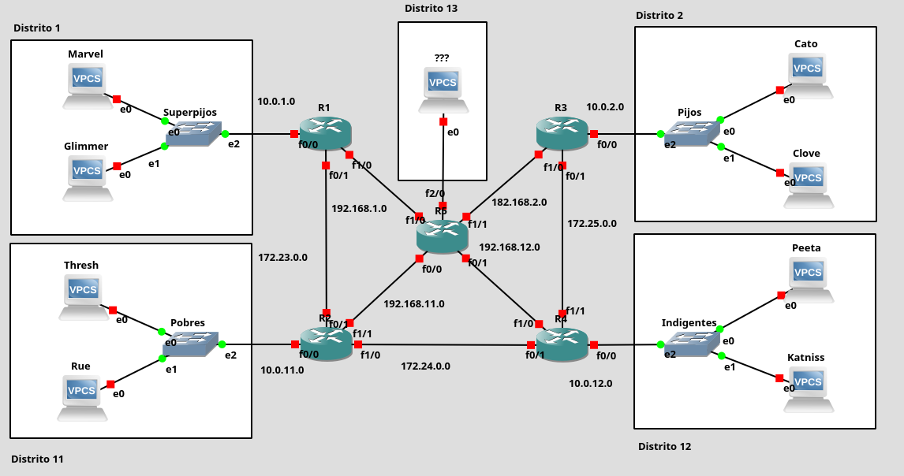

## Direccionamiento IP Participantes (/24):

Marvel: Inicialmente 10.0.1.2, luego DHCP

Glimmer: Inicialmente 10.0.1.3, luego DHCP

Cato: 10.0.2.2

Clover: 10.0.2.3

Thresh: 10.0.11.2

Rue: 10.0.11.3

Peeta: 10.0.12.2

Katniss: 10.0.12.3

## Direccionamiento IP Routers (/24):

R1

|          |              |
|----------|--------------|
| Interfaz | Dirección IP |
| f0/0     | 10.0.1.1     |
| f0/1     | 172.23.0.1   |
| f1/0     | 192.168.1.2  |

R2

|          |              |
|----------|--------------|
| Interfaz | Dirección IP |
| f0/0     | 10.0.11.1    |
| f0/1     | 172.23.0.2   |
| f1/0     | 172.24.0.1   |
| f1/1     | 192.168.11.2 |

R3

|          |              |
|----------|--------------|
| Interfaz | Dirección IP |
| f0/0     | 10.0.2.1     |
| f0/1     | 172.25.0.1   |
| f1/0     | 192.168.2.2  |

R4

|          |              |
|----------|--------------|
| Interfaz | Dirección IP |
| f0/0     | 10.0.12.1    |
| f0/1     | 172.24.0.2   |
| f1/0     | 192.168.12.2 |
| f1/1     | 172.25.0.2   |

R5

|          |              |
|----------|--------------|
| Interfaz | Dirección IP |
| f0/0     | 192.168.11.1 |
| f0/1     | 192.168.12.1 |
| f1/0     | 192.168.1.1  |
| f1/1     | 192.168.2.1  |
| f2/0     | 10.0.13.1    |

Inicialmente, el escenario debe estar abierto, es decir, cada participante deberá poder comunicarse con cualquier otro para que puedan matarse entre ellos o establecer alianzas.

## Tablas de enrutamiento

R1

|                   |               |                 |
|-------------------|---------------|-----------------|
| Dirección de red  | Máscara       | Siguiente salto |
| 10.0.11.0         | 255.255.255.0 | 172.23.0.2      |
| 172.24.0.0        | 255.255.255.0 | 172.23.0.2      |
| 0.0.0.0           | 0.0.0.0       | 192.168.1.1     |

R2

|                   |               |                 |
|-------------------|---------------|-----------------|
| Dirección de red  | Máscara       | Siguiente salto |
| 10.0.1.0          | 255.255.255.0 | 172.23.0.1      |
| 10.0.12.0         | 255.255.255.0 | 172.24.0.2      |
| 172.25.0.0        | 255.255.255.0 | 172.24.0.2      |
| 0.0.0.0           | 0.0.0.0       | 192.168.11.1    |

R3

|                   |               |                 |
|-------------------|---------------|-----------------|
| Dirección de red  | Máscara       | Siguiente salto |
| 172.24.0.0        | 255.255.255.0 | 172.25.0.2      |
| 10.0.12.0         | 255.255.255.0 | 172.25.0.2      |
| 0.0.0.0           | 0.0.0.0       | 192.168.2.1     |

R4

|                   |               |                 |
|-------------------|---------------|-----------------|
| Dirección de red  | Máscara       | Siguiente salto |
| 10.0.2.0          | 255.255.255.0 | 172.25.0.1      |
| 10.0.11.0         | 255.255.255.0 | 172.24.0.1      |
| 172.23.0.0        | 255.255.255.0 | 172.24.0.1      |
| 0.0.0.0           | 0.0.0.0       | 192.168.12.1    |

R5

|                   |               |                 |
|-------------------|---------------|-----------------|
| Dirección de red  | Máscara       | Siguiente salto |
| 10.0.1.0          | 255.255.255.0 | 192.168.1.2     |
| 10.0.2.0          | 255.255.255.0 | 192.168.2.2     |
| 10.0.12.0         | 255.255.255.0 | 192.168.12.2    |
| 172.23.0.0        | 255.255.255.0 | 192.168.1.2     |
| 172.25.0.0        | 255.255.255.0 | 192.168.2.2     |
| 0.0.0.0           | 0.0.0.0       | 192.168.11.2    |

## Enrutamiento y asignación interfaces

Ejercicio 1: Realizar la configuración de la red que sea necesaria para que todos los participantes puedan comunicarse entre sí por la ruta más corta posible. Documenta el proceso y demuestra su funcionamiento.

### Router 1

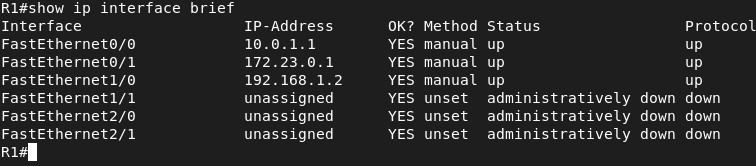

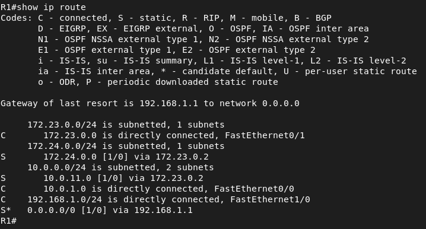

### Router 2

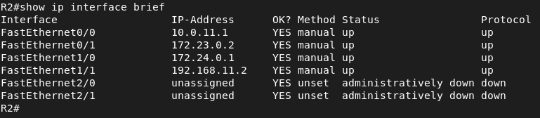


### Router 3

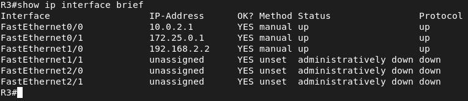

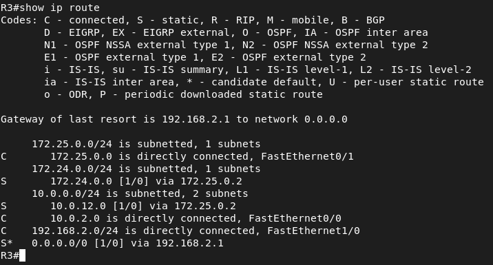

### Router 4

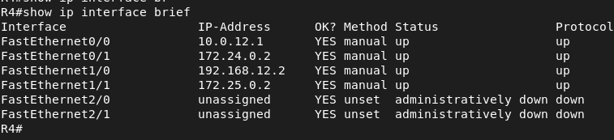

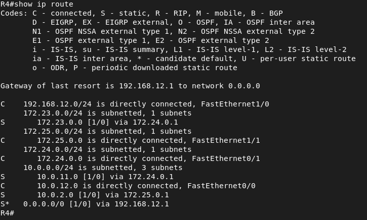

### Router 5

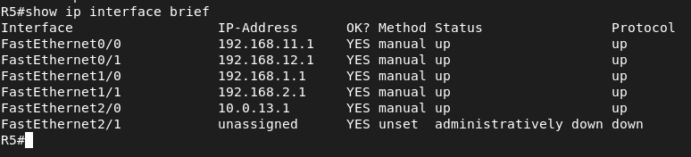

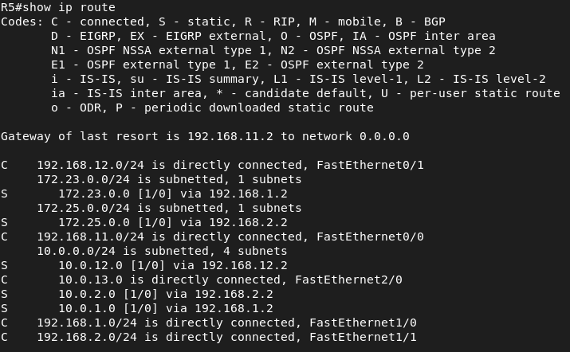

### Verificación conectividad

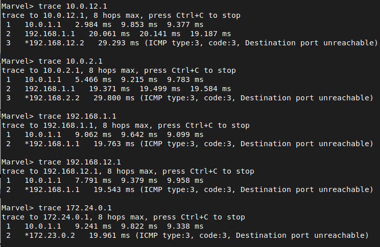

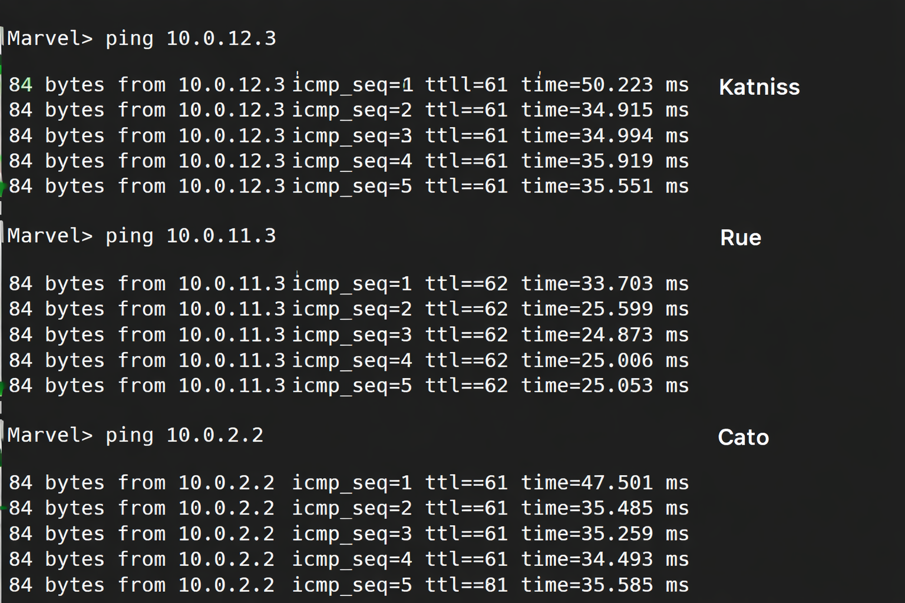

A medida que avanza el juego se van modificando las alianzas y, por tanto, algunos participantes pasan a ser enemigos y dejan de tener comunicación entre ellos. Así, el segundo día la situación es la siguiente:

• Los superpijos se han peleado con todos y no se comunican con el resto de distritos, cuyos mensajes no quieren escuchar.

• Los indigentes se comunican con los pobres, pero los demás distritos no quieren saber nada de ellos.

• Los pobres y los pijos han establecido una alianza un tanto sorprendente y pueden comunicarse aun entre ellos, aunque solo a través de R5.

## Configuración de ACL

Ejercicio 2: Establecer las ACL necesarias para reflejar la situación antes descrita. Documenta el proceso y demuestra su funcionamiento.

Al día siguiente, los superpijos deciden que es supercansado poner las direcciones IP a mano, así que tienes que montarles un servidor DHCP en el router de su red para que sus máquinas reciban automáticamente una dirección IP de las cinco primeras de su rango de direcciones, reservando la primera para el propio router.

### ACL 1

Los superpijos se han peleado con todos y no se comunican con el resto de distritos, cuyos mensajes no quieren escuchar.

En este caso yo lo he puesto de salida a R1 pero también se puede poner de entrada lo que pasa que si lo ponemos de entrada luego cuando tengamos que montar el servidor DHCP tendremos que permitir los puertos de servidor-cliente DHCP para que el router le puedan llegar esas peticiones de lo contrario las máquinas de esta red no podrán llegar al servidor DHCP si configuramos esta ACL de entrada.

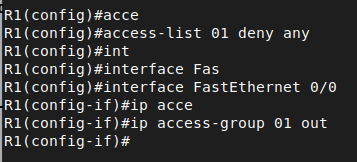

Aquí vemos como al hacer ping están los matches es decir las coincidencias de paquetes encontradas.

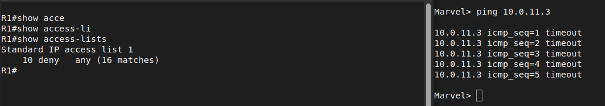

### ACL 2

Los indigentes se comunican con los pobres, pero los demás distritos no quieren saber nada de ellos.

Para esta ACL voy a configurar de manera que el tráfico entre ambos distritos se va a permitir, luego voy a deneger todo lo demás desde R4 que es el Distrito 12 para que no se comunique con cualquier otro distrito y por último voy a permitir lo demás por si en un futuro hay ampliaciones en el escenario. Esta ACL la voy a configurar de salida en la interfaz 0/0 ya que primero ve la tabla de enrutamiento y luego mira si el paquete coincide con alguna regla.

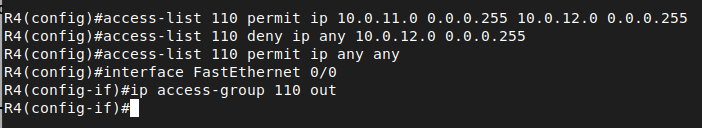

Aquí podemos ver la prueba de conectividad desde Distrito 12 al 11 como es efectivo y como no puedo llegar a las otras redes. Vemos como las ACLS están haciendo su trabajo con los matches.

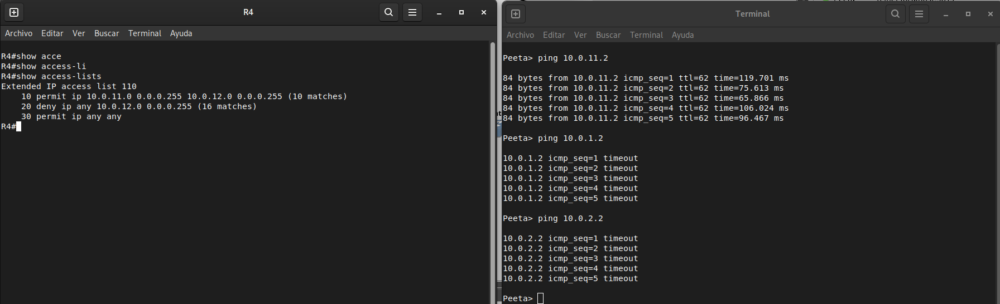

Una vez configurado esto en R4 también hay que hacer una configuración en R2 ya que ahora mismo R2 se puede comunicar con todos los distritos para ello voy a crear una ACL extendida permitiendo el tráfico entre el Distrito 11 (pobres) y 12 (indigentes) y luego voy a denegar todo el tráfico del distrito 11 que es a la red donde está conectado este router para que no se pueda comunicar con los demás distritos y nuevamente permitimos lo demás por ampliaciones futuras. Esta ACL extendida se va a configurar de salida por lo que he explicado anteriormente.

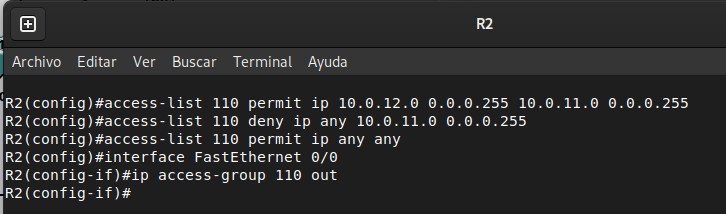

### ACL 3

Los pobres y los pijos han establecido una alianza un tanto sorprendente y pueden comunicarse aun entre ellos, aunque solo a través de R5.

Para esta ACL voy a configurar en R5 una ACL extendida para permitir el tráfico entre los pobres y los pijos y permitir todo lo demás por futuras ampliaciones, luego voy a configurar otra ACL para la vuelta de los paquetes y permitir todo lo demás. Ambas ACL las he puesto de entrada, la 110 en la interfaz 0/0 ya que en esta interfaz los paquetes vienen del distrito 11 hacia R5 y para la interfaz 1/1 lo mismo los paquetes le llegan desde el distrito 2. Esto va a ser solo a través de R5 ya que en las tablas de enrutamiento las configuré para que R2 llegué a los pijos mediante R5, de lo contrario habría que modificar las tablas de enrutamiento o configurar más ACLS.

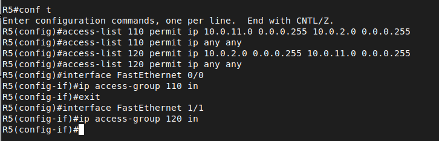

En la ACL de R2 hay que hacer una modificación ya que estabamos denegando todo el tráfico que no fuese del distrito 12. Por lo tanto como las ACLS de leen de arriba hacia abajo he configurado antes del deny una regla para permitir el tráfico de origen desde el distrito 2 (pijos) a los pobres. He configurado esta ACL así ya que esta ACL está configurada como salida de la interfaz entonces es como le llegaría el paquete al router y lo va a mandar hacia la red de pobres.

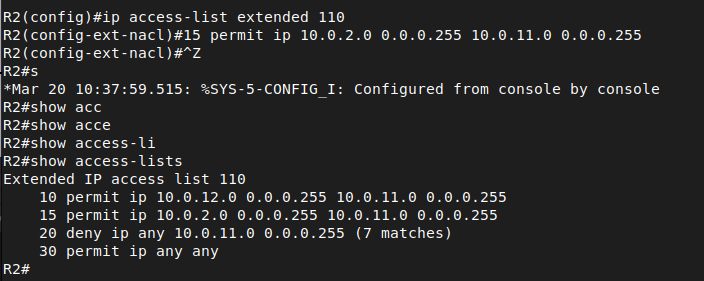

Aquí vemos las pruebas de conectividad como los pijos se pueden comunicar con los pobres y como las ACLS están funcionando mediante los matches.

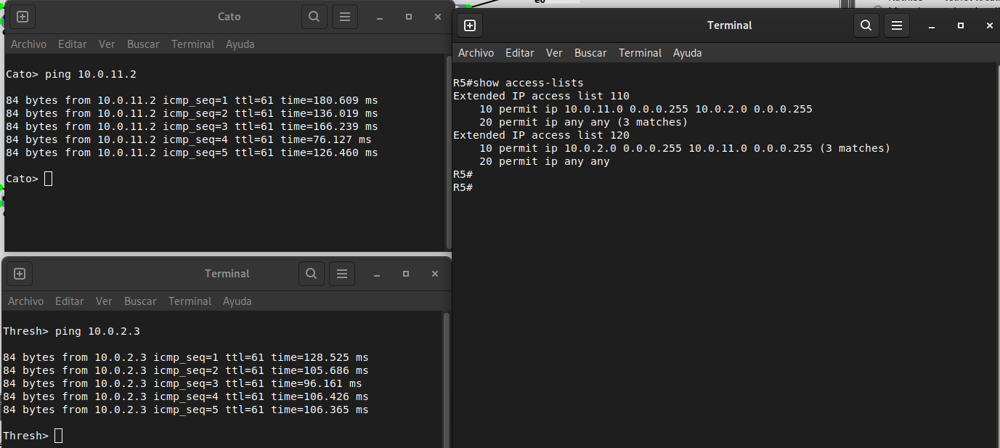

Y vemos como los pijos no se pueden comunicar con los superpijos ni con los indigentes.

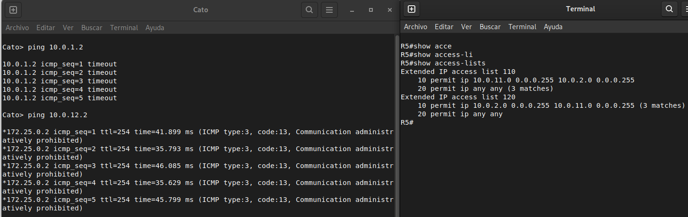

## Servidor DHCP

Ejercicio 3: Configura el servidor DHCP de los superpijos. Documenta el proceso y demuestra su funcionamiento.

Cuando pasa una semana, las alianzas y enemistades ya no son solo entre distritos sino entre participantes individuales.

• Peeta establece una alianza con Clove y debe poder comunicarse con él.

• Katniss deja de hablarse con Rue

• Katniss y Cato están empezando una bonita relación y necesitan comunicarse entre ellos.

• Cato y Thresh han acabado peleándose y ya no hay comunicación entre ellos.

Lo primero que vamos a realizar es excluir la IP de la interfaz del router para que no haya conflicto, y luego como solo quiero las 5 primeras IPS vamos a excluir de la 6 a la 254. Vamos a crear el pool (grupo) que se va a llamar superpijos y le vamos a indicar en la red que va a trabajar y por último la puerta de enlace que van a recibir los clientes que cojan una configuración por DHCP.

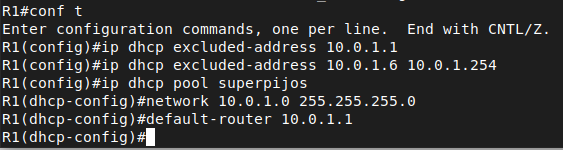

Aquí vemos que el pool se ha creado correctamente aunque hay que tener algo en cuenta ya que con este comando no nos sale correctamente las direcciones que ofrece el DHCP ya que como estamos viendo es de la 1 a la 254 cuando hemos excluido de la 6 a la 254.

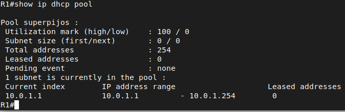

Una vez hecho esta configuración previa vamos a arrancar el servicio para que sea funcional.

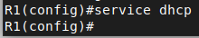

Una vez que hemos montado el servidor DHCP vamos a ver que realmente está funcionando para ello me voy a ir a la máquina Marvel y voy a pedir una configuración IP por DHCP y como vemos el servidor nos responde con una IP en el rango del pool del servidor DHCP.

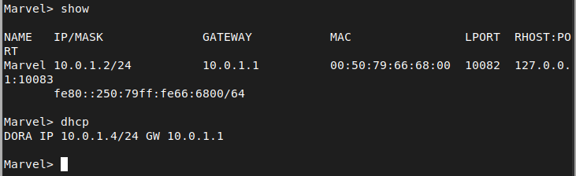

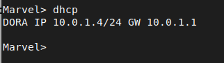

Si nos vamos al router podemos ver las IPS que ha prestado y cada IP está asociado a un Client-ID. Normalmente los servidores DHCP suelen tener un lease time que es el tiempo de concesión que el servidor permite a un cliente utilizar una configuración antes de renovarla.

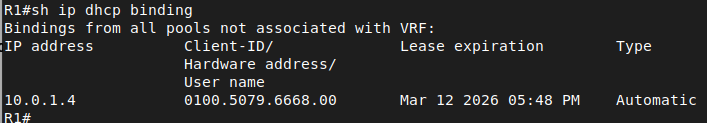

Con este comando podemos ver el número de peticiones que le ha llegado al servidor DHCP en este caso vemos que solo se está usando 1 dirección del pool.

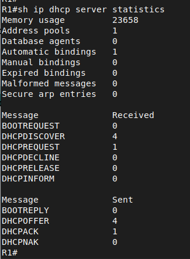

## Configuración nuevas ACL

Ejercicio 4: Configura las ACL (extendidas o no) que sean necesarias para representar este nuevo escenario. Documenta el proceso y demuestra su funcionamiento.

Los juegos del hambre van avanzando y algunos participantes han descubierto al fin el secreto del distrito 13. No parece existir vida en él, pero hay un servidor web lleno de documentos muy útiles para sobrevivir.

Peeta establece una alianza con Clove y debe poder comunicarse con él.

He configurado la ACL de nuevo incluyendo los pasos anteriores ya que reinicié el router accidentalmente y perdí la configuración pero las reglas para que funcione este paso es la primera en la cuál permitimos un host concreto.

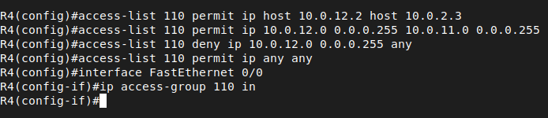

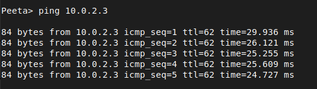

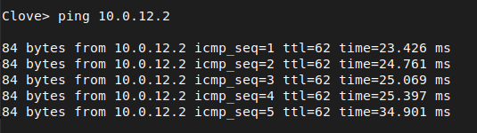

Aquí vemos las coincidencias es decir que las ACLS están funcionando.

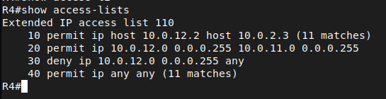

• Katniss deja de hablarse con Rue

Denegamos un host en concreto por lo tanto en este ACL no es necesario la máscara de wildcard.

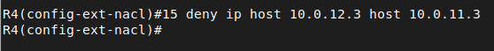

Aquí vemos como ya no se comunicar y como la ACL tiene los matches.

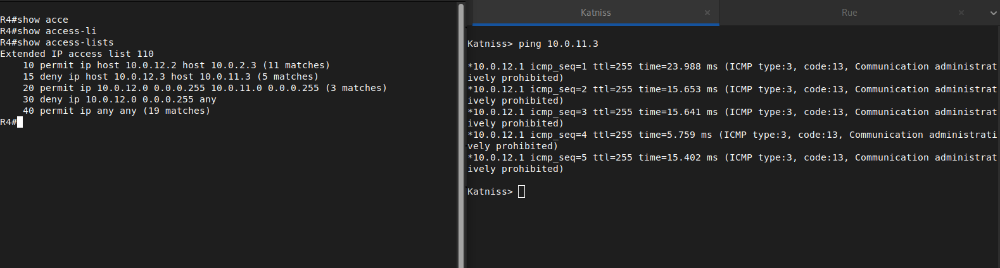

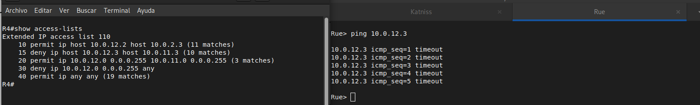

• Katniss y Cato están empezando una bonita relación y necesitan comunicarse entre ellos.

Vamos a meter una regla antes del deny para permitir de host a host dicha comunicación.

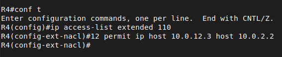

Como vemos aquí están los matches y los ping funcionan gracias a la regla que hemos añadido.

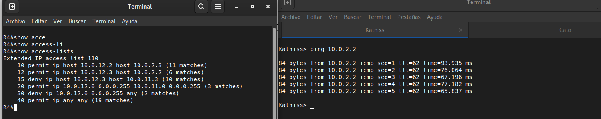

También si lo hacemos desde cato también tenemos respuesta.

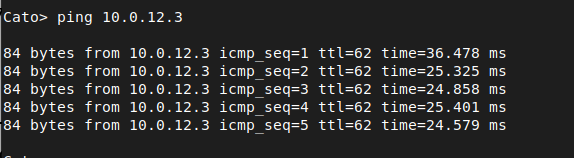

• Cato y Thresh han acabado peleándose y ya no hay comunicación entre ellos.

Para ello voy a configurar la ACL que ya teníamos y voy a poner esta regla la primera antes de que lea la 2 que permite esta red ya que las ACLS se leen de arriba hacia abajo.

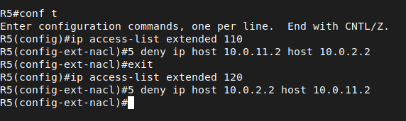

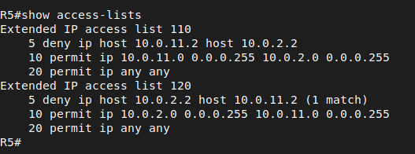

Y aquí vemos las coincidencias al hacer ping.

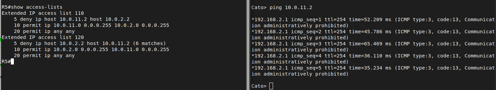

## Servidor web

Ejercicio 5: Monta un servidor web en el distrito 13 que sea accesible mediante ACL extendidas solo para los participantes de los distritos 11 y 12. La comunicación se establecerá por el puerto 80. Documenta el proceso y demuestra su funcionamiento.

Lo primero que vamos a realizar es en el Distrito 13 añadir el elemento NAT para tener conectividad con el exterior y la máquina de dicho distrito que va a ser el servidor web vamos a ponerle que reciba una configuración IP por DHCP. Todo esto es porque es un escenario sin salida a Internet y para poder instalar el paquete apache2.

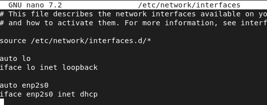

Para que los cambios que hemos realizado tengan efecto vamos a reiniciar el servicio.

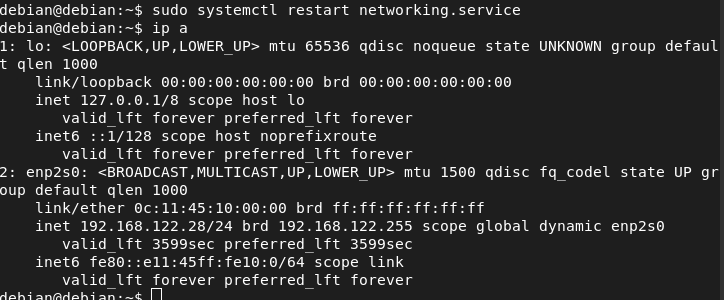

También vamos a poner los DNS primario y secundario para que resuelva nombres.

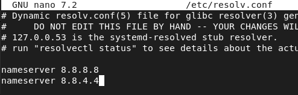

Une vez que hemos hecho esta configuración vamos a actualizar la lista de repositorios del sistema.

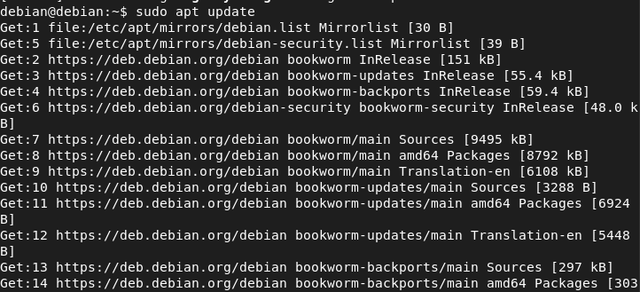

Y vamos a actualizar los paquetes que tenemos instalado en el sistema.

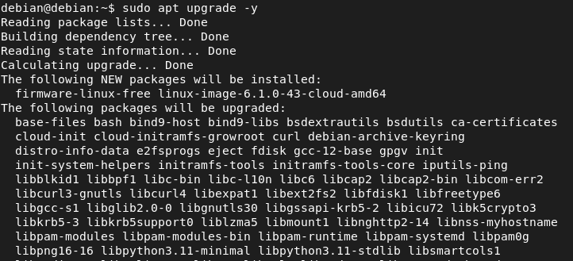

Ahora vamos a proceder con la instalación de apache que es bastante sencilla.

|                                               |
|-----------------------------------------------|
| <debian@debian>:~\$ sudo apt install apache2  |

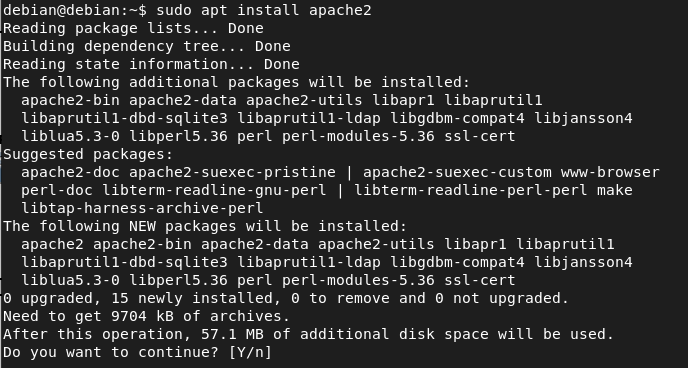

Y una vez instalado miramos que el servicio esté corriendo en caso de que no lo esté lo iniciamos.

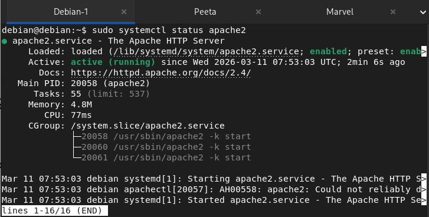

Una vez que hemos hecho todo esto he añadido un Firefox temporal para ver que el apache está funcionando correctamente. También se podría hacer con curl.

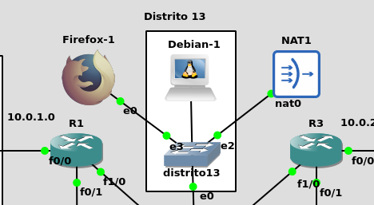

Y como vemos está corriendo correctamente.

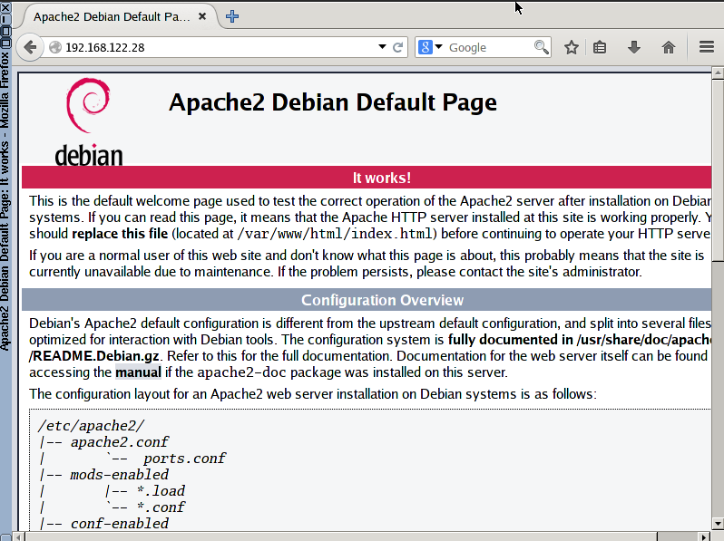

Vamos a configurar el conjunto de reglas mediante una ACL extendida para permitir solo el distrito 11 y 12 mediante el puerto 80 y denegar todos los demás distritos mediante el puerto 80. Esta interfaz la voy a configurar a la interfaz que está conectado el servidor web de salida.


Esta regla de la ACL va a permitir los paquetes cuya conexión con el servidor se hayan establecido es decir SYN/ACK.


Y lo configuramos en la tarjeta que conecta al servidor web de salida.


Para hacer las pruebas de esto voy a cambiar Thresh por una máquina debian ya que los VPCS no tienen curl.


Le asigno la misma IP que tenía Thresh.


Y le añadimos la ruta por defecto a la puerta de enlace para que sepa llegar. Una vez hecho esto al hacer un curl el servidor nos responde.


En vez de poner una ruta por defecto también podríamos haber configurado el gateway en el fichero de interfaces.


Y aquí vemos los matches de la ACL para acceder al servidor web por el puerto 80.


Ahora vamos a probar la conexión desde el distrito 12 para ello he sustituido Peeta por una máquina Debian y le he asignado la misma IP. Le he cambiado el hostname para que sea más identificativo.


Y como vemos al hacer el curl desde el distrito 12 nos responde el servidor web.


Esta sería la ACL que he configurado en R4 que es el router que conecta el Distrito 12.


## Acceso a base de datos (MariaDB) remoto

Primero lo que voy a hacer es en el Distrito donde está el servidor apache que es donde vamos a instalar MariaDB, voy a añadir un NAT y un switch para poder acceder al exterior (Internet) para instalar los paquetes necesarios para el servidor de base de datos. Una vez añadido el NAT voy a configurar la interfaz del servidor Apache para que reciba IP por DCHP.


Una vez hecho estos cambios vamos a reiniciar el servicio y verificar que el DHCP le ha asignado una configuración IP.


Una vez que tenemos una configuración válida vamos a actualizar los repositorios y paquetes ya instalados que vienen en el template de Debian 12 de GNS3 que es el que estamos usando.


Una vez actualizado vamos a instalar el servidor de MariaDB mediante una instalación desatendida.


Cuando hayamos instalado MariaDB vamos a proceder a iniciar el servicio y hacer que se arranque cada vez que se inicie la máquina.


A continuación, debes asegurar adicionalmente MariaDB. Para ello, el programa dispone de un script de seguridad propio, con el que puedes configurar mecanismos de seguridad individuales. Se ejecuta con el siguiente comando:


Este script ofrece algunas opciones adicionales para asegurar o reforzar la instalación. Por ejemplo, puedes establecer una contraseña de root, eliminar usuarios anónimos, eliminar la base de datos de prueba e impedir inicios de sesión remotos de root. Para realizar estas acciones, introduce \[Y\]. Si no quieres realizar ninguna acción, selecciona \[N\]. Confirma ambas opciones con \[Intro\]. Para el acceso remoto de root lo voy a desactivar por seguridad ya que para la conexión remota voy a hacer un usuario nuevo.


Una vez que está instalado todo vamos a ver que podemos acceder a la base de datos.


Ya instalado el servidor de base de datos nos faltaría el cliente para ello voy a hacer la conexión remota desde el Distrito 11, para ello he añadido un NAT al switch para poder tener acceso al exterior para poder instalar los paquetes necesarios. También voy a configurar Thresh para que recibe IP por DHCP. Esta máquina anteriormente era un VPCS y la he cambiado por una máquina Debian para poder instalar el cliente de MariaDB.


Una vez cambiada la configuración de la interfaz y reiniciado el servicio vamos a comprobar que los cambios hayan surgido efecto.


Y vamos a actualizar la lista de repositorios y mejorar los paquetes que ya estén instalados en el sistema.


Vamos a instalar de manera desatendida el cliente de mariadb en la máquina Thresh.


Y vamosa comprobar que se ha instalado correctamente.


Una vez que se haya instalado ya podemos volver a asignarle la dirección IP suya. Esto lo hemos hecho ya que es un escenario sin salida a Internet y para que tenga salida al exterior hay que añadir el elemento NAT y la máquina tiene que recibir IP por DHCP para que le de una dirección IP en el rango del NAT.


Reiniciamos el servicio y comprobamos que tengamos IP.


### Configuración servidor 

Primero, editaremos el archivo de configuración de MariaDB para permitir conexiones desde direcciones IP específicas. Para ello abrimos el fichero /etc/mysql/mariadb.conf.d/50-server.cnf con un editor de texto:


Buscamos la línea que comienza con bind-address y la cambiamos para que acepte conexiones desde cualquier dirección IP. Podemos hacer que acepte conexiones desde todas las IPS con:


Una vez editado el fichero de configuración para que los cambios surtan efecto hay que reiniciar el servicio de MariaDB.


Vamos a acceder al servidor y vamos a crear un usuario.

IMPORTANTE: al crear el usuario para que se pueda acceder de manera remota al servidor tenemos dos opciones, una que es permitir todas las direcciones IPS que esto no se hace por temas de seguridad obvios y otra que es crear el usuario y asignarle una IP en concreto.

Para permitir todas las IPS es con la siguiente sentencia:

CREATE USER 'usuario_remoto'@'%' IDENTIFIED BY 'password';

Si el usuario ya existe:

GRANT ALL PRIVILEGES ON midb.\* TO 'usuario'@'%' IDENTIFIED BY 'password';


Como vemos a mi no me estaba permitiendo conectarme remotamente ya que había creado el usuario en localhost. Para ello consulte el diccionario de datos y me di cuenta de esto. Una vez estamos aquí le di permisos al usuario sobre la dirección IP que se va a conectar al servidor.


Para hacer pruebas voy a crear una base de datos y le voy a introducir el script de creación de tablas del esquema SCOTT el cual tiene 2 tablas, dept y emp.


Aquí vemos las 2 tablas que he mencionado anteriormente.


### Acceso cliente

Para acceder al servidor de base de datos desde el cliente vamos a poner el parámetro -u para indicarle el usuario, el -p para poner la contraseña y por último -h para indicar el host que es el servidor remoto de base de datos. Una vez que entramos vemos las diferentes bases de datos entre ellas el diccionario de datos y la que hemos creado.


Vamos a verificar que realmente los datos que hemos introducido al servidor son accesibles desde el cliente y como vemos aquí tenemos las tablas.


Por último vamos a ver si los datos están con una consulta simple y como vemos los datos se encuentran ahí.


## Bibliografía

<https://www.cisco.com/c/es_mx/support/docs/security/ios-firewall/23602-confaccesslists.html>

<https://blog.junglacode.org/software/software-libre/configurar-acceso-remoto-en-mariadb/>

<https://www.ionos.es/digitalguide/hosting/cuestiones-tecnicas/instalacion-de-mariadb-en-debian-12/>

## 📎 Ficheros de la práctica

<details>
<summary><code>ACL.txt</code></summary>

```bash
configure terminal
ip access-list extended 110
  no 80
  25 permit ip host 10.0.12.3 host 10.0.2.2
exit

deny icmp any any administratively-prohibite
```

</details>

